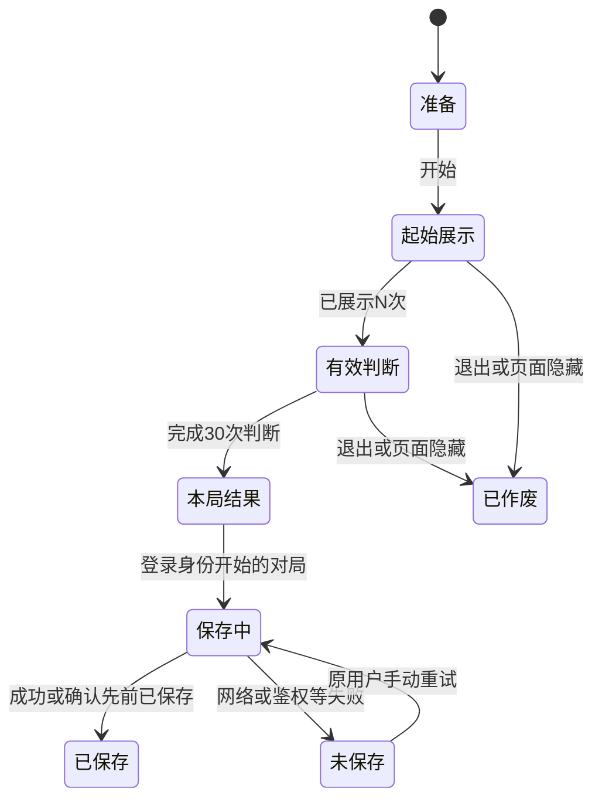
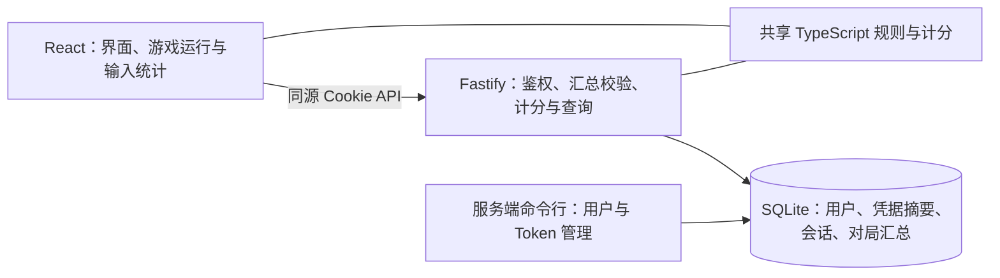

> 由 scope skill 于 2026-11-12 生成
> 状态：已批准 2026-11-12
> 读者：实施 Agent 与审阅者

# BrainGym 首版：空间 N-back 与个人训练记录

## 目标

建立可扩展的 Web 健脑游戏合集，首版以一个完整的空间 N-back 游戏打通试玩、Token 登录、训练结果、个人历史及最佳成绩。服务端保持轻量，用户能够在电脑和手机上完成训练并可靠地查看自己的记录。

## 决策基线

### 需求决策

- **范围与界面**：首版只实现九宫格空间 N-back，保留后续接入其他游戏的结构。采用简体中文、浅色、简洁工具风格，适配桌面浏览器与手机；电脑支持点击和空格键，手机支持触屏。不做声音通道、自动进阶、其他游戏、排行榜、成绩分享或管理网页。
- **难度与节奏**：玩家手动选择 N＝1～5，每局固定。先展示 N 次位置作为记忆起点，之后进行 30 次有效判断。每步持续 2.5 秒，位置亮起 0.5 秒，随后留空 2 秒；整步内均可作答。起始 N 次不计分、不接受作答。每次有效判断只接受首次匹配输入，无输入表示不匹配。
- **随机出题**：起始位置从九个格子等概率选取。随后每步独立以 30% 概率生成匹配题，此时位置等于 N 步之前；否则从另外八个位置等概率选择。每局匹配总数不固定。生成后检查 30 次有效判断，若缺少匹配或不匹配任一题型，重新生成整局序列，直到两类均存在。
- **计分**：平衡准确率为匹配命中率与不匹配正确拒绝率的平均值，转换为 0～100 分。同时展示命中、漏报、误报、正确拒绝四类次数。按 N 值分别评定个人最佳，不引入反应时间等第二评分指标。
- **身份与可见性**：用户直接输入预先发放的个人 Token 登录，无注册、账号密码或第三方登录。游客可完成游戏并查看本局结果；只有以登录身份开始且完整完成的对局才可保存，游客成绩不补传。保存时必须核对开局用户与当前会话用户一致，包括跨标签页切换账户的情况。历史与最佳仅本人可见。
- **记录与失败行为**：保存每局完整对局的 N 值、四类次数、分数、对局完成时间及服务端首次接收时间，个人历史按对局完成时间展示和排序；另提供各 N 值最佳成绩。不保存题目序列或逐步操作日志。主动退出、离开游戏页、切后台或锁屏使进行中的对局作废，不保存历史、不更新最佳，不提供暂停续玩。上传失败时保留当前页面结果并明确标记未保存，支持手动重试；刷新或离开页面后不恢复待上传数据，不做持久化离线队列。
- **Token 管理**：通过服务端命令行创建用户、生成、吊销和换发个人 Token。换发保持用户身份及历史成绩不变。退出登录使当前会话失效；吊销或换发个人 Token 使旧 Token 无法再次登录，并使该用户所有现有会话失效。

### 技术决策

- 前端使用 React、Vite、TypeScript；后端使用 Node.js、Fastify、TypeScript；持久化使用 SQLite。构建后由一个服务提供前端静态文件和同源 API，支持本地启动及 Docker 单机部署，SQLite 文件使用持久化目录。
- 使用个人 Token 换取有效期 7 天的服务端会话，通过 HttpOnly Cookie 保持登录。会话必须可撤销；个人 Token 与会话凭据使用安全随机值，仅保存不可逆摘要，不在浏览器持久化保存个人 Token，不将凭据写入日志。生产环境通过 HTTPS 设置 Secure Cookie，并限制 Cookie 的作用范围及跨站使用。
- 浏览器负责出题、游戏时序、收集输入和四类统计；服务端仅校验汇总、重新计算分数及查询记录。不建立服务端对局运行状态，不验证实际游玩过程，不提供强防作弊保证。
- 游戏规则与汇总计分使用无 UI、无网络依赖的 TypeScript 模块，允许前后端复用；游戏实现、展示与成绩持久化解耦。游戏标识与规则版本进入记录边界，以便后续接入其他游戏或变更规则时区分成绩；首版只接受已实现的空间 N-back 规则。
- 用户归属由服务端有效会话确定；保存请求携带开局时确认的用户标识 `startedByUserId`，仅作为与会话用户的一致性校验条件，不能替代鉴权或指定其他归属。每局保存带有唯一标识，重试必须幂等；分数与最佳成绩以服务端复算结果为准。
- 对局完成时间 `completedAt` 由前端在完整结束时生成一次 UTC 时间，服务端首次接收时间 `receivedAt` 由服务端首次成功保存时生成。重试不改变二者。完成时间来自客户端，仅用于个人历史展示和排序，不作为会话有效期或成绩判定的可信时间依据。

## 设计视图

### 功能设计

#### 入口与游玩

首页以合集形式展示可玩的空间 N-back，进入后说明匹配规则、操作方法、固定节奏和中断行为，允许选择 N 值。未登录状态明确提示试玩不保存；登录状态可进入个人记录。

开始时固定本局配置与身份；登录对局先通过当前身份接口确认用户，保存其 `startedByUserId`，再生成符合题型约束的序列。初始 N 次仅展示，进入有效判断后显示当前进度。点击匹配按钮、按空格键或触屏触发同一作答逻辑；键盘长按的重复事件及同一步重复输入均不得重复计数，空格操作不得导致页面滚动。结果根据当前题目是否匹配及有无有效输入分类。

| 题目事实 | 有匹配输入 | 无匹配输入 |
| --- | --- | --- |
| 匹配 | 命中 TP | 漏报 FN |
| 不匹配 | 误报 FP | 正确拒绝 TN |

记 `P＝TP＋FN`、`Q＝TN＋FP`，则 `P＋Q＝30`，且出题保证 `P＞0`、`Q＞0`。最终分数为 `100 × (TP/P＋TN/Q) / 2`。显示时可以统一舍入，但最佳成绩比较使用未舍入值；同分不引入其他评优指标。

#### 完成、保存与个人记录

完整完成后展示 N 值、分数和四类判断次数。游客只展示本局结果；登录对局向服务端提交汇总，并展示保存中、已保存或未保存状态。服务端成功响应后才视为保存成功，并使用服务端结果显示成绩、刷新相应难度的最佳记录。

上传失败时，本局汇总、开局用户标识、完成时间及唯一标识留在当前页面内存中，手动重试沿用同一份结果。若响应丢失但服务端已保存，重试仍返回原记录，不新增第二局，也不改写原有两个时间。此状态不启用自动持久化补传。

对局开始时的身份在本局内固定。游客中途登录不能将该局转为可保存对局；登录对局遇到会话失效时保留结果，重新登录原用户后可手动重试。切换为其他用户不能把原用户的结果保存到新账户，记录界面也必须清除原账户数据。若其他标签页改变了 Cookie 中的会话，服务端仍须在本次保存请求中检查身份一致性；不一致时拒绝写入，并提示重新登录开局用户，不修改待上传结果的归属。

个人记录展示每次已保存对局的完成时间、N 值、分数和四类次数，历史按 `completedAt` 倒序并采用稳定的同时间排序后分页，不以上传先后替代训练先后；另展示 1～5-back 各自的最佳成绩，未玩过的难度显示暂无记录。查询仅返回当前用户的数据，不提供公开榜单。

#### 中断状态

作废后清理计时与输入监听，不产生保存请求。再次开始必须是一局新游戏。对局已经完整结束后切后台不撤销结果，结果保存状态继续按上传响应处理。

### 技术设计

#### 整体方案

Vite 用于前端开发与构建，生产运行不需要独立的前端开发服务器。Fastify 提供静态页面、登录与退出、当前身份、成绩保存、历史及最佳成绩查询。命令行与 API 共用数据访问及凭据管理逻辑，管理能力不作为公开 HTTP 接口提供。

前端游戏运行状态仅存在于内存，负责区分准备、起始展示、有效判断、作废及完成。使用单调时间确定轮次和输入截止时间，避免靠定时器次数累加造成节奏漂移。每步亮起时段与作答窗口分别控制，留空期间仍可作答；页面隐藏或游戏页面卸载时立即使未完成对局失效，并清理所有回调。

#### 关键结构与边界

| 结构 | 主要内容与约束 |
| --- | --- |
| 用户 | 稳定用户标识；Token 换发不改变该标识，不删除或转移历史 |
| 个人凭据 | 所属用户、Token 摘要及有效状态；吊销或换发与失效该用户会话在一致的数据操作中完成 |
| 会话 | 凭据摘要、所属用户、过期时间；固定 7 天有效，退出或管理操作可提前撤销 |
| 对局汇总 | 所属用户、对局唯一标识、游戏标识、规则版本、N 值、TP/FN/FP/TN、服务端复算分数、`completedAt`、`receivedAt` |
| 内存结果 | 开局用户标识或游客状态、配置、四类统计、唯一标识、`completedAt` 及保存状态；不写入持久化离线队列 |

两个时间均随首次落库的汇总保留，服务端接收时间不覆盖对局完成时间。最佳成绩从已保存记录按用户、游戏、规则版本及 N 值取最高分，无需客户端另行维护权威最佳值。

API 边界如下，具体路径命名由实施阶段统一：

- **登录与会话**：登录接受个人 Token，验证成功后设置 Cookie 并返回当前用户身份；失败不创建会话。退出撤销当前会话并清除 Cookie。无效、过期或已撤销会话不能读写个人数据，前端转为需要重新登录状态，不继续显示旧用户记录。
- **保存汇总**：需要有效会话；请求包含 `startedByUserId`、游戏标识、规则版本、N、对局唯一标识、四类次数及 `completedAt`。先比较 `startedByUserId` 与本次请求的有效会话用户，不一致则返回明确的身份冲突错误，不向任何账户写入；一致时仍以会话用户作为记录归属。检查规则受支持、N 范围正确、计数为非负整数、合计 30、两类分母均非零、完成时间为合法 UTC 时间，随后服务端计算分数并生成首次保存的 `receivedAt`。拒绝非法、未知或不完整数据，不接受客户端直接指定最终分数、服务端接收时间或他人归属。
- **幂等保存**：身份一致性检查在写入或返回已有记录前均必须执行，以会话用户和对局唯一标识唯一约束记录。相同汇总（含原配置、四类统计和 `completedAt`）的重复请求返回原结果及原有两个时间；同一标识但内容不同则返回冲突，不覆盖已有记录。校验、写入及返回的结果保持一致，失败不得留下半条记录。
- **历史与最佳查询**：需要有效会话，并始终按会话用户过滤；历史按完成时间排序并使用有界分页。最佳与历史使用同一套服务端计分规则，不混合不同 N 或后续规则版本的成绩。

Cookie 鉴权的写接口校验请求来源，避免跨站请求使用用户会话写入数据；登录接口限制滥用。CLI 仅在生成或换发时输出一次明文 Token，后续不可从数据库取回。API 错误响应和日志不泄露 Token、会话或其他用户数据。

#### 实现流程

1. 运维通过命令行创建稳定用户身份并发放个人 Token；用户在网页输入后换取会话，前端不持久保存个人 Token。
2. 前端开始登录对局时确认当前用户，再冻结 N 值与开局用户标识；游客对局固定为游客。按随机规则生成并检查序列，随后按固定时序展示、接受首次输入并归类统计。
3. 任一中断发生在完成之前，则终止状态机并清理资源。只有全部有效判断结束才构造本局结果并生成一次完成时间，只有登录身份开始的结果才进入保存流程。
4. 服务端验证会话、开局用户一致性与汇总，计算分数并以唯一标识写入，同时记录首次接收时间。客户端根据响应展示已保存状态，查询并刷新历史与最佳；失败时保留原汇总、身份、唯一标识和完成时间，允许原用户重试。
5. 退出撤销当前会话；管理端吊销或换发 Token 时使旧 Token 失效，并同时撤销该用户全部会话。数据仍归属于原用户，换发后使用新 Token 重新登录可继续查看原有记录。

### 预估改动面

当前仓库无业务代码，需要建立前端应用、服务端、共享规则模块、数据库初始化与迁移机制，以及构建和开发配置。预估覆盖：

- 前端：合集入口、N-back 说明与难度选择、游戏运行、结果与保存状态、Token 登录、个人历史和最佳记录、响应式样式。
- 服务端：静态页面托管、会话鉴权、汇总校验与幂等保存、个人记录查询、SQLite 数据访问、用户及 Token 管理命令。
- 工程与部署：依赖与脚本、配置示例、必要测试、Docker 构建和数据卷、本地及生产启动说明。部署交付为可运行项目与配置，不要求操作实际线上服务器。
- 验证重点：随机概率阈值与整局约束、计分、时序及输入边界、中断清理、跨标签页身份归属、凭据和会话撤销、记录隔离、完成与接收时间语义、重试幂等，以及桌面和手机主要流程。
- wiki 目标：实现后新建 `docs/wiki/architecture.md`、`docs/wiki/n-back.md`、`docs/wiki/operations.md`，分别记录实际架构、规则与计分、启动部署与 Token 运维；按最终实现复核，避免复制 spec 作为当前事实。

## 验收

- 全新环境按文档可本地启动；生产构建及 Docker 方式均能由单个应用服务提供页面和 API，容器重建后保留挂载卷中的记录；验证启动、构建及持久化恢复。
- 桌面与手机尺寸下可完成首页、规则、难度选择、训练、结果和记录主要流程，无遮挡操作的布局问题；验证真实浏览器操作与页面检查。
- 选择任意 1～5-back → 配置整局不变，先进行 N 次不计分展示，再恰好进行 30 次有效判断；验证规则及状态机测试。
- 对决定是否匹配的概率抽样分别注入 `0.299` 和 `0.301` → 前者生成匹配题，后者生成不匹配题；非匹配位置始终不同于 N 步前，整局两类题均存在且数量不固定；验证 30% 阈值两侧的确定性测试及退化序列重新生成测试，不以抽样频率统计替代阈值验证。
- 每步亮起 0.5 秒、留空 2 秒；两段均可作答，起始展示不可作答，同一步多次点击、长按空格或重复触屏事件最多计一次；验证受控时钟及浏览器交互。
- 已知序列及输入 → 四类次数符合事实、合计 30；全对得 100 分、全部判断相反得 0 分、始终不操作得 50 分；验证共享规则与服务端计分测试，确认最佳比较不使用显示舍入值。
- 游客完成游戏 → 可见结果但没有保存请求；游客中途或结果页登录也不能补传该局；验证浏览器流程及网络请求。
- 未完成对局主动退出、导航离开、页面隐藏或锁屏 → 对局作废且无历史记录，恢复页面不能续局；验证状态机、页面可见性处理与浏览器切后台行为。
- 有效 Token 登录 → 获得 7 天 HttpOnly 会话且浏览器持久化存储中无个人 Token；无效、过期及已撤销会话均不能访问个人记录接口；验证 Cookie 属性与 API 集成测试。
- 两名用户分别保存成绩 → 互相不能读取、覆盖或归入对方的数据；前端切换账户后清除旧身份记录，原结果不能上传到新账户；验证隔离及账号切换流程。
- A 用户结果页保留待上传对局，另一标签页登录 B 后再重试 → 服务端因开局用户与会话不一致而拒绝，A、B 均无新增记录；在原结果页重新登录 A 后重试 → 仅保存到 A 且仅一条记录；验证共享 Cookie 的双标签页流程及身份冲突 API 测试。
- 完整对局保存 → 历史显示其汇总及前端在结束时固定的完成时间，数据库另有首次接收时间，对应 N 值最佳正确更新；其他 N 值不受影响，无记录难度显示空态；验证数据库与查询接口。
- 同一用户上午完成的一局延迟到下午上传，而另一局中午完成并先上传 → 历史仍将中午完成的对局排在上午对局之前，两个时间分别反映完成和接收，重试不改变顺序；验证受控客户端及服务端时钟的 API 测试。
- 相同对局重复或并发提交 → 仅产生一条记录且 `completedAt`、`receivedAt` 均不变；相同标识但配置、统计或完成时间不同 → 明确冲突且原记录不变；验证 API 集成测试。
- 断网、服务端失败或响应丢失 → 页面显示未保存并保留可重试结果，恢复后手动重试不重复计局；刷新或离开不产生后续补传；验证故障模拟与浏览器流程。
- 非法 N、未知规则、负数或非整数计数、总数不为 30、缺少任一题型、缺失或非法完成时间、缺失或非法开局用户标识的汇总 → 服务端拒绝且不写入；客户端传入分数或接收时间不能成为服务端最终值；验证输入校验测试。
- CLI 创建、生成、吊销和换发可用；退出仅失效当前会话，吊销及换发使该用户全部会话立即失效；换发后重新登录仍能查看历史；验证 CLI 与会话集成测试，并检查数据库和日志不含明文凭据。
- 分别在吊销和换发个人 Token 后，用旧 Token 发起全新登录 → 均被拒绝且不创建有效会话；换发后使用新 Token 登录 → 成功且历史仍归属于原用户；验证凭据管理与登录 API 集成测试。
