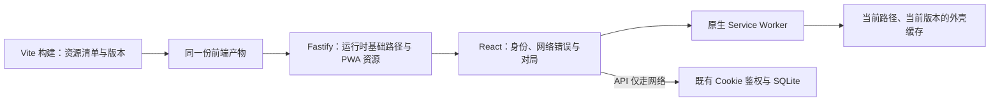

> 由 scope skill 于 2026-11-12 生成
> 状态：已批准 2026-11-13
> 读者：实施 Agent 与审阅者

# BrainGym PWA 与离线游客练习

## 目标

让 BrainGym 可以从桌面或主屏幕作为独立应用打开，并在已完成资源缓存后提供离线空间 N-back 游客练习，使网络中断不再阻止本地练习，同时保持私人数据、对局归属和成绩保存的现有边界。

## 决策基线

### 需求决策

- **目标平台**：Android Chrome、Windows/macOS 的 Chrome 和 Edge，以及 iPhone/iPad Safari。浏览器不支持安装或离线能力时，仍可作为普通网站联网使用。不涉及应用商店发布。
- **安装与启动**：仅使用浏览器自身的安装菜单或“添加到主屏幕”流程，页面不新增安装入口、安装提示横幅或自动安装弹窗。沿用 BrainGym 名称、现有蓝色图标风格及配色，独立窗口启动进入训练大厅。
- **离线范围**：成功联网缓存完整资源后，断网仍可打开训练大厅、规则与准备页，选择 1～5-back 并完成游客练习。首次从未加载过、资源缓存失败或已被浏览器清除时，不承诺离线启动。
- **显式游客选择**：断网后开始新对局，必须由用户明确选择“以游客身份练习”；不能把登录开局静默降级为游客。冷启动断网、无法确认先前身份时也遵循此规则。保留原服务端会话，不因网络错误退出登录或伪造身份验证成功。
- **私人功能与恢复联网**：登录、退出登录、身份验证、私人历史、最佳成绩及成绩保存依赖网络。离线游客对局的身份在开局时固定，恢复联网或重新登录不改变本局归属、不补传其结果；后续新对局重新按在线身份流程开始。
- **已正常开局的对局**：在线完成身份验证后开局，途中断网仍可完成。保存失败沿用当前结果页的手动重试；刷新或离开后不恢复待保存结果，不建立持久化离线队列或后台自动补传。
- **更新体验**：新版本后台准备；仅在使用旧版的所有 BrainGym 标签页和独立窗口关闭后，下次打开生效。不新增更新提示、不强制刷新，不中断对局或丢弃当前页的待重试结果；新版准备失败继续使用旧版。
- **保持现有业务**：不改变游戏规则、版本合同、单调时间推进、每步首次输入、离开/切后台/锁屏作废规则、用户数据库、Token/会话撤销、服务端计分、用户隔离和保存幂等语义。不增加推送、后台同步、遥测或新游戏。
- **交付边界**：本次完成仓库实现、测试和使用文档；不授权修改真实部署、Hub/Monitor 配置、代理入口、生产账户或生产数据库。

### 技术决策

- 沿用 React、Vite、TypeScript、Fastify 和 Node.js SQLite；采用原生 Service Worker 和 Cache Storage，由现有 Vite 构建流程生成资源清单及内容版本，不引入 `vite-plugin-pwa`、Workbox 或其他 PWA 依赖。
- 保持单份构建，运行时继续由规范化的 `APP_BASE_PATH` 决定 `/` 或 `/braingym/`。manifest 的应用标识、启动地址、作用域，以及 worker、图标、页面和 API 地址均与当前基础路径一致，不硬编码部署 Origin。
- 使用版本化的完整页面外壳缓存：只包含无个人信息的运行时 HTML、构建产出的脚本/样式及应用图标。API、非 GET 请求、其他应用路径、跨 Origin 资源和未知资源不进入缓存，也不以页面外壳替代其错误响应。
- 新版缓存与活动版分开准备，完整且版本一致才视为安装成功；活动版提供同版本外壳和静态资源，避免在线 HTML 与旧版缓存混用。缓存名称包含应用标识、基础路径和构建版本，清理仅限当前应用、当前基础路径的旧缓存。
- 使用浏览器默认的 worker 等待与激活生命周期，不主动调用 `skipWaiting()`、不通过 `clients.claim()` 抢占已打开页面，不监听版本变更来强制刷新。worker 更新检查不得被长期 HTTP 缓存锁住。
- PWA 缓存仅在构建产物运行时启用，Vite 开发模式不注册持久化 worker。生产依赖既有 HTTPS、精确 Origin 与 Secure Cookie 约束；本机回环 HTTP 用于隔离验证。不得为支持安装放宽 CSP、Cookie、来源校验或宿主机绑定。
- 不把 Token、会话值、用户名、私人记录或待上传成绩写入 Cache Storage、localStorage、IndexedDB 或 URL。worker 不参与认证；会话仍仅通过现有受保护 Cookie 交给服务端验证。

## 设计视图

### 功能设计

用户在线访问后，页面保持现有训练与登录入口；资源在后台准备，浏览器按自身能力提供安装菜单。安装后的应用以独立窗口展示，启动到当前部署路径下的训练大厅。图标补齐常规 192/512 PNG、maskable 图标及 Apple 主屏幕图标规格，保留现有视觉标识；界面仅补齐独立窗口必要的安全区和视口适配，保留缩放和可访问性。

断网打开或开局前遇到网络失败时，界面明确说明当前无法联网验证身份、游客成绩不会保存，并提供“以游客身份练习”。该动作只确定本次对局为游客，不修改已有会话。此前在内存中的用户信息不能作为本次登录开局已获验证的依据。取消游客选择则不开始对局，恢复联网后可重新走正常开局流程。

练习开始后，网络恢复不改变本局身份或自动保存策略。游客完成后显示本地结果及不保存说明；已在线验证的用户完成后仍走原保存流程，失败显示重试入口。私人功能在网络失败时显示明确错误，不展示伪造的离线记录、退出成功或保存成功。网络错误与 401、身份冲突等业务错误分别处理，后者继续沿用现有身份失效和账户切换逻辑。

所有已打开的页面继续使用当前资源版本，新版本不在页面使用期间接管；用户正常关闭全部旧页面后再打开即可获得已准备好的版本。浏览器不支持 worker、注册失败或缓存空间不足时，在线功能继续可用，不把离线能力失败变为应用启动失败。

### 技术设计

#### 整体方案

构建侧掌握发行版本及静态资源白名单，不把数据库、环境文件、测试产物或任意目录内容收进清单。Fastify 复用现有基础路径机制提供 HTML、manifest 和 worker；缓存的是包含正确 `<base>` 与运行时路径的 HTML，不直接缓存尚未经过服务端路径处理的构建模板。manifest 的 `id`、`start_url`、`scope` 跟随当前基础路径，`display` 为 `standalone`，图标地址不逃逸到根路径。

浏览器主线程负责 worker 注册、初始身份读取、网络失败提示和显式游客选择；继续由现有游戏组件拥有本局归属、计分及仅存于当前页的结果。`navigator.onLine` 只作为网络提示，不能替代 API 身份验证或把可联网等同于已登录。API 客户端保持 `cache: no-store`，服务端 API 保持 `Cache-Control: no-store`；worker 对 API 不读写缓存、不返回模拟响应、不排队写请求。

worker 以自身注册的基础路径解析资源，导航只为应用入口及 `index.html` 提供外壳，现有 hash 导航继续由 React 处理。资源读取仅命中明确白名单，其余请求保持原网络语义。前缀 worker 不扩大作用域；根路径 worker 也不得缓存或改写其他应用资源。缓存命名防止误清理，不被当作同 Origin 应用间的安全隔离，继续沿用现有可信同源应用的部署前提。

worker 脚本和 manifest 使用正确的媒体类型与可更新的缓存策略，缺失时不误返回 SPA HTML。缓存保留现有安全响应头；如实现需要显式声明 worker/manifest 的同源 CSP 指令，仍保持来源为 `'self'`，不引入外部来源或削弱既有策略。

#### 关键结构

| 所有者        | 数据与约束                                                                                        |
| ------------- | ------------------------------------------------------------------------------------------------- |
| 构建产物      | 内容版本、无基础路径的相对资源清单、worker 与图标；不携带真实入口或凭据。                         |
| Fastify       | 当前规范化基础路径、对应 HTML/manifest/worker 的响应；不加入个人化 HTML。                         |
| 主线程内存    | 最近的身份验证结果、网络失败状态、本次显式游客选择、本局 owner 与结果；网络恢复不重写本局 owner。 |
| Cache Storage | 当前基础路径各版本的完整公共外壳资源；不承载私人数据或待上传结果。                                |
| 既有服务端    | 用户、会话、成绩与授权的唯一权威；不增加离线身份或成绩接口。                                      |

#### 实现流程

1. **首次访问与缓存**：在线页面照常加载并读取当前身份，生产客户端按当前基础路径注册 worker。安装阶段以新版本缓存准备完整外壳和资源，检查响应成功、类型与版本一致性；网络失败、资源缺失、部署切换导致版本不一致或存储失败均不发布半成品缓存。失败不得破坏活动版，且后续具备重新准备的机会。成功后，新导航可以由该版本提供外壳；没有完整缓存时仍依赖网络。
2. **离线开始与结束**：缓存外壳启动 React；初始身份请求或登录开局前身份请求发生网络错误时，保留会话并进入明确的联网不可用状态。用户主动选择游客后，直接使用本地游戏引擎、固定空 owner 开始；完成后仅展示当前页结果。恢复联网可重新验证当前会话，不能把正在进行或已完成的游客局转为登录局。
3. **在线对局的断网重试**：已通过开局身份校验的 owner 保持不变，完成后按原 payload 保存；网络失败保留结果及 result ID，仅用户手动重试。服务端仍以当前有效会话确定身份；过期、撤销、跨账户切换或幂等冲突继续按既有契约拒绝，不由 worker 兜底。
4. **更新与清理**：浏览器检查同一 worker 地址的新版本，新版独立准备缓存后等待。只要旧 worker 仍控制任何 BrainGym 页面就不主动激活；全部关闭后由浏览器完成切换，新导航使用新版本完整外壳。清理只删除当前应用与基础路径下不再使用的版本；中断安装遗留的缓存也按相同归属约束回收，不触碰其他路径或应用的数据。

### 预估改动面

- `vite.config.ts`、构建辅助逻辑及 worker 源码：自动清单、内容版本、预缓存、失败恢复与更新生命周期；不维护根路径/前缀两套构建。
- `index.html`、`public/`：manifest 关联、平台图标与必要移动端元信息。
- `src/client/`：worker 注册、网络错误与显式游客开局状态、必要安全区样式；复用现有引擎与成绩重试逻辑。
- `src/server/app.ts` 及相关共享路径逻辑：PWA 资源的运行时路径、媒体类型、缓存头和安全策略兼容；不改数据库 schema、认证接口或游戏合同。
- `tests/`、`tests/e2e/` 及必要验证辅助逻辑：构建产物/HTTP 契约、离线冷启动与游客练习、私人数据不缓存、跨账号与重试、更新等待及失败回退；使用隔离数据库。
- 文档：更新 [README](../../README.md) 的能力与使用入口、[架构 Wiki](../wiki/architecture.md) 的缓存/身份边界、[运维 Wiki](../wiki/operations.md) 的安装/离线/更新及清缓存说明；按实际结果记录 `docs/verification/` 验收证据。游戏规则不变，无须修改 N-back 规则定义。

## 验收

- 同一份 `npm run build` 产物先后运行于 `/` 与 `/braingym/` → manifest、图标、worker、外壳、hash 导航和 API 地址均正确，无前缀逃逸，`/braingym` 仍归一到带尾斜杠入口；HTTP 集成测试和两种基础路径的浏览器测试证明。
- 安装元信息 → 名称和图标保持现有标识，安装作用域/应用标识与当前路径一致，启动进入训练大厅并以独立窗口展示；manifest/图标产物检查、浏览器显示模式验证及实际安装记录证明。页面不存在新增安装入口、安装横幅或主动安装调用；源代码检查与浏览器验证证明。
- 已完成缓存后关闭页面、断网并重新打开 → 训练大厅、规则、难度选择可用；明确选择游客后完成一局并查看分数，无成绩 POST、无自动补传；真实 Service Worker 环境下的离线浏览器测试证明，不能只模拟 API 失败代替外壳离线启动。
- 已登录后断网开始新局，以及离线冷启动无法确定身份 → 正常登录开局不绕过身份验证、不静默降级，主动选择游客才开始；不撤销现有会话；恢复联网后仍可按该会话重新验证，当前游客局不变为登录局；浏览器身份与网络切换测试证明。
- 在线身份校验后开局、途中断网 → 本局可完成，失败保留当前页重试；重新联网由原开局账户重试只保存一次。切换为其他账户、会话过期或撤销后仍拒绝保存；现有及必要新增服务端/浏览器用例证明，不削弱幂等冲突和归属校验。
- 登录、退出、身份、历史、最佳及保存接口在线/离线请求 → API 始终不从 worker 缓存读取，不以外壳 HTML 或假成功兜底；Cache Storage 无这些请求、私人记录或凭据，localStorage/IndexedDB 无新建私人数据与成绩队列；缓存枚举、请求观察及安全审查证明。
- 新版本已准备、仍有旧页面打开（包含另一标签页或独立窗口） → 旧版继续运行、进行中对局与未保存结果不被刷新或接管；关闭所有旧页面后重开使用新版完整资源；使用真实两个构建版本、真实 worker 生命周期的浏览器验证证明。
- 新版资源下载失败、缺失或不一致 → 不激活半成品、不破坏旧版离线启动；后续正常条件下可完成更新；两个版本及故障注入验证证明。缓存清理不影响另一个基础路径或同 Origin 其他应用的哨兵缓存；浏览器验证证明。
- worker/缓存不可用，或首次缓存尚未完成 → 在线页面和既有 API 功能不因此失败，不虚报离线已可用；注册/存储失败及首次访问场景验证证明。Vite 开发模式不注册新 worker；开发入口检查证明。
- 独立窗口移动端 → 安全区不遮挡头部、操作按钮或登录框，横竖屏及软键盘下可操作，不禁用缩放；Android 和 iPhone/iPad 实际设备记录证明。目标平台安装、图标、启动及后台作废必须有实际平台证据；无法取得的设备或浏览器明确列为未验证，不能用 Chromium 模拟替代或宣称全部平台已通过。
- 安全与既有行为 → HTTPS/Origin/Cookie、宿主机回环绑定、CSP 及其他既有安全头保持约束；匿名、跨账号、过期/撤销会话、游客不补传、后台作废和上传重试无回归；针对性 HTTP/浏览器测试、现有原生 Chromium CDP 后台验证及按变更面开展的安全审查证明，不操作生产账户库。
- 提交代码前依次执行 `npm run typecheck`、`npm run build`、`npm test`、`npm run test:e2e`，再对同一构建设置 `$env:E2E_BASE_PATH='/braingym/'` 运行 `npm run test:e2e`，结束后执行 `Remove-Item Env:E2E_BASE_PATH` → 全部通过；保留本次证据，不并行执行构建与运行时测试。若实际引入或调整构建等相关依赖，追加 `npm audit --json` 并核实告警影响。
- 文档与交付 → README/Wiki 描述与实际运行一致，明确需要预先联网缓存、离线不保存、更新等待全部关闭及浏览器可能清缓存；真实部署值、凭据、数据库和临时产物不入库；链接/命令检查、变更范围及脱敏安全扫描证明。
