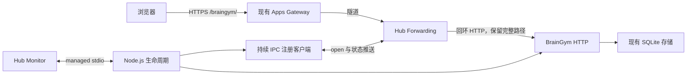

> 由 scope skill 于 2026-11-12 生成
> 状态：已批准 2026-11-12
> 追加确认：用户于 2026-11-12 选择端口方案 A，托管端口改为 3001，公网入口不变；3000 保留给现有服务。
> 读者：实施 Agent 与审阅者

# BrainGym 接入 WheelMaker Monitor 与 Forwarding

隐私说明：本文中的域名已替换为保留示例，私有接入指南链接已移除；真实部署值由私有配置维护，原批准范围和业务要求不变。

## 目标

让当前 Windows 机器上的 BrainGym 由 WheelMaker Hub 启停、监控健康并收集日志，同时通过现有 Apps 入口稳定访问完整业务。接入遵循已确认的 WheelMaker Monitor 和 Forwarding 私有接入指南，保留已有训练数据和普通本地、开发及 Docker 使用方式。

## 决策基线

### 需求决策

- **范围**：同时接入 Monitor 和 Forwarding，并完成实际本机配置与公网验证；Hub 直接运行 Node.js，不托管 Docker 容器。Hub 状态目录为 `C:/Users/fjxyy/.wheelmaker`，应用目录为 `D:/GithubRepos/BrainGym`。沿用当前 `main` 工作树开展本次 spec 与后续实施，不初始化长期 Git 偏好。
- **标识与入口**：Monitor 进程 ID 为 `braingym-process`，显示名称为 `BrainGym`；Forwarding 服务 ID 为 `braingym`，target 为 `http://127.0.0.1:3001`，公网入口为 `https://apps.example.com/braingym/`。复用已存在的 Apps 域名及服务端配置，不新增 DNS、调整 Registry/Gateway 或修改 WheelMaker 源码。`https://registry.example.com` 是 Registry 地址，不作为本次 Apps 入口。
- **路径兼容**：普通 `npm start`、开发模式和 Docker 默认保留根路径 `/`；Hub 托管使用 `/braingym/`。两者使用同一份构建，通过运行时基础路径配置适配前端、资源、API 与 Cookie，不维护两套产物。
- **访问与身份**：Hub 托管时，登录、退出及成绩写入只接受公网 Origin，使用 Secure Cookie；不提供托管模式下的本机 HTTP 登录与成绩保存。本机 HTTP 保留健康探测用途。普通非托管模式继续支持本地 HTTP 登录。
- **共享 Origin 的信任前提**：已确认 `apps.example.com` 下的其他应用均可信，且发布权限受控，继续使用该共享 Origin。私人记录的保护依赖这一部署前提及应用自身会话鉴权，不承诺同域不同路径之间的应用隔离；Cookie Path 和 SameSite 不能阻止同域其他应用脚本访问已登录用户的 BrainGym 接口。
- **登录限流**：保留每客户端 IP 每分钟最多 20 次登录请求的现有规则，成功与失败请求共用该来源的额度。托管模式使用可信转发链提供的客户端 IP，不将所有用户计入 Hub 回环地址的同一额度。不能取得可信客户端 IP 时拒绝该次登录并提示服务配置异常，记录可操作诊断；不使用共享保底额度或跳过限流。普通运行保留直接连接来源的原有限流语义。
- **数据与业务**：沿用 `data/braingym.sqlite`、现有用户、个人 Token、训练历史及最佳成绩，不迁移数据库 schema，不变更游戏规则、记录归属、会话撤销、成绩校验和保存幂等语义。公网首次使用仍通过已有个人 Token 登录，不迁移浏览器在本地 Origin 的 Cookie。
- **故障与停止**：进程就绪及健康与公网发布状态分开处理；Forwarding 不可用时后台恢复注册，不因发布失败退出或重启业务进程。停止时幂等撤销注册、关闭 HTTP 与数据库，正常退出使用退出码 0；启动或不可恢复的运行故障使用非零退出码。

### 技术决策

- 保持 React、Vite、TypeScript、Fastify 和 Node.js SQLite 的现有技术栈。由一个前台 Node.js 根进程承载 HTTP、managed stdio 和 Forwarding 客户端；Hub 直接执行解析出的 `node.exe` 绝对路径及构建后入口，不通过 npm、shell 或后台启动器包装。
- 仅检测到 Hub 注入的 `WHEELMAKER_APP_MANAGED=1` 时启用 managed stdio 和本次联合注册流程；普通启动不消费 stdin 控制命令，也不自动连接 Hub。协议处理与 HTTP、存储及注册生命周期各自封装，避免混淆 Monitor 与 Forwarding 的身份和状态。
- managed stdio 使用版本 1、UTF-8 JSON Lines，每帧含换行不超过 8 KiB；stdout 仅承载合法协议帧，业务与运行诊断写 stderr。身份来自本次 `initialize`，后续报告原样回显 `appId`、`instanceId`，响应逐条回显对应的 `requestId`，不固定实例 ID 或请求序号。健康状态仅使用 `healthy`、`degraded`、`unhealthy`、`unknown`。
- Forwarding 使用 Node.js 内置网络与密码学能力连接当前账号的 Hub 本地 IPC，采用持续连接的 `open` 协议、版本化状态推送和断线重连；不引入 Go 辅助进程，不使用旧 `register`/`renew` 租约接口，不持有 Registry token。
- 新增运行时基础路径配置 `APP_BASE_PATH`，默认 `/`。Hub 使用 `/braingym/`；服务端将规范化后的基础路径提供给前端，同一份构建不包含固定部署前缀。托管配置中的服务 ID、基础路径和公网入口必须一致。
- 复用现有 `APP_ORIGIN`、`COOKIE_SECURE`、`HOST`、`PORT` 和 `DATABASE_PATH`。托管时固定公网 Origin，不根据未经校验的请求 Host 或转发头动态放宽来源校验；本机健康检查不依赖公网可达性。
- 托管登录的限流键只采用经过公网入口清洗、由 Gateway 隧道与 Hub 传递的 `X-Forwarded-For` 客户端地址，并限制直接对端为实际 Hub 回环地址。该信任仅用于登录限流，不全局启用无条件 `trustProxy`，不据此推导鉴权身份、公网 Origin 或 Cookie 安全属性；普通运行忽略转发头。

## 设计视图

### 功能设计

普通运行保持现有入口和操作流程。Hub 托管时，用户在目标 Hub 的 Settings → Monitor 中看到 BrainGym 的进程、健康及 stderr 日志，并通过 Start、Stop、Restart 管理该应用。Settings → Forwarding 独立显示服务注册和发布状态；只有收到 `ready` 与有效 `publicUrl` 才报告可打开的公网入口。

用户从公网入口访问首页、进入训练、以个人 Token 登录、完成并保存成绩、查看历史与最佳成绩、退出登录，业务行为与原版一致。页面内 hash 导航和刷新保持服务前缀，静态资源及 API 不逃逸到 Apps 域名根路径。访问不带尾斜杠的 `/braingym` 时归一到 `/braingym/`；带前缀的未知 API 维持 API 404，不返回首页 HTML。

不同来源各自拥有登录额度，同一来源不能通过伪造转发头获得新额度。可信客户端地址不可用时，登录返回服务配置异常，不创建会话、不改写凭据；修复后用户可持原 Token 正常登录。该请求错误不阻止本机健康探测，也不因此退出业务进程。

健康报告只反映应用必需资源：正常时返回最小 `healthy`，不列出成功组件。必需资源发生运行异常时返回对应异常状态与可操作诊断；恢复后的完整 `healthy` 报告清除旧诊断。有效的异常健康报告不主动触发进程退出。注册连接断开、发布 pending 或发布失败由 Forwarding 状态及 stderr 解释，不把它们并入业务进程健康。

停止操作同时结束本次服务发布与业务进程。停止、stdin EOF 或正常终止信号可以重复到达，不造成二次关闭、残留重连或残留监听。普通启动不会因为 stdin 为 EOF 而自行退出。

### 技术设计

#### 整体方案

运行入口协调资源初始化与唯一的退出流程。HTTP 层拥有基础路径、静态文档、鉴权及接口；存储继续拥有业务数据。managed 适配器负责 Hub 控制协议、身份与健康报告；注册客户端负责 IPC 连接、请求关联、发布快照及重连。注册客户端不控制进程健康，HTTP 不依赖注册成功才启动。

#### 运行配置与路径

本次 Hub 启动定义合并到 `C:/Users/fjxyy/.wheelmaker/config.json` 的 `apps`，保留原有全部配置；`cwd` 指向应用目录，`args` 指向 `dist/server/server/main.js`。不设置已停用的监督策略、`publish` 字段或保留变量 `WHEELMAKER_APP_MANAGED`，后者由 Hub 注入。定义使用以下应用配置：

| 配置            | Hub 托管值                                     |
| --------------- | ---------------------------------------------- |
| `HOST`          | `127.0.0.1`                                    |
| `PORT`          | `3001`                                         |
| `DATABASE_PATH` | `D:/GithubRepos/BrainGym/data/braingym.sqlite` |
| `APP_BASE_PATH` | `/braingym/`                                   |
| `APP_ORIGIN`    | `https://apps.example.com`                        |
| `COOKIE_SECURE` | `true`                                         |
| `NODE_ENV`      | `production`                                   |

Hub 状态目录在应用配置中可指定，缺省使用当前用户的 `.wheelmaker`；本次明确指向已确认的状态目录，不另建正式 Hub。转发服务使用已确认的 `braingym`，target 从实际回环 listener 得到，不能带业务路径。错误的路径、服务 ID 或 target 配置在启动时明确报错，避免注册与路由不一致。

基础路径统一规范为 `/` 或带首尾斜杠的路径，不允许查询、片段或路径逃逸。Fastify 的路由、静态资源、API 禁缓存规则、404 判断和 Cookie Path 共用该配置；托管不额外提供根路径 API 别名。本机健康地址因此为 `/braingym/api/health`，普通模式仍为 `/api/health`，现有 Docker 健康检查继续有效。

Vite 构建使用可随入口路径定位的资源 URL。服务端将基础路径作为经过转义、不可执行的页面配置交给前端；客户端 API 由该配置拼接，不依赖固定 `/api/`，也不引入 CSP 允许范围外的内联脚本。开发模式无需后端提供 HTML 时，前端基础路径回退为 `/`，保留现有 Vite 代理。

Cookie 保持七天有效期、HttpOnly 和 SameSite=Strict；登录设置与退出清除使用同一基础路径。托管使用 `Path=/braingym/; Secure`，普通模式保持原有默认配置。来源校验继续覆盖所有写接口，API 不缓存，不放宽身份或开局用户校验，不记录个人 Token、Cookie 或请求正文。

基础路径及 Cookie Path 用于资源定位和 Cookie 发送范围，不作为浏览器 Origin 隔离机制。现有 Apps 域名继续由可信发布者管理；后续若引入不受信任的同域应用，需要重新确定浏览器 Origin 边界，不能仅调整路径或 Cookie 属性后沿用当前信任结论。

#### 客户端 IP 与登录限流

HTTP 的直接 TCP 对端是 Hub，不能直接用默认 `req.ip` 区分公网用户。本次代理契约为：公网 Caddy 清洗客户端提交的转发信息并产生客户端地址，Gateway 保留该受信任上下文，经隧道和 Hub 转送到应用。启用前须核对实际代理链和清洗行为；不能仅因请求含有转发头就认定其可信，也不以未经验证的额外代理跳数解释地址链。实际入口不符合该契约时报告外部配置问题，本次不擅自修改 Gateway 或扩大代理信任范围。

托管登录仅在直接对端为已配置的 Hub 回环地址（本次 `127.0.0.1` 及其等价表示）时读取 `X-Forwarded-For`，且只接受单个合法、非回环的客户端 IP。缺失、重复头、多地址列表、非法地址、回环占位或不受信任的对端均不产生可用限流键。合法 IPv4/IPv6 地址先规范化，再按该地址使用现有登录额度；不使用 `Forwarded`、`X-Real-IP`、任意 Host/Proto 头或个人 Token 作为替代来源。回环链路及本机运行环境属于本次受信任部署边界，不能把该头用于认证本机进程身份。

来源校验仍按固定 `APP_ORIGIN` 独立执行；合法 Origin 但客户端地址不可用的登录返回 HTTP 503 和稳定错误码 `CLIENT_IP_UNAVAILABLE`，不进行 Token 换会话，也不回退到回环地址或全站额度。stderr 只记录代理契约失败的原因类别，不回显凭据、请求正文或完整客户端转发头。普通模式继续按直接连接地址限流，客户端转发头不改变额度。本机 health 与非登录接口不要求这些代理地址字段。

#### Monitor 实现流程

1. 托管入口先建立有界输入解析及退出处理，收到合法版本 1 的 `initialize` 后保存本次身份；随后初始化存储、静态文档及 HTTP listener。无效协议或身份不一致属于控制协议故障，记录诊断并清理，以非零状态退出。
2. 必需资源就绪后，在后台启动独立的 Forwarding 注册流程，并在 Hub 的 30 秒初始化期限内发送一次 `ready`，其中包含版本和完整健康报告。`initialize` 不额外回复普通 `response`；不等待 IPC、Registry 或 Gateway 成功才发送 `ready`。
3. 对每个 `health` 请求在 5 秒内回显正确身份与请求序号，不要求这些后续请求携带 `protocol`。健康采样覆盖 HTTP 生命周期和可用的 SQLite 访问；托管模式须约束同步存储等待与探测耗时，为控制响应留出余量，不能让现有 5 秒 SQLite busy timeout 耗尽整个控制期限。本机 HTTP health 复用核心检查，健康时保留 `{ "ok": true }` 成功响应，不健康时返回失败状态。
4. 健康状态变化可以推送完整报告；只列异常组件及诊断，恢复时发送最小 `healthy`。协议输出序列化、大小检查与写入集中管理，避免并发输出混行、重复 ready 或 stdout 日志污染。

#### Forwarding 实现流程

Windows IPC 端点按实际状态目录的规范化绝对路径转小写后取 SHA-256，使用前 24 个小写十六进制字符生成 `\\.\pipe\wheelmaker-app-registration-<hash>`，与当前 WheelMaker 的派生方式一致。应用与 Hub 使用同一系统账号。

listener 就绪后，客户端连接 IPC，发送递增正整数 `requestId` 的 `open`，包含 `id=braingym` 和实际 target；按 8 KiB UTF-8 JSON Lines 边界持续读取完整帧。先检查顶层 `code`、`error` 与响应关联，再接受注册快照。首个状态不要求为 pending；同一连接只应用最新版本，重复状态不重复触发副作用，忽略旧版本，重连后重置版本基线。

IPC 建连设 5 秒期限；连接建立后，从发送 `open` 到收到首个完整有效响应另设 5 秒期限。超时包括对端始终静默或只发送半行的情形，均关闭连接、清除本次状态并进入退避重连。首个有效响应后解除握手读取期限：正常持续注册可以长期没有状态变化，不因静默断开，也不额外引入心跳或轮询。应用停止始终能够取消等待并关闭连接。

成功后保持连接，不续租、不用 `status` 轮询、不依赖每个中间状态都会送达。只有 `ready` 且返回的 URL 符合本次配置入口时，才在运行诊断中报告发布成功。连接失败、EOF 或坏帧会清理当前连接与过期快照，以有上限的退避重试并重新 `open`；Hub 未启动时同样重试，Registry 未连接时允许保持注册等待。冲突或其他注册错误明确记录，不自动更换服务 ID 或覆盖已有归属。

注册客户端只针对当前连接执行后续命令，不附带 `id` 或 `handle`。本次无动态切换监听端口需求，无需提供业务上的 update 入口。退出时先取消重连并关闭注册连接，利用 Hub 收到 EOF 后撤销映射；此后不得再次自动注册。

#### 退出与实际配置

managed `shutdown` 可先回复接受，再与 stdin EOF、SIGINT、SIGTERM 共用幂等关闭流程：标记停止、撤销注册、停止接受新请求并有界排空在途 HTTP、关闭存储，最后退出。在 Hub 的 15 秒停止期限前为清理预留余量，不无限等待连接；释放资源失败必须保留诊断并按运行失败退出。当前应用不新增业务子进程。

实际配置前核对端口与数据路径，仅停止能够明确归属为冲突旧实例的 BrainGym 进程；不终止其他服务。保留配置备份，合并并校验唯一的启动定义后使用 Monitor Reload 加载。应用由 Hub 启动而非安装或构建，构建与依赖准备须在加载前完成。配置备份及含用户数据的文件不进入 Git。

复用现有 Apps 入口，不以修改服务端配置或重启整个 Hub 来掩盖发布错误。真实 Hub 上仅操作本次 BrainGym 条目；异常健康和转发故障使用隔离环境验证，避免中断当前 Hub 的其他工作。IPC 服务单独中断时，验证原应用实例继续服务并重新注册；整个 Windows Hub 的正常退出和强制终止则在隔离 Hub 中验证，旧托管实例随 Hub 结束，新 Hub 从配置重新拉起应用，以新 `instanceId` 初始化、打开同一隔离数据库并恢复发布。两类测试各自留存证据，不用 IPC 插拔代替 Hub 冷启动验收。

公网业务验证在切换构建产物前，由升级前版本创建专门的临时验证账号，并保存一条可识别的历史；保留该身份的 Token、用户与结果标识供切换后验证，凭据不进入日志或 Git。升级后持同一 Token 经公网登录，读取原历史并完成新成绩保存与退出。结束后仅按该临时身份精确清理测试账号及从属数据，不换发或吊销现有用户的 Token，验证记录只保留脱敏证据。

### 预估改动面

- `src/server/`：运行配置、基础路径路由、可信客户端 IP 解析与登录限流、代理信息不可用的错误响应、健康采样和统一关闭；新增 managed stdio 与 Forwarding 模块，存储仅补充必要的健康检查能力，不改业务模型。
- `src/client/api.ts`、前端入口、`index.html`、`vite.config.ts`：运行时基础路径读取、API 与资源路径适配，保留现有页面与游戏逻辑。
- `tests/`、必要的验证辅助脚本：协议与真实进程生命周期、首次 IPC 握手期限与重连、状态顺序、隔离 Hub 冷启动恢复、旧版本签发凭据与历史兼容、可信代理与登录额度隔离、双路径 HTTP 与 Cookie、根路径和带前缀浏览器流程回归。
- `.env.example`、`README.md` 及必要的启动配置示例或辅助工具：说明普通运行和 Hub 托管差异、实际应用定义、更新与排障。实时 Hub 配置在仓库外合并，不提交机器凭据或正式数据库。
- **wiki 更新**：实现与验证完成后更新 `docs/wiki/architecture.md` 的模块、数据流及身份边界，更新 `docs/wiki/operations.md` 的托管、路径、配置、更新与恢复操作；本次不预写未实现事实。

## 验收

- 合法 initialize → 自 Hub 启动进程起 30 秒内，在必需资源就绪后恰好发送一次 ready，后续 health 5 秒内返回且正确回显不同 requestId 与本次身份，stdout 无普通日志；真实 Node 子进程协议测试和 Monitor 实际状态证明。
- 分段输入、多帧输入、超长帧、非法 JSON、非法初始化及身份不一致 → 帧解析有界，非法控制协议明确失败并释放资源，无重复 ready 或污染输出；协议与进程测试证明。
- 必需资源异常、存储锁等待及恢复 → Monitor 在控制期限内收到完整异常诊断和恢复后的最小 healthy，旧诊断清除，有效异常报告不改变 PID；隔离故障、锁竞争测试和恢复快照证明。
- Hub 不可用或 IPC 服务单独中断 → listener 与进程就绪不受发布影响，原应用实例保持运行，客户端退避后重新 open，丢弃旧连接快照、重置版本基线，恢复正确发布；隔离 IPC 测试及 PID、instanceId 前后比较证明。
- IPC 建连超时、已连接但 `open` 响应静默或只收到半行 → 各自在 5 秒期限到达时关闭本次连接并退避重试，Hub 恢复响应后可重新发布；成功注册后长期没有状态推送仍保持连接；握手与空闲会话测试证明。
- 整个 Windows Hub 正常退出或强制终止后重新启动 → 旧托管实例结束，新实例由已保存的启动定义自动拉起，使用新的 instanceId，在初始化期限内就绪，沿用原数据库且重新发布，原身份和历史保留；隔离 Hub 的真实生命周期及重新发布测试证明，不重启正式 Hub 的其他工作。
- pending、ready、乱序或重复版本、注册 conflict 与非法响应 → 仅正确的最新状态更新入口，失败可诊断，不打开错误 URL，不覆盖其他注册，不误报业务进程失败；注册协议测试证明。
- shutdown 与 stdin EOF 同时或重复到达，以及终止信号 → 只执行一次关闭，无继续重连、端口或注册残留，正常退出码为 0，并在 Hub 15 秒期限内结束；真实进程测试和实际 Monitor Stop/Start 证明。普通非托管进程不因 stdin EOF 退出。
- 同一份构建分别以 `/` 和 `/braingym/` 运行 → 页面、脚本、样式、图标、hash 导航、刷新与 API 均可用；无尾斜杠入口正确归一，API 404 不返回 HTML，前缀模式不泄漏根路径 API 别名；HTTP 与浏览器测试证明。
- 托管鉴权 → 登录 Cookie 含 HttpOnly、SameSite=Strict、Secure 及 `Path=/braingym/`，退出按同一路径清除；仅配置的公网 Origin 可写，本机和错误 Origin 的登录/保存被拒绝；HTTP 测试与公网 Cookie 检查证明。
- 登录来源与限流 → 两个有效客户端 IP 的登录额度相互独立，同一来源第 21 次请求返回 429；经真实入口伪造的转发头不能更换额度，非托管模式也不接受客户端头改变限流键；不同地址、地址等价表示、可信/非可信对端的 HTTP 测试、代理链集成测试及真实入口清洗行为核对共同证明。
- 代理地址不可用 → 合法 Origin 的托管登录遇到缺失、重复、多地址、非法或回环客户端地址，或不受信任对端时，返回 503/CLIENT_IP_UNAVAILABLE，不创建会话、不改写 Token、不使用共享额度；修复后原 Token 可正常登录，本机 health 始终可在无转发头时探测；失败与恢复测试及脱敏诊断证明。
- 部署信任边界 → 运维与架构文档明确记录同域应用可信、发布权限受控的已确认前提，不将路径前缀、Cookie Path 或 SameSite 描述或验收为跨应用隔离；本次需求确认与文档核对证明。
- 普通运行回归 → 根路径本地登录、游客练习、登录对局保存、历史、最佳与退出保持可用；开发 Vite 代理和默认 Docker 健康探测不被前缀改造破坏；相关回归测试及本地/容器运行检查证明。
- 数据兼容 → 现有数据库 schema、用户与凭据摘要、训练数据不因接入迁移或丢失；升级前版本签发的验证 Token 在升级后仍可登录、读取升级前保存的可识别历史，并保存新的成绩，结果幂等和归属校验仍生效；跨版本验证身份与历史、存储/API 回归及实际数据前后核对共同证明，不能只用新版创建的账号替代旧凭据验证。
- 实际配置加载 → 主配置其他内容保持不变，Monitor 显示 BrainGym 且 PID 为实际 Node 根进程，stderr 日志可查看；Forwarding 显示 `braingym`、正确回环 target、ready 及确认的公网 URL；脱敏配置核对和 Hub 状态证明。
- 实际公网访问 → `https://apps.example.com/braingym/` 的页面与资源可加载，使用升级前准备的同一临时验证 Token 完成登录、旧历史读取、训练结果保存、历史/最佳读取及退出，之后精确清理该验证身份及其数据，现有账号和记录保留；真实 HTTPS/浏览器检查及脱敏验证记录证明。仅有隧道 ready 不视为业务验收通过。
- 交付一致性 → `npm test`、`npm run typecheck`、`npm run build` 及相关浏览器回归通过，wiki 与运行配置、源码一致；命令结果和验收记录证明，未具备的外部条件必须如实报告，不以模拟结果替代实际公网成功。
