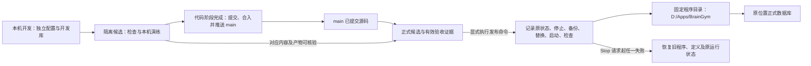

> 由 scope skill 于 2026-11-13 生成
> 状态：已批准 2026-11-13
> 读者：实施 Agent 与审阅者

# 开发与正式环境隔离及显式发布

## 目标

将本机开发演练与现有 WheelMaker 正式实例分开，使日常修改、构建、测试和账户管理不会改变正式程序或数据。新功能先在开发环境演练，合入 main 后显式发布，并在本次实施中完成现有正式实例的迁移。

当前 `npm run dev`、普通 CLI 与托管配置默认使用仓库内的 `data/braingym.sqlite`；托管定义的 cwd 指向仓库，静态文件从 cwd 下的 `dist/client` 读取。仅改变端口或 NODE_ENV 不能隔离数据库和正在提供的静态资源。

## 决策基线

### 需求决策

- 开发环境仅供本机访问，独立配置、端口、数据库和构建产物；开发启动及账户管理默认使用开发库。开发身份、Token、会话与训练结果不复制到正式环境。
- 正式程序使用仓库外的固定目录 `D:\Apps\BrainGym`，由现有 WheelMaker 继续托管。每次发布更新该固定目录，不建立供日常切换的多版本目录体系。
- 新功能先本机演练，再合入 main；正式发布只接受 main 上已提交的版本。普通启动、开发构建、测试、Git 提交或合并均不触发发布，必须明确执行发布命令。
- 本次按“代码交付 → 正式迁移”两个阶段完成：代码与隔离验证完成后先合入并推送 main，再从稳定的 main 工作区显式发布；实际迁移及在线验收完成后才算整个任务完成。发布失败保留已合入的代码，恢复正式运行版本，不自动回退 main。
- 发布前，对应版本必须通过自动检查和本机演练；发布使用已验证的构建产物及匹配的运行依赖，不在正式目录重新构建。
- 接受切换时短暂停服。发布前保留旧程序，更新并重启后检查；从发出 Stop 请求起，任何可处理失败都进入状态核对与恢复流程，包括停服成功后备份失败、写入进程未退出或配置冲突。恢复发布前的程序、定义和运行状态；原服务运行时自动重启，原本停止时保持停止。恢复失败时停止操作、报告状态并保留恢复材料，不循环重试。
- 正式数据库保持现有绝对位置；程序替换和自动恢复不覆盖、回滚或删除数据库。现有账户、Token、会话和历史保留，正常到期或撤销语义不变。
- 本次包括现有正式实例的实际迁移与验收。保持现有 HTTPS Origin、`/braingym/` 路径、3001 回环端口、Monitor 应用及 Forwarding 服务标识；不改变其他应用、既有 Docker 服务或数据卷。

### 技术决策

- 沿用 Node.js、npm 锁文件、React/Vite、Fastify、SQLite 和现有 WheelMaker 协议，不引入新的部署平台、认证服务或数据库迁移机制。
- 统一启动与 CLI 的环境选择、路径解析和校验；开发入口显式采用开发配置，正式启动与管理显式采用正式配置，测试使用隔离配置。缺失或冲突时拒绝执行，不静默退回正式库或另一环境。
- 正式配置以现有私有 Hub 应用定义为依据；迁移先读取并确认原 cwd、Node 路径、数据库路径及环境，数据库相对路径按原 cwd 固化为绝对路径。真实入口和认证材料不写入跟踪文件或通用示例。
- 发布工具复用 WheelMaker 现有认证和 `hub.state.get` / `hub.state.action` 的 Monitor 控制能力，按 appId 仅对 BrainGym 执行 Stop、Start；Reload 是全局操作，不支持 appId 限定。定义未变时不写 Hub 配置、不调用 Reload；首次迁移或确需改变定义时，仅在能证明非目标定义没有待加载变更、配置变更已冻结后进行受保护的全局 Reload，证据不足则拒绝。Hub 仍直接启动前台 Node 根进程，npm 或发布脚本不作为托管根进程。
- 本次 Git 顺序以代码交付阶段的完成为提前合入和推送的依据，不等待正式迁移；只对本次流程明确阶段顺序，不回写长期 Git 偏好。main 存在任务外修改而不能安全合入时保留工作区并报告，不从功能分支绕过发布限制；阶段间的 Git 清理、证据存放及后续验收记录遵循下文安排。
- 候选产物及验收记录绑定已提交源码、锁文件、运行环境和产物摘要。发布前重新核对来源与摘要，只有仍然有效的检查证据可以复用；检查失败、来源或产物变化、运行环境不兼容时阻止切换。
- 备份、锁和操作记录不依赖将被清理的任务 worktree，且与程序替换范围、数据库源目录分离。文件操作必须校验规范化绝对路径和所有权，不沿重解析点误入数据库、仓库根或其他应用目录。

## 设计视图

### 功能设计

日常开发保持 Vite 热更新与 API 调试流程，前端代理和 API 从一致的开发配置取得端口及 Origin。启动命令与账户管理命令明确显示当前环境和非敏感目标信息；开发库可独立创建练习身份，正式账户操作另有显式入口，使用正式版本的 CLI 和原数据库。

开发者可单独执行本机演练，检查候选程序、页面、登录、对局保存、记录和退出。演练使用独立临时身份与数据库，开发和验收入口均不注册正式 Forwarding。日常开发的缓存及生产构建的 PWA 验证使用独立的本机 Origin，避免已注册 worker 干扰开发。

代码交付阶段包含功能实现、隔离演练及可交付的文档。完成该阶段的检查、提交、同步与推送后，按本次阶段约定合入并推送 main，核对实际远端 SHA；代码阶段完成不等于正式迁移完成。干净的任务分支与 worktree 可按原清理偏好收尾，之后从稳定 main 工作区读取同一 spec 和计划并继续迁移，私有候选、备份和操作记录不能随 worktree 消失。阶段切换时结束代码阶段的 Git 上下文，在稳定 main 工作区写入验收记录前重新 prepare 并保留已有修改，不继续使用已清理 worktree 的 prepared 上下文。迁移后的验收记录和文档修正在 main 中按偏好提交、同步和推送。

功能合入 main 后，开发者显式执行发布命令。命令首先固定 main 源码版本、准备候选并确认检查证据，只有全部通过才进入维护期。阶段间 main 内容变化时重新核对候选与检查证据，不把功能分支的旧结果直接视为有效。无有效证据时先完成必要检查；不得提供跳过必需验收而切换正式的入口。输出脱敏的阶段、版本、成功或失败结果，详细私有记录留在受保护的本机目录。

发布以发出 Stop 请求作为维护期起点，而不是以覆盖程序或启动新版为界。此前失败不改变旧实例；此后即使还没有新版进程、程序文件尚未改动，也必须核对正式状态并恢复发布前的运行状态。定义没有变化的常规发布只需对 BrainGym 执行 Stop、程序替换和 Start。

正式目录只承载发布工具管理的程序及依赖，正式数据通过绝对路径引用。成功后，后续开发、构建、测试及任务 worktree 清理均不改变正式程序。PWA 继续采用既有后台准备、关闭全部旧窗口后激活的规则，发布不会强制刷新正在使用的页面。

### 技术设计

#### 整体方案

环境解析同时供 API、CLI、开发代理和发布工具复用，避免各入口各自推断数据库或 Origin。开发资源与正式资源的区别由独立运行目录和配置实现；同一候选构建仍须支持 `/` 和 `/braingym/`，不为正式路径另建前端。

发布工具分离候选准备、演练、正式切换和恢复职责。源码快照只取 Git 中目标提交的文件，运行包只包含构建输出、包清单、锁文件和锁定安装的运行依赖，不夹带 `.env`、数据库、备份、本地技能、源码工作区或验收凭据。运行依赖在候选阶段准备并验证，正式停服期间不安装依赖或运行构建。

WheelMaker 控制通过现有私有配置建立认证连接，认证值仅供控制使用，不传入开发程序或页面。定义未变时沿用 Hub 已加载的定义，只调用单应用 Stop、Start。控制接口、权限或目标身份无法确认时，在停止正式实例前失败。

定义需要变化时，先取得本机已知成功加载的私有应用定义基线及配置变更冻结证据，对照当前磁盘完整 apps 定义和 Monitor 状态：除 BrainGym 外，定义及应用 ID 集合必须与已加载基线一致，不能夹带尚未加载的新增、删除或参数变更，存在其它应用待重启变更时也拒绝。当前 Monitor 快照不包含完整定义与环境值，不能把 ID 一致、进程健康或本工具没有改其它 JSON 字段当作已加载配置一致的证明；无法取得可信基线或冻结条件时，在 Stop 前拒绝首次迁移，不通过试做 Reload 探测影响，也不新增或假定 WheelMaker 有单应用 Reload 接口。

写入配置沿用原子替换和同权限备份，只变更 BrainGym，保留其他字段。写入前在变更冻结条件下再次核对完整配置与基线；候选原子写入后取得允许 Hub 读取、拒绝外部写入与替换的文件保护，读回并确认完整内容与候选一致，再执行全局 Reload，保护保持到核验完成。无法建立保护或发现竞争时拒绝继续。全局 Reload 前后核对非目标应用的 ID、PID、instanceId、运行阶段、待重启状态和稳定健康状态，要求没有本次操作导致的变化。回退仅撤回本工具写入且未被后续更改的字段；只有 Hub 已加载的目标定义确实需要恢复时才重新 Reload，并执行相同的全局影响检查，不能整体回滚他人的配置或操作其它应用作补偿。

#### 关键结构

| 结构 | 所有权与约束 |
| --- | --- |
| 开发配置与数据 | 属于当前开发工作区；与正式库、正式程序目录及正式 Origin 分离；私有配置及数据加入 Git 和镜像忽略规则 |
| 候选与验收证据 | 记录源码提交及内容摘要、锁文件、产物清单、运行环境、实际检查及结果；允许演练功能分支，正式切换时必须能对应 main 的已提交内容 |
| 固定正式程序 | `D:\Apps\BrainGym`；更新范围限定为工具管理的程序文件；目标存在陌生内容时拒绝覆盖 |
| 正式数据库 | 沿用原正式定义解析出的绝对路径；不属于运行包、程序覆盖或自动恢复范围 |
| 发布记录与备份 | 保存原运行状态、原定义、旧程序和逐阶段变更标记；Stop 请求及可能的部分文件写入在执行前记录；访问权限与所含私有内容相符，与替换范围分离，异常中断后保留现场并阻止新的发布覆盖未完成操作 |
| 全局 Reload 依据 | 仅定义变更时需要；私有已加载配置基线、变更冻结证据、非目标应用前后快照与受保护配置摘要；缺失基线时拒绝，不能由当前磁盘配置或简化的 Monitor 快照自行推定 |

发布切换使用互斥锁；同一正式目标只能有一个发布或恢复操作。发布时核对 main、候选内容及产物未变化；涉及本次候选的未提交源文件或锁文件变更不能混入正式发布，既有任务外未跟踪技能目录不纳入运行包，也不要求删除或提交。

操作记录区分预检、Stop 已请求、已停服、备份完成、程序已开始修改、定义已写入、定义已加载、新版已启动、验收完成。程序与定义的变更标记在尝试写入前落盘，部分写入也属于需要恢复的修改。预检记录原服务稳定运行或稳定停止；启动中、停止中等无法确定的状态先拒绝发布。Stop 超时或回复丢失时，依据相同实例的 Monitor 状态、实际根进程与端口归属核对是否已停服，不能将“未收到成功回复”视为服务仍运行。

#### 实现流程

1. **开发与演练**：启动独立开发 API、Vite 及开发 CLI；候选在隔离目录构建和验证。执行 `npm run typecheck`、`npm run build`、`npm test`、`npm run test:e2e`，再对同一构建设置 `E2E_BASE_PATH=/braingym/` 执行浏览器测试并清除该配置。补充实际 Vite 代理演练及候选运行包的启动、资源和业务检查。构建与运行时测试串行，所有写入使用隔离数据库。
2. **代码交付与 main 合入**：代码阶段验证通过后，按本次阶段约定完成提交、同步、功能分支推送、main 合入及推送，并核对实际远端 SHA，再允许进入正式发布阶段。main 无法安全合入时停留在代码阶段；代码合入或 worktree 清理均不触发发布，清理后从稳定 main 工作区继续本 spec 的后续流程。
3. **发布预检**：显式发布命令选定 main 已提交内容，校验有效证据、产物和生产依赖；读取并核对现有 BrainGym 定义、原运行状态、控制接口及权限、固定目录、数据库和备份路径、磁盘及端口归属。按定义是否变化决定是否需要全局 Reload，需变更时先完成全局影响与配置冻结核验。首次迁移同样在隔离目录完成准备，不构建或覆盖旧正式实例读取的仓库 `dist`。路径交叉、目录归属不明、配置竞争或任何必需检查缺失时，在 Stop 前退出。
4. **受控停服与备份**：取得发布锁，重新核对预检条件并持久记录原状态及 Stop 请求，再通过 Monitor 停止 BrainGym，确认根进程退出、3001 释放及旧映射撤销；确认没有其他写入同一数据库的进程。按运维规则备份完整数据库目录，不能只复制活动中的 SQLite 主文件；该备份仅供人工灾难恢复，不用于发布自动回退。同时保留旧程序和原定义，备份全部完成后才允许修改受管程序文件。本阶段失败也必须恢复发布前运行状态，不能以“尚未替换程序”为由直接退出并留下停服。
5. **替换与定义加载**：记录程序开始修改后替换受管文件。本次迁移将 cwd 改为固定正式目录，数据库位置及其余正式入口属性保持不变。定义未变时不写 Hub 配置，也不 Reload；定义变化时在保护范围内仅合并本次变化，执行经预检许可的全局 Reload 并核验非目标应用不受影响。记录定义写入与加载分别是否完成，供失败时选择恢复路径。
6. **启动与验收**：仅 Start BrainGym，等待新 Node 根进程和 Monitor 健康、Forwarding ready；实际验证本机及原 HTTPS 入口的健康、页面、前缀静态资源、发行标记、匿名私人接口拒绝及适用安全头。单独的 ready 或本机 HTTP 可达不足以判定发布成功。正式启动使用的程序摘要必须与候选一致。正式库仅执行迁移所需备份与只读保留核验，登录、成绩写入及恢复故障演练使用隔离数据库。
7. **失败收敛**：按下表和持久阶段记录恢复，不依赖新版进程已经存在。恢复不整体覆盖他人的 Hub 配置，不回滚数据库。首次迁移失败时恢复原仓库定义及旧程序；已经合入 main 的源码提交保留，不通过回退 Git 代替正式恢复。
8. **完成与清理**：记录发布或恢复结果，清理已明确归属的候选临时进程、临时身份及数据，保留最近一次发布所需恢复材料。现有长期账户、凭据、会话和成绩不参与测试清理；验收结果及文档最终修正在稳定 main 工作区按 Git 偏好提交、同步和推送。只有正式迁移与必需验收通过才报告本次任务完成，恢复成功但新版未发布仍报告迁移未完成。后续普通开发无需接触正式配置或发布目录。

| 失败位置 | 恢复结果 |
| --- | --- |
| Stop 请求发出前 | 保持原实例、程序和定义；退出并报告失败 |
| Stop 超时或回复丢失 | 先核对实际进程状态；原实例仍稳定运行且未修改时保持原状，已经停服时进入原运行状态恢复；状态无法确认时停止文件操作并报告恢复失败 |
| 已停服、程序和定义尚未修改 | 备份失败、仍有数据库写入进程、磁盘不足或配置冲突时，原服务曾运行则按原定义 Start 并核验恢复；原本停止则保持停止，不要求先有新版进程，也不回滚数据库 |
| 程序或定义已开始修改 | 新进程存在时先停止并确认退出，再恢复受影响的旧程序与本次定义变更；仅在必要且全局条件满足时恢复已加载定义，然后按原运行状态 Start 或保持停止，并核验结果 |
| 恢复失败或意外中断 | 保留阶段记录及备份，报告实际可用状态，禁止后续发布覆盖未完成现场；不启动无法确认版本或定义的程序，不反复重试，也不操作其它应用作为补偿 |

本次保持 schema version 1，不引入 schema 变更。候选与正式 schema 不兼容时在切换前拒绝发布；自动恢复只承诺程序与当前数据库兼容的情况，不通过恢复旧数据库丢弃发布期间已接受的数据。

### 预估改动面

- `package.json`、`scripts/`：环境入口、开发代理及 CLI 调用、候选准备与演练、显式发布、Hub 控制、失败恢复和脱敏记录；复用已有验证能力，避免直接复用会切走正式 Forwarding 的公网预检方式。
- `src/server/config.ts`、`src/server/main.ts`、`src/server/cli.ts` 及按需共享模块：统一环境与路径解析、启动校验和显式正式管理入口。游戏规则、计分和成绩归属合同保持不变。
- `vite.config.ts`、测试启动配置及 `tests/`：一致的开发代理配置、隔离候选运行、环境误选和发布失败恢复的回归验证；不修改界面视觉或既有 PWA 更新策略。
- `.env.example`、`.gitignore`、`.dockerignore`、`README.md`、`AGENTS.md`：同步开发与正式入口、私有配置及打包输入边界；既有 Docker 定义继续使用其独立数据卷。
- 更新 `docs/wiki/operations.md`：开发演练、两阶段交付、显式发布、首次迁移的全局 Reload 前置条件、正式 CLI、备份与各失败阶段恢复；更新 `docs/wiki/architecture.md`：环境配置、程序与数据所有权、单应用控制与全局重载边界。长期 Git 偏好文件不因本次阶段顺序而修改。
- 在 `docs/verification/` 保存本次命令与实际迁移的脱敏结果，不能以历史验收记录替代；真实入口、原始机器报告和凭据留在忽略的私有位置。

## 验收

- 普通开发启动、构建、测试和开发 CLI → 仅影响独立开发或测试资源，正式进程、程序文件与数据不变，开发代理下的登录、成绩保存、记录和退出可用；配置/CLI/进程测试、Vite 实际浏览器演练及正式程序摘要对比证明。
- 开发配置误指正式资源、端口冲突或必需配置缺失 → 明确失败，不退回正式默认值、不终止其他服务；隔离测试证明，测试不打开真实正式库。
- 仅执行演练、构建、提交或合并 → 不执行正式 Hub 控制、正式文件写入或发布；隔离测试 Hub 的控制不属于正式操作，发布入口测试及受控文件/控制调用记录证明。
- 两阶段交付 → 代码及隔离验证通过后先合入并推送 main，发布只使用对应 main 内容；代码阶段完成但正式迁移尚未通过时，整体状态保持未完成。临时 Git 仓库与控制调用记录证明合入、远端 SHA 核验及显式发布的先后关系；另覆盖 main 无法安全合入、阶段间 main 内容变化、worktree 已清理仍可从稳定 main 继续及迁移后验收记录提交。
- 显式发布不符合 main 已提交来源，或未能取得全部有效检查证据、检查失败、候选被改动 → 在停止正式实例前拒绝；缺失或过期证据须先重新检查，取得有效证据后才可继续。使用临时 Git 仓库、产物和控制替身覆盖，并记录实际拒绝原因。
- 对最终代码及运行配置 → 依次通过 typecheck、build、Node 测试、根路径浏览器测试及同一构建的 `/braingym/` 浏览器测试；发布脚本和验证记录列出实际命令、结果与对应版本，不并行构建和运行时测试。
- 合格候选发布 → 正式目录的产物及运行依赖与已验证候选一致，不重新构建；Node 根进程直接受现有 Hub 管理，原 Origin、路径、3001、Cookie 属性和来源校验保留；产物摘要、进程及真实 HTTPS 浏览器检查证明。
- 定义未变的常规发布 → 只控制 BrainGym 的 Stop、Start，不写 Hub 配置、不调用 Reload；控制调用及文件写入记录证明。定义变化时仅使用经保护的全局 Reload，不宣称存在单应用 Reload；隔离真实 Hub 中设置其它应用待加载新增、删除、参数修改、待重启状态或缺失已加载基线，均须在 Stop 前拒绝，验证其它应用的进程及运行状态不变。
- 获准的全局 Reload 或定义恢复 → 非目标应用定义及 ID 集合与已加载基线一致，受保护期间配置不能被外部写入或替换；前后非目标 PID、instanceId、阶段及待重启状态不变。隔离 Hub 验证正常加载、配置竞争和保护无法建立的拒绝路径，不能靠先执行全局 Reload 再撤回其它应用变化证明安全。
- 停止失败、控制权限不足、陌生目标目录或并发发布 → 不越过对应保护阶段，不覆盖运行中的程序或无归属文件；Stop 超时或回复丢失时核对真实状态，不能把实际停服当作无副作用失败。故障注入与互斥测试证明。
- Stop 已成功、程序尚未替换 → 分别注入数据库备份失败、程序备份失败、其他数据库写入进程未退出、磁盘不足及配置冲突，原服务曾运行时必须按原定义重新就绪，原本停止时保持停止；程序和数据库不被恢复流程覆盖，不能依赖新版 PID 才进入恢复。用隔离数据库、临时目录及控制端验证，并在隔离真实 Hub 覆盖一次 Stop 后备份失败恢复。
- 程序部分替换、定义写入或加载、新版启动或发布后检查失败 → 根据持久阶段记录恢复旧程序及本次定义变化、恢复原运行状态，数据库不回滚，已合入 main 的源码提交保留，其他 Hub 配置不变；临时目录、隔离数据库及模拟控制端验证各阶段，至少一次隔离真实托管流程证明停止、切换与恢复闭环。
- 恢复失败或操作意外中断 → 明确报告实际可用状态并保留备份与阶段记录，后续发布不能无条件覆盖现场；恢复故障和中断场景测试证明。
- 正式数据保留 → 首次迁移前后对原正式数据库执行只读核验，既有账户、凭据摘要、会话及历史的脱敏指纹保留，数据库绝对位置不变；私有报告保存必要证据，控制台及跟踪文档不包含原始记录。另在隔离数据库中由迁移前程序创建临时身份、会话及历史，用候选程序验证同一 Token、会话、旧历史、新成绩和退出，证明旧身份兼容；该测试显式指定隔离 DATABASE_PATH，结束后仅清理测试资源。
- 实际完成迁移 → 现有 Monitor 指向 `D:\Apps\BrainGym`，Forwarding 和原 HTTPS 业务通过上述验收；迁移后再次开发构建不影响正式页面和资源。真实环境未完成的项目必须标为未验证，不以替身或历史记录宣称迁移成功。
- 凭据、文档与打包输入 → 跟踪 diff、忽略规则及候选文件清单检查通过；无真实入口、密钥、Token、SQLite、备份或本地技能进入提交及运行包，日志和公开证据脱敏；依赖审计按实际依赖变更执行，发现阻塞或必需证据缺失时不标为通过。
