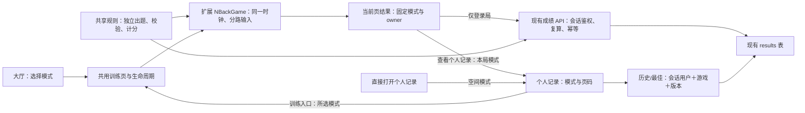

> 由 scope skill 于 2026-11-13 生成
> 状态：已批准 2026-11-13
> 读者：实施 Agent 与审阅者

# 位置＋颜色 N-back

## 目标

在现有空间 N-back 之外提供同时记忆位置和颜色的新模式，让玩家独立判断两个维度的匹配情况，查看整体与分项表现，并按模式跟踪私人训练历史和最佳成绩。

## 决策基线

### 需求决策

- **入口与模式**：训练大厅新增“位置＋颜色 N-back”卡片，与“空间 N-back”并列，各自进入规则和准备页。保留原空间模式的玩法、入口和成绩含义。
- **刺激与难度**：新模式仍使用九宫格，每次仅亮起一个带颜色的格子，固定使用同一套 6 色色板。位置、颜色共用 N＝1～5，一局内保持不变；不提供两路独立 N、自定义颜色数或可调速度。
- **时序**：先进行 N 次起始展示，不接受输入、不计分；再进行 30 轮有效判断，每轮包含一次位置判断和一次颜色判断。每步 2.5 秒，亮起 0.5 秒、留空 2 秒；整个有效判断窗口均可作答。
- **出题**：两路独立生成；每路在有效轮以 30% 概率与该维度 N 步前相同，不匹配时从该维度其余候选值中等概率选取。每局每一路都必须包含匹配和不匹配题，匹配数量不固定；不固定两路同时匹配的轮数，也不要求四种组合每局全部出现。
- **输入**：提供并排的“位置匹配”“颜色匹配”按钮，电脑快捷键为 F＝位置、J＝颜色；支持鼠标、触屏和键盘。两路都匹配时都需按下，不匹配的维度不操作。每轮每个维度仅接受首次输入，标记不可撤销；输入一路不禁用另一路，支持同轮同时或先后标记两路；长按重复事件不跨轮作答。
- **成绩**：每路分别按现有四类统计计算平衡准确率，综合分为两路未舍入分数的算术平均。结果页同时展示综合分、两路分数和各自命中、漏报、误报、正确拒绝统计。展示保留一位小数，最佳成绩按未舍入综合分比较。
- **个人记录**：按模式切换，分别查看该模式的历史和 1～5-back 最佳成绩；不同模式不混排最佳。新模式历史能够分辨两路表现，不能将两路统计直接相加后作为单路 30 次结果呈现。
- **跨页模式选择**：结果页的“查看个人记录”选中本局模式；个人记录页的“开始训练”和空列表中的“开始第一局”均进入当前所选模式的准备页；直接打开个人记录（含顶部导航入口和直接访问记录地址）默认选中空间模式。
- **既有生命周期与身份**：沿用单调时间推进、离开/切后台/锁屏/主动结束使未完成局作废、完成结果仅保留当前页的行为。在线开局重新验证身份；离线必须明确选择游客，游客结果不补传；登录局保存失败可手动重试，不建立持久化离线队列。每局归属不随之后的登录或网络变化而改变。
- **交付范围**：完成仓库实现、验证及 README/Wiki 同步；不修改真实部署、Hub/Monitor、代理配置、生产账户或生产数据库。不新增声音维度、纯颜色模式、自适应难度、实时正误提示或外部依赖。

### 技术决策

- 沿用现有 React、TypeScript、Vite、Fastify 与 Node.js SQLite 技术栈。扩展现有 `NBackGame` 支持单路/双路模式，共用时钟推进、中断、结束和输入生命周期，不新增平行维护的第二套运行引擎。
- 原模式保持 `game: spatial-n-back`、`version: 1` 和现有扁平四类统计合同；新模式使用 `game: spatial-color-n-back`、`version: 1`，保存分别命名的位置、颜色统计。用共享的可辨别联合类型表达两类结果，并按游戏和版本分派校验与计分。
- 复用现有 `results` 表、索引、用户及会话表；无需 schema 迁移，不改写历史 payload 或分数。已有 `game`、`version` 和 JSON `payload` 足以保存新模式。
- 继续使用成绩保存、历史、最佳接口；历史和最佳查询增加可选 `game` 参数，不传时保持原空间模式行为，服务端将所选游戏解析到受支持的规则版本。游戏/版本筛选不得替代会话用户约束。
- 由共享规则实现出题、统计校验与计分，服务端按有效会话派生成绩归属并复算分数。保留 `(user_id, result_id)` 幂等、不同内容冲突拒绝及客户端/服务端完成时间分离；不持久化序列或逐步操作，不新增游玩真实性验证。
- 保持同一构建支持 `/` 与 `/braingym/`，沿用 hash 导航、运行时基础路径与现有 PWA 外壳缓存机制。所有新模式资源随现有构建发布，离线练习不依赖外部字体、图片或接口；不扩大 worker 的缓存范围。

## 设计视图

### 功能设计

大厅两张卡片分别打开对应训练准备页。新模式准备页说明双路规则、6 色范围、共享 N、双按钮与 F/J 操作；颜色选取和亮起呈现保持对比清晰，控件的名称、焦点和已标记状态不只依赖颜色。沿用现有界面风格，手机上九宫格与并排按钮均能完整显示和操作。

开局后，每步同时呈现同一个刺激的位置与颜色。起始展示阶段仅记忆；有效判断阶段两路按钮独立开放，某一路标记后该路显示已标记，另一按钮仍可操作。亮起结束后不继续显示该步颜色，但两路输入窗口保持开放直到下一步；界面仅反馈是否标记，不提前提示正误。键盘和按钮输入进入同一引擎入口，防止同一操作被 pointer/click 或键盘事件重复记入。

完成后展示综合分与两个清楚标注维度的分项区，每项含分数和四类统计。游客仅看本地结果；登录局自动保存，失败保留当前结果和原 result ID 供手动重试。“再练一局”回到本模式准备页；离开时不持久化结果。

个人记录提供两种模式的切换控件，按跨页模式选择基线初始化所选模式；同一所选模式同时决定历史、最佳成绩查询和页面内各训练入口的目标。切换时重置到第一页，并清理旧模式数据；较早请求返回不得覆盖当前模式的数据。新模式按综合分展示最佳，每条历史明确区分位置与颜色的分项表现。既有账号切换、错误、加载、空列表和分页行为继续适用。

### 技术设计

#### 整体方案

训练组件拥有本局模式、N、owner、result ID 和当前页结果。引擎只管理内存序列、时间索引、每路作答集合及结束后的统计，不拥有网络或身份状态。共享规则是随机策略和计分的唯一实现；API 在不信任客户端分数和归属的前提下规范化结果，由 Store 保存和按模式读取。

页面导航显式确定记录页的初始模式：结果入口从已冻结的本局游戏标识派生，普通记录入口使用空间模式；不能用无条件的默认值覆盖结果入口携带的模式。记录页维护自己的当前所选模式，所有训练入口由它解析对应训练路由；切换记录筛选不改写已完成对局的模式或 payload。

#### 关键结构

| 结构           | 合同与边界                                                                                                                                                                                                                                |
| -------------- | ----------------------------------------------------------------------------------------------------------------------------------------------------------------------------------------------------------------------------------------- |
| 游戏与规则配置 | 两个明确的游戏标识和各自规则版本；空间模式保持原定义，新模式绑定 9 个位置、6 个颜色和共用时序。色板具体色值属于界面实现细节，整局及不同难度使用同一色板。                                                                                 |
| 新模式刺激     | 按步配对的位置索引 0～8、颜色索引 0～5；两路都引用各自 N 步前值，不能以颜色是否相同决定位置是否匹配。                                                                                                                                     |
| 引擎快照与输入 | 包含当前刺激及每路是否已标记；双路输入显式指定维度，共用当前时间索引。原模式仍只启用位置输入和空格操作。                                                                                                                                  |
| 原模式结果     | 保留原 `ResultInput` 中的公共字段及扁平 `tp/fn/fp/tn`；已落库记录继续原样读取，原请求的规范化和重试语义保持兼容。                                                                                                                         |
| 新模式结果     | 公共字段沿用 `resultId/startedByUserId/game/version/n/completedAt`；新增必填 `position: Counts` 与 `color: Counts`，不以一组共 60 次的四类统计替代。                                                                                      |
| 校验与分数     | 每路四类次数均为非负整数、合计 30，且匹配/不匹配两类分母都大于零。`BA(c) = 100 × (c.tp/(c.tp+c.fn) + c.tn/(c.tn+c.fp)) / 2`；新综合分为 `(BA(position)+BA(color))/2`。保存的权威 `score` 是综合分，两路分数从统计派生。                   |
| 查询与最佳     | `history?page=1&game=spatial-color-n-back`、`bests?game=spatial-color-n-back`；省略 `game` 仍读原模式，未知或非单值游戏参数返回 400。用户 ID 仅来自有效会话，版本仅从受支持游戏配置解析。原有历史排序、每页 20 条及最佳同分排序规则保留。 |

新模式请求必须同时包含两路合法统计；单路 payload 不能被当作双路结果，未知游戏/版本、越界 N、非法时间或任一路非法统计均拒绝。客户端附带的分数不得成为存储依据。旧 result ID 若被换成另一模式或改变任一路内容，仍按同一用户的结果冲突拒绝，而不是新增另一条记录。

#### 实现流程

1. **选择与开局**：hash 路由确定模式，准备页固定本局规则。正常开局调用现有身份验证，成功后冻结 owner 与模式；网络失败只有显式游客操作才进入本地开局，不能沿用未经验证的旧用户状态。
2. **生成与运行**：各维初始 N 个值独立等概率选择；随后按需求基线生成完整序列。某一路全匹配或全不匹配时重抽该路，确保分数可计算，再按步组合刺激。原空间模式继续按原规则生成单路序列。引擎按单调时间计算当前步，不按回调次数累计进度；F/J 或按钮分别记录当前有效轮的对应维度，忽略 warmup、重复输入、键盘 repeat 和结束后的输入。
3. **结束与作废**：到达同一结束边界后一次性形成所启用维度的统计。未完成时收到离开/后台/锁屏/主动结束事件，共用中断路径停止帧回调且不形成可保存结果；已完成结果不被后来的后台事件撤销。
4. **保存与重试**：客户端只构造当前模式的结果合同。服务端验证会话和开局用户前置条件，再按游戏/版本校验、复算并执行现有幂等事务。网络失败保留当前页结果供原账户重试；换账号、会话失效或 payload 冲突继续拒绝；原重试的首次落库时间不改变。
5. **读取记录与返回训练**：先按导航来源初始化记录模式，从第一页请求该模式的历史与最佳；服务端同时限制会话用户、游戏和版本，模式变化/账户变化/卸载使过期请求失效。最佳仅比较该模式、该版本、该 N 的未舍入分数，不把空间模式记录转换或复制为新模式记录。用户切换记录模式后，训练入口随该选择更新，不再固定指向空间模式。

### 预估改动面

- `src/shared/contracts.ts`、`src/shared/rules.ts`：模式与版本定义、结果联合类型、双路刺激、规则分派与计分校验。
- `src/client/game.ts`：现有引擎的模式参数、分路快照/输入及统计，保留公共时序和中断语义。
- `src/client/App.tsx`、`src/client/styles.css`：大厅新卡片与 hash 路由、双路准备/作答/结果、个人记录模式切换和必要移动端布局；按需调整 API 客户端类型使用。
- `src/server/app.ts`、`src/server/store.ts`：结果解析、服务端计分分派及模式查询参数；不迁移表、不改认证机制。
- `tests/rules.test.ts`、`tests/game.test.ts`、服务端/HTTP 与 `tests/e2e/`：规则和边界、旧数据与接口兼容、双路交互、记录隔离、身份与重试、PWA 离线回归及双基础路径；必要时复用现有原生 Chromium CDP 后台验证方式。
- 文档：更新 [README](../../README.md)、[N-back Wiki](../wiki/n-back.md) 和 [架构 Wiki](../wiki/architecture.md)，按实际验证结果记录 `docs/verification/` 证据；运维机制未变，不新增部署流程。

## 验收

- 大厅与模式入口 → 两张卡片分别进入正确准备页；原空间 hash 入口保持可用，新模式可选择 1～5-back，规则文案与实际一致；桌面和移动视口浏览器验证。
- 跨页模式选择 → 分别完成两种模式并从结果页进入个人记录，对应模式被选中，历史和最佳请求均使用该模式；在记录页切换模式后，“开始训练”和空列表的“开始第一局”均进入所选模式准备页；此前曾选择位置＋颜色模式时，离开后再通过顶部导航或直接访问记录地址仍默认选中空间模式；覆盖两种模式、有记录/无记录及直接入口的浏览器验证证明。
- 出题 → 对所有 N 生成 N＋30 步，位置及颜色均在各自范围内，两路独立使用 30% 阈值与排除目标后的等概率候选，每路均含匹配/不匹配，目标总数可变化；固定随机源和已知序列的规则测试证明，不能仅凭小样本频率断言随机策略正确。
- 时序与输入 → 起始展示拒绝两路输入；亮起与留空期间均可分别作答；同轮两路同时或先后输入均有效，重复点击/混合输入/长按不重复计入或跨轮补答；新模式 F/J 分路，原模式空格保持原行为；引擎测试和真实按钮/键盘浏览器测试证明。
- 完成与计分 → 每路四类次数之和均为 30，综合分准确等于两路未舍入平衡准确率的平均；两路全对为 100、两路全错为 0、完全不操作为 50，分项不同和先舍入再平均的误差情形按公式处理；规则、引擎和服务端测试及结果页显示证明。
- 中断 → 时间跳步按单调时间推进，未完成局离开训练页、主动结束、后台或锁屏均作废且不保存，已完成结果不被后台撤销；引擎测试、路由浏览器测试与现有原生 Chromium CDP 后台验证证明。无实际锁屏平台证据时明确列为未验证，不能以模拟事件声称已完成实机验收。
- 结果校验 → 未知游戏/版本、缺失某一路、分数分母为零、次数负数/非整数/合计不符、非法 N/完成时间均拒绝；伪造客户端分数不能影响保存结果；服务端负向测试证明，原空间合法请求和历史 payload 保持兼容。
- 保存与授权 → 新模式匿名、过期/撤销会话无法读写私人记录，跨账号不能保存原用户结果或读取对方记录；同一有效用户同一 payload 重试只保存一次，更改任一路或游戏标识返回冲突；`startedByUserId` 不授予身份，Token 换发/吊销后旧会话不能继续使用；隔离数据库下服务端测试与跨标签页账户切换、响应丢失/手动重试浏览器测试证明。
- 记录与旧数据 → 同一用户的两种模式按所选模式返回、分页和比较最佳，不改变原成绩；省略查询游戏仍返回原模式，非法或重复游戏参数拒绝；不同用户与游戏的数据不交叉，切换模式不被旧请求覆盖；已有空间记录的兼容性服务端测试和个人记录浏览器测试证明。
- 离线与页面内结果 → 已缓存公共外壳后，离线可打开新模式并显式选择游客完成；恢复联网或登录不补传；登录局断网保存失败可在当前页恢复联网后手动重试；API、身份、私人记录和待上传结果不进入 Cache Storage/localStorage/IndexedDB；真实 Service Worker 环境下浏览器验证与存储/请求观察证明。
- 手机与可访问控件 → 九宫格、双按钮、分项结果和记录切换可在现有移动视口正常操作，两路可同轮触屏输入；控件有明确名称、键盘焦点和独立已标记状态，颜色不承担按钮状态的唯一反馈；移动端浏览器和键盘检查证明，不将 Chromium 模拟等同于实际手机覆盖。
- 双路径与既有安全边界 → 同一构建在 `/` 和 `/braingym/` 下新入口、资源、API、Cookie 与 PWA 均正常，来源校验、安全头及回环绑定不放宽；HTTP/浏览器回归和安全审查证明，不操作默认账户库或生产配置。
- 实施验证门槛 → 按顺序执行 `npm run typecheck`、`npm run build`、`npm test`、`npm run test:e2e`，再设置 `$env:E2E_BASE_PATH='/braingym/'` 对同一构建运行 `npm run test:e2e`，最后执行 `Remove-Item Env:E2E_BASE_PATH`；全部通过且不并行构建与运行时测试。测试和人工脚本显式使用隔离 `DATABASE_PATH`；若实际变更相关依赖，追加 `npm audit --json` 并评估告警。
- 文档与交付 → README/Wiki 与最终行为一致；以实际 diff 和变更文件列表完成中文 Findings、Verification、Residual Risk 审查，针对性扫描真实入口、凭据和临时产物；本 spec 阶段仅做文档检查，不把计划中的应用验证记为已通过。
