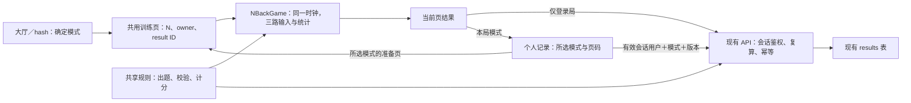

> 由 scope skill 于 2026-11-13 生成
> 状态：已批准 2026-11-13
> 读者：实施 Agent 与审阅者

# 位置＋颜色＋数字 N-back

## 目标

在现有两种 N-back 模式之外，新增同时记忆位置、颜色和数字的第三种模式，让玩家独立判断三个维度，查看综合与分项表现，并单独跟踪私人历史和最佳成绩。

## 决策基线

### 需求决策

- **模式与入口**：训练大厅新增“位置＋颜色＋数字 N-back”独立卡片和准备页；保留“空间 N-back”“位置＋颜色 N-back”的入口、规则和成绩含义。
- **刺激**：九宫格每步只亮起一格，以格子背景表示颜色，格内居中显示一个 1～9 的数字，数字使用清晰的对比色。沿用现有蓝、橙、紫、绿、玫红、金 6 色；位置、颜色、数字同时呈现，留空时三者一并消失。
- **难度与时序**：三路共用 N＝1～5，一局内不变，默认难度沿用现有 2-back。先展示 N 次，不接受输入、不计分，再进行 30 轮有效判断。每步 2.5 秒，其中展示 0.5 秒、留空 2 秒；有效轮的整个窗口均可作答。
- **出题**：三路独立生成，起始 N 个值各自在本维度候选集中等概率选取；有效轮每路以 30% 概率匹配各自 N 步前的值，否则从其余候选值中等概率选取。每局每路都包含匹配与不匹配题，缺少任一类时只重抽该路。不固定匹配总数、同时匹配次数，也不要求八种匹配组合每局全部出现；数字不与格子编号绑定。
- **输入**：位置、颜色、数字分别与各自 N 步前的值比较。提供“位置匹配”“颜色匹配”“数字匹配”三个按钮及 F／J／K 快捷键，支持鼠标、触屏和键盘。同轮可同时或先后标记任意多个维度，不匹配的维度不操作。每轮每路只接受首次输入、不可撤销，互不禁用；长按重复事件不得跨轮作答。按钮仅反馈已标记，不即时提示正误。
- **成绩**：三路各自统计命中、漏报、误报、正确拒绝，并按现有平衡准确率公式计分；综合分取三路未舍入分数的等权平均。结果页展示综合分、三路分数和各自四类次数，显示保留一位小数，最佳比较未舍入综合分。不将三路次数合并成一组 90 次统计。
- **记录与导航**：个人记录增加第三种模式，历史按用户、模式和规则版本读取，最佳在此基础上按 1～5-back 分别比较。结果页进入记录时选中本局模式；记录页训练入口随当前选择变化；普通顶部入口或直接访问记录页默认空间模式。切换记录模式重置分页，旧请求不得覆盖新选择。
- **生命周期与身份**：沿用单调时间推进；未完成局在主动结束、离开、切换训练模式、切后台或锁屏时作废，不能续局或保存。已完成结果不被之后的后台事件撤销。正常开局重新验证身份，离线必须明确选择游客；游客结果不在联网或登录后补传。登录局自动保存，失败只在当前页保留结果供手动重试，不建立持久化离线队列，本局归属不随账号或网络变化。
- **范围限制**：不新增声音、独立分路 N、自定义数字或颜色范围、速度设置、自适应难度、实时正误提示、排行榜或游玩真实性验证；不重新设计现有界面体系，不新增依赖。
- **交付与发布边界**：按仓库 [AGENTS.md](../../AGENTS.md) 和[运维流程](../wiki/operations.md#接入-wheelmaker)执行验证、演练、Git 交付及后续正式发布，正式发布验收完成前不报告整体完成。代码阶段与正式阶段分别建立 Git 上下文；正式部署从已合入并推送的稳定 main 显式执行。本 spec 编写不触发部署或生产数据操作。

### 技术决策

- 沿用现有技术栈，扩展共享 `NBackGame`，三种模式共用时钟、结束、中断和输入去重机制，不另建三路引擎或接口。
- 新模式标识为 `spatial-color-number-n-back`，规则版本为 `1`，hash 入口为 `#triple-n-back`。共享结果合同按游戏标识区分；旧两种模式保持现有标识、版本、字段和规范化结果不变。
- 新结果在现有公共字段外保存必填的 `position: Counts`、`color: Counts`、`number: Counts`。共享规则负责独立出题、统计校验和计分；服务端复算综合分，分项分数从各路统计派生。
- 复用现有 `results` 表、索引、JSON payload 和成绩／历史／最佳接口；历史及最佳的可选 `game` 参数扩展到三种模式，省略时仍查询空间模式。无需数据库迁移，不改写历史记录。
- 成绩归属及查询用户只由有效会话确定，`startedByUserId` 仅为开局身份前置校验。保持 `(user_id, result_id)` 幂等、不同内容冲突拒绝、规范化字段顺序及首次落库时间语义；不保存题目序列或逐步操作。
- 保持同一构建兼容 `/` 与 `/braingym/`，复用运行时基础路径和 PWA 公共资源缓存。新模式随现有前端构建提供，不依赖外部资源，不扩大缓存范围，不缓存 API、身份或私人数据。

## 设计视图

### 功能设计

大厅第三张卡片进入本模式准备页，说明九宫格、6 色、1～9 数字和 F／J／K 操作，再选择 N 开局。沿用当前视觉与页面结构，三按钮在窄屏允许重排，确保标签、已标记状态和触控区域完整可用；数字与六种背景均保持清晰对比。控件提供明确名称、键盘焦点和文字状态，不只靠颜色表达是否已标记。

起始阶段仅记忆，随后三路按钮独立开放。玩家只标记相同的维度；一路标记后另两路仍可操作。留空时不继续显示当步数字、颜色或位置高亮，辅助描述也表示留空，但作答窗口持续至下一步。所有输入进入同一引擎入口，避免键盘、pointer 和 click 重复计入。

完成页显示本模式、N、30 轮三路判断、综合分与三个分项区。游客结果仅本地展示；登录局保存失败时保留原 result ID 和统计，恢复网络且身份正确后可手动重试。“再练一局”回到本模式准备页，“查看个人记录”选中新模式；刷新或离开不恢复待保存结果。

记录页的所选模式同时决定历史、最佳和训练入口。新模式历史清楚区分三路分数及次数，最佳卡片按综合分比较；切换模式或账号清理旧数据显示，并让过期请求失效。现有加载、失败重试、空列表、分页与账号切换行为继续适用，记录表内部滚动不应造成整页横向溢出。

### 技术设计

#### 整体方案

训练页拥有本局模式、N、owner、result ID 和当前页结果；引擎只拥有内存刺激序列、时间索引、分路作答集合及最终统计，不管理网络或认证。共享合同明确区分单路、双路、三路结果，出题、结果构造、校验、计分和渲染必须按启用维度处理，不能继续把“非空间模式”一律当成双路。

服务端解析支持的游戏与版本，验证并规范化该模式的字段，再由共享规则复算和现有事务落库。读取仍同时限制用户、游戏和版本，游戏参数不授予身份。原两种结果的规范化字段及顺序保持兼容，避免升级后相同重试被误判冲突。

#### 关键结构

| 结构 | 合同与边界 |
| --- | --- |
| 三路刺激 | 每步包含 `cell`（0～8）、`color`（0～5）、`number`（1～9）；三路序列按步组合，数字值与位置索引独立。 |
| 引擎输入与快照 | 维度扩展为 `position`、`color`、`number`，仅接受当前模式启用的维度；快照携带当前刺激与各路已标记状态。旧模式不接受新增维度的输入。 |
| 三路结果 | 公共字段为现有 `resultId/startedByUserId/game/version/n/completedAt`，另含三组 `Counts`；不接受缺路或单组统计冒充三路结果。 |
| 每路校验 | `tp/fn/fp/tn` 均为非负整数、合计 30，且 `tp+fn`、`tn+fp` 均大于零。未知游戏／版本、非法 N／完成时间或任一路非法均拒绝。 |
| 计分 | `BA(c) = 100 × (c.tp/(c.tp+c.fn) + c.tn/(c.tn+c.fp)) / 2`；三路综合分为 `(BA(position)+BA(color)+BA(number))/3`，只在界面显示时舍入。 |
| 模式查询 | `history?page=1&game=spatial-color-number-n-back`、`bests?game=spatial-color-number-n-back`；非法、空或非单值游戏参数返回 400。保留每页 20 条、历史稳定排序和最佳同分排序。 |
| 幂等与兼容 | 同一用户同一 ID 的规范化内容相同则返回原记录，任一路或游戏标识改变均返回 409；仅请求键顺序不同不构成冲突。旧结果仍按原合同读取和计分。 |

#### 实现流程

1. **选择与开局**：hash 确定训练模式，正常开局重新取得当前身份；只有明确的游客操作才允许离线开局。冻结 owner、模式、N 和 result ID 后，独立生成各路完整序列并初始化共用引擎。
2. **记忆与作答**：按单调时间计算当前步和亮起状态，起始展示拒绝全部输入；有效轮将 F／J／K 或按钮映射到对应维度，同一时间索引分路去重。输入一路不改变其他路，时间跳步不补造输入，长按 repeat 不进入后续轮。
3. **结束与清理**：完整结束后一次性形成三组统计和本地分数；中断复用现有作废与帧回调清理路径，不生成可保存结果。训练模式切换重新挂载训练组件，不能携带前一局的序列、标记或异步结果。
4. **保存与重试**：登录局构造该模式 payload，服务端验证有效会话及开局身份、规范化、复算并幂等写入；跨账号、会话失效、统计不合法或内容冲突继续拒绝。响应丢失或网络失败保留当前页结果，由原账户按原 ID 重试；游客始终没有可上传 payload。
5. **记录与返回**：结果入口选择本局模式，普通记录入口选择空间模式；所选模式控制查询与训练目标，切换重置页码并使旧请求失效。服务端按用户／模式／版本查询，不转换、复制或混合旧成绩。

### 预估改动面

- `src/shared/contracts.ts`、`src/shared/rules.ts`：第三种标识与结果联合类型、三路刺激生成、规则分派和等权计分。
- `src/client/game.ts`：数字维度、快照、输入和统计；保留共用时钟和中断语义。
- `src/client/App.tsx`、`src/client/styles.css`：第三张卡片、hash 路由、规则准备页、数字呈现、三按钮、三路结果及记录；必要的窄屏适配。
- `src/server/app.ts`、`src/server/store.ts`：新模式识别、三路校验和规范化、复算与查询选择；不改表或认证机制。
- `tests/`、`tests/e2e/`：新规则与引擎、服务端负向和幂等授权、旧合同兼容、桌面／移动输入、记录导航、PWA 离线与双基础路径；后台中断沿用现有原生 Chromium CDP 验证方式。
- 文档：同步 [README](../../README.md)、[N-back Wiki](../wiki/n-back.md)、[架构 Wiki](../wiki/architecture.md)，在 `docs/verification/` 记录本次实际证据。复用既有发布流程，不因新增模式修改部署定义。

## 验收

- **入口与呈现** → 大厅三张卡片进入各自准备页，新 hash 可直达；新模式范围、时序和操作说明与实际一致。数字仅出现在亮起格内且为 1～9，六种背景下均清晰，留空不残留数字或刺激描述；桌面及移动视口浏览器观察证明。
- **出题** → 所有 N 均生成 N＋30 步，各路范围正确且独立使用 30% 阈值与排除目标后的等概率候选；每路包含两类题，重抽一路不要求改动其他路；固定随机源、候选边界和已知序列测试证明，不以小样本频率代替算法验证。
- **时序与分路输入** → 起始 N 次拒绝三路作答，亮起和留空均可输入；已知序列覆盖零至三项匹配的八种组合，标记任意一路不影响其他路，同轮同时／先后标记均有效。重复点击、混合输入和长按不重复或跨轮计入；引擎测试及 F／J／K、真实按钮浏览器测试证明。
- **统计与分数** → 每路次数合计 30；三路全对为 100、全错为 0、完全不操作为 50；分项不同及先舍入再平均会产生差异的用例仍按未舍入均值保存和比较。客户端、共享规则及服务端结果一致，页面显示一位小数；规则、引擎、API 测试和结果页观察证明。
- **结果校验** → 缺失或畸形任一路、负数／小数／合计错误／分母为零、非法游戏／版本／N／时间均拒绝；伪造客户端分数不能影响保存。逐路负向测试及合法三路保存测试证明。
- **授权与重试** → 匿名、过期／撤销会话不能访问私人记录或保存，换发／吊销 Token 后旧会话失效，跨账号无法重试保存原用户结果或读取对方数据；相同结果重试只保存一次且首次落库时间不变，仅键顺序变化可重试，更改任一路或跨模式复用同一 ID 返回冲突。隔离数据库服务端测试及响应丢失、手动重试、跨标签页账号切换浏览器测试证明。
- **记录与导航** → 三模式历史和各 N 最佳互不混合，综合与三路分项展示完整；结果进入记录选中本局模式，记录页各训练入口进入所选模式，普通入口仍默认空间模式。切换后分页重置，慢响应和账号变化不会覆盖当前选择；有记录／空列表浏览器测试与服务端查询测试证明。
- **旧合同兼容** → 已有单路、双路 payload、保存重试、历史读取、分数和最佳含义不变，省略 `game` 仍查空间模式；非法或重复游戏查询参数拒绝，旧模式不能接受数字输入。使用升级前格式的数据及请求验证，无 schema 迁移或历史改写；兼容性测试与既有测试集证明。
- **中断** → 时间跳步仍由单调时间推进；未完成局主动结束、离开、切换训练模式、后台或锁屏后不保存且不能续局，已完成结果不被后台撤销；引擎、路由及原生 Chromium CDP 后台验证证明。实际手机和锁屏未实测时明确列为未验证，不以模拟事件代替实机证据。
- **离线与结果保留** → 公共外壳缓存完成后，离线可打开第三种模式、显式选择游客并完成；恢复网络或登录不补传。登录局保存失败可留在当前页恢复网络后手动重试，刷新／离开不恢复结果；真实 Service Worker 浏览器验证、请求与存储观察证明，私人数据及待上传结果不写入 Cache Storage、localStorage 或 IndexedDB。
- **移动与可访问控件** → 窄屏九宫格、三按钮、模式选择和结果均可操作，无标签截断或整页横向溢出；同轮多点触屏可独立标记三路，键盘焦点与已标记文字状态可辨认；移动视口、多点触屏和键盘验证证明，并注明模拟与实际设备的覆盖差异。
- **路径与安全** → 同一构建在 `/` 和 `/braingym/` 下训练入口、资源、API、Cookie 与 PWA 正常；来源校验、会话边界、安全头、回环绑定和打包排除规则不放宽，无新增外部依赖或私人信息暴露；HTTP、浏览器回归及实际 diff 安全审查证明。
- **验证门槛** → 依次通过 `npm run typecheck`、`npm run build`、`npm test`、`npm run test:e2e`；对同一构建设置 `$env:E2E_BASE_PATH='/braingym/'` 后再运行 `npm run test:e2e`，最终用 `Remove-Item Env:E2E_BASE_PATH` 清理，构建与运行时测试不并行。测试及手动脚本显式使用隔离数据库，不操作默认账户库；实际变更相关依赖时追加 `npm audit --json` 并评估可达性。
- **演练与正式交付** → 使用既有 `npm run rehearse` 准备有效候选，将输出的候选目录赋给 `$releaseCandidate`；代码验证后合入并推送 main，从稳定 main 按现有 `npm run release -- deploy --candidate $releaseCandidate` 和 `npm run release -- status` 完成正式部署及在线验收，保持既有数据库、用户、Token、会话和历史。定义未变不 Reload，正式数据库不写测试身份或成绩；保存候选／程序一致性及实际发布验收证据，未通过不报告整体完成。
- **文档与审查** → README／Wiki 与实际功能一致，验收文档区分已验证与未验证；按实际变更输出中文 Findings、Verification、Residual Risk，并扫描入口、凭据与临时产物。本 spec 阶段仅检查文档，不把计划中的应用验证记为已通过。
