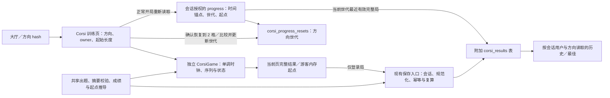

> 由 scope skill 于 2026-11-14 生成
> 状态：已批准 2026-11-14
> 读者：实施 Agent 与审阅者

# 顺序记忆：Corsi 方块

## 目标

在 BrainGym 中增加与持续匹配判断不同的顺序记忆训练，让玩家在九宫格中正序或倒序复现空间序列，以成功复现的长度观察个人表现，并根据上一局表现自动确定下局起点。

## 决策基线

### 需求决策

- **入口与方向**：大厅新增一张“顺序记忆 · Corsi 方块”卡片，进入准备页选择正序或倒序；正序按展示顺序复现，倒序按相反顺序复现。两方向分别记录成绩、最佳和下局起点，准备页显示各自的起点与最佳。使用现有固定九宫格，支持鼠标、触屏及数字键；不重做既有界面体系。
- **长度与出题**：每个方向首次从 2 格开始，一局内每通过一级增加 1 格，不设玩法长度上限，也不因超过九格而结束。每个长度固定两题，使用不同序列；每题第一步从九格等概率选择，后续每步从上一格之外的八格等概率选择，允许隔位重复，不允许相邻两步相同。
- **展示与复现**：每步计划亮起 500 ms、留空 500 ms，最后一步同样完成留空后才开放作答；速度固定，不允许提前作答。作答不限时，只反馈已输入数量和按下的格子，不提示逐步正误、不给出已输入序列，也不能撤回。点满本题要求的次数后自动整体判定，所有位置与顺序都正确才算答对；“记不住了”直接将本题判为失败，不要求补满输入。
- **题间与结束**：每级两题都必须完成，不因第一题答对而跳过第二题；至少一题答对便升级，两题都错则整局结束。非末题结束后显示本题对错与本级进度，由玩家点击“下一题”继续，不重播答案。末题结束进入结果页，同时说明本题失败、本级两题均未通过及整局结果。
- **正式成绩**：取本局至少一题答对的最高长度，单位为“格”，不换算为百分制或脑力总分。整局没有答对任何题时显示“未通过起始 X 格”，内部以 0 表示没有通过长度，仍可保留该完整失败局的历史，但不计入最高通过长度的最佳记录。两方向各有一项最高通过长度最佳，不按起始长度另分榜；同成绩沿用首次入库较早、再按结果 ID 的稳定选择方式。
- **下局起点**：只参考同一方向、当前进度世代内的上一局。若该局开局第一题失败，下局从该局起始长度减 1 开始，最低为 2，此规则优先于后续表现；否则取该局“每个长度第一题就答对”的最高长度。下局不能根据正式成绩或最高挑战长度代替上述计算，不提供任意选择起始长度或速度的设置；仅提供下述显式恢复到 2 格的例外。
- **账号与保存**：登录用户以服务端最近成功保存且时间有效的完整局推导起点，刷新及换设备后生效。“最近”按服务端时间锚定的完成时间倒序，完成时间相同按首次入库时间倒序、再按结果 ID 倒序确定；迟到旧局只增加历史，不覆盖较新完成局的起点。完成时间、首次入库时间和幂等重试的权威定义见“时间合同”。保存失败仅在当前结果页保留原结果供手动重试，成功前继续沿用服务端既有起点；离开或刷新后不恢复待保存结果。
- **异常起点恢复**：准备页及训练异常提示提供“从 2 格重新开始”，明确说明只重置所选方向的进度、保留历史和最佳，确认后执行；不自动截短序列或降低起点。登录用户的恢复跨设备生效，通过进度世代隔离重置前已开局或尚未上传的结果：这些结果仍可保存历史和参与最佳，但不再决定当前起点。游客只重置当前页面对应方向的内存起点。重置失败或结果未知时显示可重查状态，不假定已生效，正常开局仍重新读取服务端进度。
- **运行资源与展示异常**：不设固定玩法长度上限，也不以固定格数替代资源检查；极端长度不得造成巨量同步预分配或不可取消的生成循环。生成／存储／索引或时间表示无法安全继续时，整局作废、释放资源并说明原因，不计成绩、不自动降级，可退出并使用起点恢复入口。展示异常的判废阈值见“展示交付合同”；它只判定呈现是否有效，不改变固定速度或引入总时限。
- **游客**：两方向的起点仅保存在当前浏览器文档的内存中，当前页面内再次训练及切换方向时可复用，刷新或新开页面后均从 2 格开始。游客不保存私人历史或最佳，准备页说明登录后可查看最佳；游客结果和起点不在登录后补传，也不影响账号进度。
- **身份与中断**：正常开局重新取得有效身份与本方向起点并冻结本局归属、方向和起始长度；离线或网络校验失败时必须明确选择游客，不能使用缓存账号的私人起点开局。主动结束、离开、切换训练方向、切后台或锁屏使未完成局作废，不保存、不更新起点、不能续局；题间等待也属于未完成局。已完成结果不被之后的后台事件撤销。
- **范围与交付**：保留既有三种 N-back 的入口、规则、版本和成绩含义；不增加声音、练习模式、答案回放、逐步提示、排行榜、临床解释或训练收益承诺，不新增依赖、认证 provider、遥测或持久化离线队列。沿用既有演练、Git 交付及正式发布流程，正式验收完成前不报告整体完成；本 spec 审阅阶段不实施或操作正式环境。

### 技术决策

- 沿用 TypeScript、React、Fastify 与 Node SQLite；新增独立 Corsi 内存引擎和共享规则，不把 Corsi 并入 `NBackGame` 的维度、计时或平衡准确率逻辑。公共游戏标识区分 N-back 与 Corsi 子类型，避免现有“非空间模式即多路 N-back”的分支误处理新结果。
- 两个游戏标识为 `corsi-forward`、`corsi-backward`，各使用规则版本 `1`。`#corsi` 默认进入正序准备页，`#corsi-backward` 进入倒序准备页；它们对应同一张大厅卡片，方向切换与记录返回可恢复正确目标。
- 前后端共用 Corsi 摘要校验、成绩与起点推导。只保存常量规模的整局摘要，不上传或持久化题目序列、逐步输入和逐级日志；请求体继续受现有 8192 字节上限保护，不以数组或请求体长度间接限制可挑战格数。数字必须为可精确计算的非负安全整数，并验证派生值不溢出，不引入人为的玩法长度档位上限。
- 在同一数据库追加 `corsi_results`、`corsi_progress_resets` 及所需索引，不重建或放宽既有 `results.n BETWEEN 1 AND 5`，不改写旧 payload、分数或数据。前者保存成绩，后者只保存各用户／方向／规则版本的当前进度世代和最后重置时间，不保存可被旧结果覆盖的起始长度。附加表作为兼容扩展初始化，核心 `PRAGMA user_version` 保持 `1`，旧程序可忽略附加表；用升级、旧程序重新打开和再次升级验证兼容。扩展初始化须原子完成且可重复。
- 复用 `POST /api/results`、按游戏选择的历史和最佳接口；新增只读 `GET /api/corsi/progress`，一次返回有效会话用户、`serverNow` 及两个方向的起点、进度世代和最佳概览；新增 `POST /api/corsi/progress/reset` 接受方向、预期用户及世代，以身份前置校验和比较并更新方式执行恢复。起点从当前世代最近的有效已保存结果推导，最佳和历史跨世代保留。所有路径由既有运行时基础路径构造，恢复接口沿用会话授权、Origin 校验和请求体限制。
- 登录局完成时间由开局 progress 响应的服务端 UTC 时间与客户端单调经过时间生成，不使用设备墙上时钟。服务端对首次保存施加未来时间容差，读取进度时排除既有异常未来记录；详细边界及重试次序见“时间合同”，不改动 N-back 的时间合同。
- 保持有效会话授权、`startedByUserId` 前置校验、Origin 校验、规范化、服务端复算与事务。现役程序在旧表与 Corsi 表之间统一检查同一用户的 result ID，维持跨模式的 `(user_id, result_id)` 幂等／内容冲突语义；旧三种请求的规范化内容及字段顺序保持不变。
- 复用 PWA 公共资源缓存和离线游客入口，不缓存 API、身份、私人记录、起点、时间锚点、世代或待保存数据。发布数据指纹在两张附加表存在时分别覆盖其存在性及既有记录，兼容尚无附加表的旧库；程序恢复不删除附加表、不回滚数据库。

## 设计视图

### 功能设计

准备页沿用现有卡片、按钮与页面层级，解释正倒序规则、题间流程、成绩和自适应起点。两个方向的账号数据读取失败时明确显示错误与重试，不将未知起点显示为已确认的 2 格；只有当前世代没有有效完整局时才显示起点 2 格。正常开始时重新读取身份与进度；准备页的旧显示不能直接决定本局起点。显式游客操作改用独立的内存进度。恢复入口始终可从准备页到达，不要求先成功生成异常长度的题目；运行中需先结束作废再恢复。确认文案说明正倒序独立、历史和最佳保留，以及其他设备重置前已开局的结果只影响历史／最佳。

游戏页持续显示方向、当前长度、第 1／2 题以及“请记忆”“请按正序／倒序复现”等阶段说明。九格编号 1～9，按从左到右、从上到下映射数字键，编号只用于定位，不表示序列内容。亮起阶段每步只呈现一格，留空时清除高亮；作答阶段显示已输入数量。按钮提供名称、键盘焦点及按下反馈；正确／错误反馈包含文字，不只使用颜色。

序列准备期间显示准备状态并可取消，准备完成且视图就绪后才开始展示时钟。资源不足或展示无效时显示“本局未计入，起点未改变”及具体原因，提供返回准备页／恢复起点入口；不能把系统故障记作答错、给出低分或自动修改账号进度。取消准备、作废和重置均使旧任务与迟到回调失效。

在同一级完成第一题后，界面说明还有第二题；第一题失败不等于立即结束整局。第二题后按本级两次结果升级或结束，进入下一长度时重新生成题目。玩家点击“下一题”才启动下次展示；展示期间不开放作答或“记不住了”。结果页显示正式成绩或未通过说明、起始长度、首题答对最高长度、起点及保存状态；明确区分“本局建议起点”与“账号当前起点”，保存失败或当前起点未读到时，不能将建议值伪作已生效的账号当前值。

登录后的个人记录增加 Corsi 正序、倒序选择，分别展示一项最佳和分页历史；历史列出完成时间、起始长度、最高通过长度、首题答对最高长度及本局推导的下局起点。历史行的下局起点是该局的推导值，不能冒充当前账号起点。结果进入记录时选择本局方向，记录训练入口进入对应准备页；普通记录入口继续默认空间 N-back。切换方向、游戏或账号清理旧数据与分页，使旧异步响应失效。

### 技术设计

#### 整体方案

训练页拥有本局身份、方向、起始长度、进度世代、时间锚点、result ID、保存状态和结果；引擎拥有当前题序列、输入索引、每级两次对错、累计摘要与终态，不负责网络或认证。引擎不保存整局逐题日志；跨级释放不再使用的序列，题目按需生成，不预先创建一个有上限的整局题库。同长度第二题与第一题不得相同。生成与分配每个工作批次最多处理 256 步，未完成时交还事件循环并在继续前检查取消状态；长度不直接作为巨量数组预分配指令。资源／表示能力不足时走可取消的作废路径，不悄悄截短、替换题目或自动重试巨量任务；批次大小不限制可挑战的总格数。

引擎按单调时间安排当前亮起步和亮／空状态，结合视图提交回执检查漏展示，不能只按绝对时间索引跳到后续步骤。所有输入走统一的阶段及数量校验入口。正序比较当前输入与原序列同位置，倒序比较与镜像索引位置；记录本题是否仍可能完全正确，点满次数后才公开结果。键盘长按 repeat、展示期间输入、反馈期间输入及已经判定后的迟到事件不产生新作答；pointer 与 click 不能重复计数。一次独立点击算一步，不用 N-back 的“同一时间步只允许一次匹配”机制吞掉连续点击。

服务端不验证浏览器实际展示或游玩真实性，保持现有信任模型；校验摘要的可达性与内部一致性，再复算派生值。完成时间使用下述服务端锚点，不接入外部时间服务或新增反作弊系统。已开局后另一个设备完成训练，不改变本局冻结的起点，也不能导致保存时因“当前起点已变”而拒绝原本合法的结果；另一设备重置进度时，旧世代完整结果仍可保存，但只进入历史和最佳。

#### 关键结构

| 结构 | 合同与边界 |
| --- | --- |
| 游戏类型 | `NBackGameId` 仅包含现有三种模式，`CorsiGameId` 包含正序与倒序；公共 `GameId` 覆盖二者。N-back 维度、结果和分数函数仍只接受适用类型。 |
| Corsi 请求 | 公共字段为 `resultId`、`startedByUserId`、`game`、`version`、`completedAt`；另带开局冻结的 `progressEpoch`，摘要字段为 `startLength`、`failedLength`、`firstTrialCorrect`、`maxFirstTryLength`。不使用 `n`、TP／FN／FP／TN 或客户端分数。 |
| 摘要含义 | `failedLength` 为最终两题均失败的长度；所有先前长度都已完成两题且至少答对一题。`firstTrialCorrect` 只表示整局开局第一题是否正确；`maxFirstTryLength` 为本局每级第一题答对的最高长度，无此长度时为 0。 |
| 摘要校验 | 长度为安全整数且 `failedLength >= startLength >= 2`；`maxFirstTryLength` 为 0 或位于 `[startLength, failedLength - 1]`。若首级即失败，首题必须错误且最大首题通过长度为 0；首题正确则必须已通过首级，最大首题通过长度不小于起点；首题错误时最大首题通过长度不能等于起点。布尔值、游戏、版本、ID、时间及所有派生数均按类型和范围验证。 |
| 正式成绩 | `span = failedLength === startLength ? 0 : failedLength - 1`；界面将 0 显示为未通过，最佳只选 `span > 0` 的记录。完整局题数为 `2 × (failedLength - startLength + 1)`，不逐题持久化。 |
| 下局起点 | `nextStartLength = firstTrialCorrect ? maxFirstTryLength : Math.max(2, startLength - 1)`。由同一共享规则在本地展示与服务端推导，不接受客户端给出的起点计算结果。 |
| 保存响应 | 在规范化请求上返回 `score`、`nextStartLength`、`receivedAt`；其中 `score` 就是整数 `span`，不是百分制。结果／历史中的 `nextStartLength` 仅代表该局推导值，账号当前起点仍由 progress 查询选择最新结果后确定。 |
| 存储 | `corsi_results` 保存会话用户、结果 ID、游戏、规则版本、进度世代、规范化摘要、复算成绩及完成／首次入库时间；历史／最佳按用户、游戏、版本收敛，最新进度还限定世代。`corsi_progress_resets` 以用户、游戏、规则版本为键保存当前世代及最后重置时间，缺少行视为世代 0。核心旧表和旧 JSON 不变。 |
| 读取 | `corsi/progress` 返回用户、`serverNow` 与两方向概览，各含 `progressEpoch`、起点及最佳；当前世代无有效完整局时起点为 2，最佳为空时显示无通过记录。`history?page=1&game=corsi-forward` 等复用每页 20 条及稳定排序，跨世代保留历史；`bests` 对每个 Corsi 方向跨世代返回最多一项最佳。省略 `game` 仍查询空间模式，非法／重复参数拒绝。 |
| 恢复请求 | `corsi/progress/reset` 接受 `game`、确认恢复时的 `expectedUserId` 和非负安全整数 `expectedEpoch`。用户由会话决定，预期用户仅为身份前置条件，不一致返回 409 且不重置；不能把它作为授权用户。事务中若预期世代等于当前值，则安全加 1 并记录服务端重置时间；不匹配返回 409，不重复重置，客户端先重查再决定是否重新确认。成功返回用户与最新概览；不接受任意起始长度。 |
| 保存与冲突 | 同一事务中检查旧表及成绩附加表的 ID 占用；同用户同 ID、同规范化内容返回原结果，方向、游戏、世代或摘要变化返回 409，不重新产生入库时间。新结果的世代必须是非负安全整数且不大于当前世代；旧世代可写历史但不能参与当前起点。分数与本局建议起点均由服务端推导。 |
| 隔离与兼容 | 全部 Corsi 查询以有效会话用户、方向和规则版本收敛；客户端 user ID、方向切换和 UI 隐藏不授予权限。新增表以外的数据、Cookie、来源校验、基础路径和托管协议保持原合同。 |

#### 时间合同

- progress 响应中的 `serverNow` 是该响应生成时的服务端 UTC 毫秒值。客户端收到正常开局响应时记录 `performance.now()` 为 `anchorMono`，冻结该响应时间与本局身份、方向、世代；完整结束时以 `new Date(serverNow + Math.floor(completionMono - anchorMono)).toISOString()` 生成 `completedAt`。准备／游玩中的设备日期修改不影响它；不得改用 `Date.now()`、旧准备页时间锚点或重试时重新取时。
- 服务端将“严格 UTC 格式且不晚于首次入库时服务端时间加 5000 ms”作为新结果的时间有效条件，不设过去时间截止以容纳延迟保存；超出容差返回 400，不写入、不更新进度。先规范化并匹配既有 result ID：相同已保存请求直接返回原记录，不因重试时钟变化重新判时或改写时间；不同内容仍按冲突拒绝。未保存请求重试沿用原 ID、摘要、世代和完成时间。
- 最新起点查询排除 `completedAt > receivedAt + 5000 ms` 的既有异常记录，以不可变首次入库时间比较，不随着当前时间流逝让异常记录重新生效。该记录仍保留历史、原值和复算成绩，历史标注完成时间异常；不静默重写、删除或自动回滚数据。若当前世代没有合格记录，起点为 2；用户也可显式恢复进度。最佳长度不因仅有时间异常而删除。
- 服务端锚点消除设备墙上时钟偏差，开局响应的传输时延仍可能造成排序误差，不声称提供严格全局物理时钟排序。保留按锚定完成时间和既定同值规则选最近局，不改成按上传先后；正式宿主时钟的正确性仍是运行前提。

#### 展示交付合同

- 亮起／留空的计划时长仍各为 500 ms，以首个亮起相位实际提交视图时建立本题单调时间基准；序列准备耗时不消耗展示时间。每个亮／空相位均须有本题对应的视图提交回执，含最后一个留空相位，才允许完整进入复现。
- 相位跳号而中间相位没有提交回执，或任一亮／空边界及进入复现的提交相对计划时间延迟超过 100 ms，立即作废整局；等于 100 ms 尚在容差内。100 ms 是展示有效性的调度容差，不是新速度或额外作答时间；不能补播、压缩间隔或跳过刺激后继续计分。检测后先作废再处理输入，展示期排队输入不得变成有效作答。
- 帧回调与视图提交反馈共同检查上述条件，不能仅由引擎快照推断每步已显示；前台阻塞、React 提交延迟和恢复后的首次回调都需覆盖。回执证明 DOM／视图已提交，不宣称能验证操作系统最终像素呈现或实际屏幕精确时长。后台／锁屏仍按原有立即作废规则处理。

#### 进度世代与恢复

世代只在用户显式恢复时增加，成绩写入不能增加或覆盖它。起点查询先取得当前世代，再在同用户／方向／规则版本／世代的时间有效结果中选择最近完整局。历史和最佳不按当前世代过滤；重置前已开局的结果携带原世代，即使更晚完成或上传也不恢复旧起点。正倒序各自维护世代，恢复不影响另一方向、用户、Token 或会话。

恢复请求同时冻结确认时的用户与世代，避免跨标签页换账号误重置另一账号，也避免响应丢失后盲目重复 POST 再清空一轮新进度。发生网络错误或 409 时先只读重查；读到新世代后展示当前真实状态，不能把未知结果标为成功、使用旧起点开局或自动再次递增。若用户仍需恢复，应基于读到的新用户／世代再次确认。账号变化与旧查询响应继续按既有身份及请求失效规则处理。

起点与成绩必须覆盖以下例子，不能将两个指标混算：

| 本局表现 | 正式成绩 | 下局起点 |
| --- | --- | --- |
| 从 4 格开始；4 格首题对，5 格首题错但第二题对，6 格两题都错 | 5 格 | 4 格 |
| 从 5 格开始；开局首题错但第二题对，6 格首题对，7 格两题都错 | 6 格 | 4 格；开局降级优先 |
| 从 5 格开始，两题都错 | 未通过起始 5 格，内部 0 | 4 格 |
| 从 2 格开始，两题都错 | 未通过起始 2 格，内部 0 | 2 格 |

#### 实现流程

1. **准备与开局**：大厅进入对应准备页，读取两个方向的账号概览或游客内存起点。正常开始重新请求 `corsi/progress`，根据响应用户确定 owner，取所选方向最新起点，冻结 result ID、方向、世代和时间锚点后可取消地准备第一题；账号变化使旧显示及异步请求失效。身份请求或序列准备完成时再次检查页面可见性与任务有效性，作废后的响应不能启动展示。失败显示可重试错误，显式游客才改用游客内存起点，不静默降级。
2. **展示与复现**：准备与视图就绪后建立本题展示基准，逐相位提交并核对展示交付合同，最后留空有效完成才开放复现。资源不足、相位漏交付或超过延迟容差均直接作废；不得继续生成可计分结果。每次独立输入仅推进一个索引，累计整题正误但不提前公开；输入完成或主动选择记不住时只结算一次。
3. **题间与升级**：第一题记录本级首题表现及必要的最大值后进入反馈；点击下一题才生成不同的第二题。第二题结束时通过则等待手动进入下一长度，否则冻结最终摘要，登录局按时间合同生成完成时间。不存在最高长度通关分支。
4. **中断与清理**：展示、复现及非终局反馈阶段均可作废；取消帧回调、撤销监听并使未完成引擎失效，不能形成可保存结果。完成后只清理运行资源，不撤销已完成结果。方向／路由切换必须清理前一局，不能携带其序列或迟到事件。
5. **保存与起点**：游客完整结束后只更新对应方向的页面内存起点。登录局按原 ID 自动保存，服务端先处理幂等／冲突，再对新结果校验时间和世代、复算并事务落库；失败保留当前结果以手动重试，账号起点保持原值。成功保存后重新查询当前世代的最新进度，而非直接把本次推导值覆盖为账号当前起点；若本局已属旧世代，说明成绩已保留但不改变恢复后的起点。若保存成功但进度刷新失败，仍标记成绩已保存，只重试进度查询，不伪报保存失败或另建结果。
6. **记录与返回**：结果跳转选中本方向的记录，训练按钮返回本方向准备页。服务端按用户／方向／版本返回历史与最佳，Corsi 页面使用格数和未通过说明渲染；N-back 页面继续使用原难度和百分制。方向／账号／分页切换使旧响应失效。
7. **恢复与重开**：异常退出或准备页可确认从 2 格重新开始。游客只更新本方向内存进度；登录用户发送带预期用户／世代的恢复请求，服务端先校验身份再事务递增世代，客户端按成功响应或重查结果更新显示。重开仍重新读取进度与时间锚点；恢复前的任务、查询与旧结果不得覆盖新状态，原历史及最佳保留。

### 预估改动面

- `src/shared/contracts.ts` 及新增 Corsi 共享规则模块：两方向标识、结果联合类型、时间／摘要／世代校验、成绩／起点推导、展示交付判定与出题。既有 `rules.ts` 保持 N-back 合同，公共分派按游戏族收敛。
- `src/client/`：新增独立 Corsi 引擎及训练组件；有界可取消的序列准备、时间锚点与视图回执、异常提示及恢复入口；`App.tsx`、`styles.css` 按需接入卡片、路由、记录与游客内存起点，不将整套 N-back 页面泛化重写。
- `src/server/app.ts`、`src/server/store.ts`：两张附加表初始化、独立结果规范化与保存分派、跨表 ID 冲突、按游戏／世代读取、时间有效性及 progress 查询／恢复；复用认证和来源策略。
- `scripts/release/files.ts` 及直接相关发布验证：两张附加表存在性／数据指纹兼容，覆盖成绩及恢复世代；证明旧库可升级、既有记录持续受保护、旧程序恢复不丢数据。
- `tests/`、`tests/e2e/`：规则和状态机、起点与计分、设备时钟偏差、异常长度可取消／恢复、世代竞争、漏展示、存储兼容、鉴权与幂等、UI／移动输入、账号和方向切换、离线与双路径、真实浏览器后台中断；测试身份与数据始终隔离。
- 文档：更新 README；新建 `docs/wiki/corsi.md`，更新 `docs/wiki/architecture.md` 与 `docs/wiki/operations.md`；在 `docs/verification/` 记录本次证据。实施后按实际变更复核 wiki 目标，不改写 N-back 规则。

## 验收

- **入口与方向** → 大厅只有一张 Corsi 卡片，两 hash 可进入正确方向；准备页显示独立起点与账号最佳，结果／记录／训练间返回方向正确，普通记录入口仍为空间模式；桌面与移动浏览器观察及端到端测试证明。
- **随机序列** → 第一格有九个等概率候选，其后每步有八个且排除前一格；允许非相邻重复，长度 10 及更长正常生成，同级两题不同；固定随机源与边界测试证明算法，不用少量抽样频率代替验证。
- **展示时序** → 无调度延迟的时钟测试中，每步在 0～499 ms 亮起、500～999 ms 留空，最后一步留空有效完成才进入复现；展示期间及留空不能提前输入，序列结束后不限时。调度延迟和时间跳步按展示交付合同判断，不以跳索引继续作答代替漏展示处理；单调时钟边界／提交回执测试与浏览器观察证明。
- **整题输入** → 正序及倒序对同一已知序列分别采用正确索引，点满才公开结果，任意一步错误导致整题失败但不提前终止或提示；只显示输入数量，不能撤回，“记不住了”将未输入或部分输入的本题计为一次失败；规则／引擎及真实按钮、数字键测试证明。
- **输入去重与可访问性** → 鼠标、触屏、数字键和可聚焦按钮均可作答；一个物理操作只计一次，长按 repeat、混合 pointer／click、超量或反馈期迟到事件不跨题输入。编号、方向、阶段和反馈有清晰文字，窄屏无整页横向溢出或不可触及的控件；键盘、移动视口及触屏测试证明，并区分模拟与实际设备。
- **升级与反馈** → 每级固定两题，首题对仍做第二题，两题均错才结束；至少一题对时点击下一题进入长度加 1 的挑战，非末题不自动开始、不回放答案。已知序列与各对错组合覆盖，并验证至少跨过 9 格后继续，不能被 1～5-back 范围或九格数量截断；引擎和浏览器测试证明。
- **正式成绩与起点** → 上述四个例子逐项成立，最高通过、最高首题通过及最高挑战长度不混用；起点最低 2，开局首题失败的降级规则覆盖后续成功，未通过局保存内部 0 但不进入最佳；前端共享规则、服务端复算及结果／记录 UI 测试证明。
- **账号进度** → 两方向及不同账号互不影响，首次或当前世代无合格完整局时为 2；刷新、重新登录、另一浏览器上下文读取到一致的起点与世代。当前世代中完成时间较旧的结果迟到不改变最新起点；相同完成时间按规定稳定排序，幂等重试不重排入库时间；服务端及多上下文浏览器测试证明。
- **设备时间与延迟保存** → 设备墙上时钟快／慢一天，或游玩中修改日期，完成时间仍按本次开局服务端锚点加单调经过时间生成；锚定完成时间较旧的局延迟上传不覆盖较新局。新结果的完成时间等于首次服务端入库时间加 5000 ms 可接受，超过 1 ms 则返回 400 且不写入／改进度；过去时间不因保存延迟拒绝，重试不得重新取完成时间或入库时间。隔离服务端时钟、客户端墙上时钟与单调时钟分别可控的规则／HTTP／浏览器测试证明。
- **既有异常时间** → 隔离库注入完成时间晚于其首次入库时间一天的 Corsi 记录，进度查询忽略它，正常设备后续完整局可更新起点；即使服务端当前时间后来越过异常完成时间，该记录仍不重新参与起点。历史保留原值、异常标记及长度成绩，最佳不因仅有时间异常被删除；存储测试与记录页观察证明，不改写正常数据或 N-back 时间语义。
- **异常长度与资源失败** → 构造起始／失败长度均为 `4294967298`、首题错误、最高首题通过长度为 0 的安全整数摘要，下局推导值仍为 `4294967297`，不得用固定格数静默截断。读取或准备该起点时不发生巨量同步预分配，工作批次有界、可取消，控件与导航保持可操作；受控注入生成／存储／数值表示失败时整局作废、无结果上传且原进度不变，可返回准备页恢复起点。以资源调用计数、可取消任务及故障注入测试证明，不真正分配巨量内存或等待超长展示；正常长度跨过 9 格继续的验收仍保留。
- **恢复与旧局隔离** → 明确确认后只将所选方向切换到新世代并从 2 格开始；账号跨设备生效，游客仅影响本页面，两方向及其他用户互不影响，原历史／最佳不减少。重置前已开局的旧世代结果在重置后完成或迟到上传，仍可保存历史／最佳但不能改变新世代起点；新世代首局继续按已确认公式推进。服务端与多上下文浏览器测试证明。
- **恢复竞争与响应丢失** → 恢复请求的预期世代匹配时只递增一次；响应丢失后重查、或用旧预期世代重试，不能再次清空新世代训练进度，后者返回 409。重查失败保持未知状态，不宣称成功、不沿用旧起点开局，也不盲目重复 POST；再次恢复须基于最新世代重新确认。未来／负数／非安全整数世代拒绝，旧查询及旧任务不能覆盖新显示；事务、网络故障及浏览器测试证明。
- **保存失败与游客** → 登录局保存失败、响应丢失、原 ID 重试的行为正确，失败前不更新服务器起点，成功后按真正最新局刷新；已保存但进度刷新失败时保持已保存状态，不能以本局建议值冒充当前值，重试查询不重复保存。游客页面内两方向起点可各自复用，刷新重置 2，登录后不补传或使用游客起点。离开／刷新不恢复待保存结果；浏览器网络故障、请求和存储观察证明。
- **认证与数据授权** → 匿名、过期／撤销会话不能查询 progress、私人历史／最佳、保存或恢复进度；换发／吊销 Token 后旧会话失效，跨标签页换账号不能将原结果写入新账号、误重置另一账号进度或显示旧用户起点，确认恢复的预期用户与当前会话不一致时返回 409 且不写入。有效会话决定所有数据用户，篡改 `startedByUserId`、`expectedUserId`、世代或恢复请求不能授予权限，恢复同样要求正确 Origin；隔离数据库服务端负向测试和跨账号浏览器验证证明。
- **摘要与请求安全** → 畸形类型、非法游戏／版本、非整数／非安全整数、非法时间、非法区间、首题布尔与最高首题长度矛盾、派生值溢出及超大请求拒绝；不信任客户端分数或建议起点。结果摘要大小不随挑战长度线性增加，现有请求体上限及来源校验保持；规则和 HTTP 负向测试证明。
- **幂等与跨表冲突** → 同用户、同 ID、同规范化摘要只保存一次，键顺序改变可重试；摘要、方向、游戏或世代变化及 N-back／Corsi 跨表占用相同 ID 均拒绝，首次入库时间不变。保存成功后即使进度被重置或服务端时钟变化，同一已保存请求仍返回原记录，不重新按首次写入时间规则拒绝；事务、重放及两种写入顺序的服务端测试证明。
- **旧库与恢复兼容** → 使用升级前结构与合法旧记录的隔离库打开新程序，既有用户、凭据、会话、N-back 历史和最佳保持；重复初始化安全，核心版本仍为 1，旧程序可重新打开且不删除两张 Corsi 附加表，再次升级后新旧记录及恢复世代均可读。任一附加表既有数据或存在性受损时保留检查失败，无附加表的首次升级可通过；文件型临时数据库、真实旧版入口与发布指纹测试证明，不操作正式库做模拟迁移。
- **旧模式回归** → 三种 N-back 的输入、版本、分数、payload 规范化、重试、历史和各 N 最佳不变；新标识不进入 N-back 引擎或统计函数；既有测试集及兼容请求证明，不削弱旧测试门槛。
- **中断与完成边界** → 展示、复现和题间等待时主动结束、离开、换方向、后台或锁屏都作废，不上传且不更新起点；完成后后台不撤销结果；引擎／路由测试及现有原生 Chromium CDP 后台方式证明，实际手机锁屏未验证时明确列为未验证，不以模拟事件代替实机证据。
- **前台漏展示** → 无 visibilitychange 的前台主线程阻塞跨过完整亮／空相位、首格之后直接提交第三格、最后留空缺少提交回执、进入复现边界延迟超过 100 ms，均整局作废，不将未展示序列记为答错、不上传且不改变起点。视图提交延迟恰为 100 ms 与 101 ms 分别覆盖容差内／超限，正常帧抖动不重播或压缩序列；作废前排队的输入不能产生结果，完成后卡顿不撤销已完成结果。单调时钟＋提交回执引擎测试及真实前台阻塞浏览器验证证明，不能仅检查快照索引或派发模拟后台事件。
- **PWA、路径与网络边界** → 同一构建在 `/` 与 `/braingym/` 下资源、路由、API、Cookie 与 PWA 正常，含 progress 查询和恢复；缓存准备后离线可显式选择游客完成两方向训练及本地恢复，恢复联网或登录不补传。API、身份、私人起点、世代、时间锚点和成绩不进入 Cache Storage、localStorage 或 IndexedDB；不放宽 CSP、Origin、Cookie、回环绑定或可信代理校验；真实 Service Worker、HTTP 和双路径浏览器回归证明。
- **验证门槛** → 代码提交前依次通过 `npm run typecheck`、`npm run build`、`npm test`、`npm run test:e2e`；同一构建再设置 `$env:E2E_BASE_PATH='/braingym/'` 运行 `npm run test:e2e`，之后执行 `Remove-Item Env:E2E_BASE_PATH`。构建不与运行时测试并行，所有手动／自动测试使用显式隔离数据库；相关依赖实际变化时运行 `npm audit --json` 并评估可达性，不以忽略告警代替修复。
- **演练与正式交付** → 按 [AGENTS.md](../../AGENTS.md) 与[运维流程](../wiki/operations.md#接入-wheelmaker)运行 `npm run rehearse` 准备有效候选，代码通过验证后提交、合入并推送 main；随后从稳定 main 重新建立发布 Git 上下文，将 rehearse 输出的候选目录赋给 `$releaseCandidate`，显式执行 `npm run release -- deploy --candidate $releaseCandidate` 及 `npm run release -- status`，完成正式在线验收。保持现有用户、Token、会话、历史与新增 Corsi 数据，定义不变不 Reload，恢复不回滚数据库；正式库不写测试身份或成绩，未完成不得报告整体完成。
- **文档与安全审查** → README、Corsi／架构／运维 Wiki 与实际实现一致，验收记录只列实际证据并注明未覆盖项；对最终 diff 按 [AGENTS.md](../../AGENTS.md) 执行安全审查，以中文 Findings、Verification、Residual Risk 输出，扫描凭据、真实入口和临时产物。本 spec 阶段仅完成文档检查，不将上述计划中的应用测试或正式验收记为已通过。
