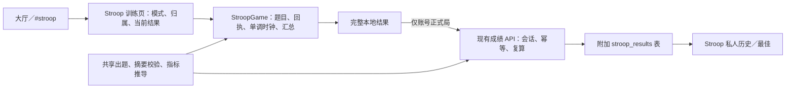

> 由 scope skill 于 2026-11-14 生成
> 状态：已批准 2026-11-14
> 读者：实施 Agent 与审阅者

# 颜色干扰 · Stroop

## 目标

在 BrainGym 中增加颜色干扰训练，让玩家忽略颜色词的字义、选择字体颜色，以准确率和正确反应时间观察本任务中的表现，并能查看自己的历史与最佳成绩。

## 决策基线

### 需求决策

- **入口与操作**：大厅新增一张“颜色干扰 · Stroop”卡片，进入独立准备页。题面使用“红、蓝、绿、黄”四个颜色词及对应字体颜色，始终回答字体颜色。四个作答按钮按红、蓝、绿、黄固定排列，电脑支持鼠标、手机支持触屏；不增加数字键或字母键等专用快捷键，保留原生按钮的键盘可操作性。沿用现有界面体系，不增加难度、速度、题数或颜色设置。
- **正式局**：固定 40 题，其中一致题 10 题、干扰题 30 题，按随机顺序混合。一致题的字义与字体颜色相同，干扰题两者不同。每题从题面提交显示后开放最多 3000 ms 的作答窗口，只接受首次有效回答且不可修改；达到期限仍无有效回答计为超时漏答。
- **单题反馈**：回答或超时后，题面替换为“正确／错误／超时”的文字反馈；答错或超时时同时显示正确颜色。反馈提交显示满 300 ms 后自动继续，期间不接受作答。末题同样反馈，末题判定时即冻结完整结果及完成时间，随后进入结果页；已完成结果不因后续后台事件撤销。
- **热身**：提供可跳过的 8 题热身，按相同规则包含一致题 2 题、干扰题 6 题，使用同一颜色、操作、时限和反馈。热身不计入正式成绩、不调用成绩保存接口、不更新历史或最佳。热身结束可查看本次本地统计，手动开始正式训练或返回准备页；正式局重新生成题目、清零统计并重新确认身份，不自动沿用热身时的身份状态开局。
- **结果指标**：整体及两类题分别展示正确、错误、超时次数、准确率和正确题平均反应时间。准确率为 `100 × 正确题数 / 本组总题数`，整体分母固定为 40，错误和超时均降低准确率；正确题平均反应时间只包含答对的题目，不把答错耗时或超时期限混入。无正确题时相应平均反应时间为 `null`，界面显示“—”。两类题都有正确题时，干扰耗时差为“干扰题正确平均反应时间－一致题正确平均反应时间”，保留正负方向；否则显示“—”。准确率显示一位小数，平均耗时和差值显示整数毫秒，舍入只用于展示，不影响最佳比较。
- **最佳与历史**：同一用户、游戏、规则版本保留一项最佳，先比较整体准确率，高者优先；相同时比较整体正确题平均反应时间，短者优先。仍相同时按首次入库时间升序、结果 ID 升序稳定选择。完整的零正确局仍保存历史；若全部记录均为零正确，按稳定顺序选择最佳并将耗时显示为“—”，不把缺失耗时当成 0 ms。私人历史按模式分页，结果进入记录时选中 Stroop，记录中的训练入口返回其准备页；普通记录入口仍默认空间 N-back。
- **保存与身份**：账号正式局保存分类汇总，游客正式局只在当前结果页展示；不保存或上传逐题题面、选择及耗时日志，不提供逐题回看。正常正式开局重新取得有效身份并冻结归属，网络不可用时需明确选择游客。保存失败可在当前结果页用原请求手动重试；离开或刷新后不恢复待保存数据，游客结果不在恢复联网或登录后补传。
- **中断与完成**：主动结束、离开训练页、切换游戏、切后台或锁屏使未完成的正式局或热身作废，不能暂停或续局；题间反馈也包含在未完成局内。末题判定后已存在的完整结果按上述完成边界保留。过期异步回调不能重启旧局、推进新局或误保存结果。
- **兼容与交付**：保留既有 N-back、Corsi 的入口、规则、版本、成绩及进度语义。沿用游客离线练习、双基础路径、PWA 更新及仓库既有演练、Git 交付、正式发布验收流程。此次审阅只产生 spec，批准前不实施或操作正式环境；不增加排行榜、综合脑力分、训练收益承诺、认证 provider、遥测、持久化离线队列或新依赖。

### 技术决策

- 沿用 TypeScript strict、React、Fastify 和 Node SQLite。新增独立的 `StroopGame`、训练／记录组件和共享规则；不将其并入 N-back 的维度、N 值、TP／FN／FP／TN 或 Corsi 的长度、进度世代逻辑。游戏标识为 `stroop`，规则版本为 `1`，hash 入口为 `#stroop`。
- 浏览器负责出题、题面交付和单调计时；前后端共用摘要校验及指标推导。先按正式／热身配额生成题型并洗牌，每题字体颜色从四种颜色中等概率选择，一致题使用同名词，干扰题从另外三种词中等概率选择。允许颜色或题面重复，不额外固定各颜色出现次数或禁止连续同类题。
- 每题使用独立标识和题面提交回执。以回执时的 `performance.now()` 建立本题起点，反馈也在提交回执后计算持续时间；旧回执及重复回执不能重置时钟。输入入口先按当前单调时间核对期限，再判定是否可作答；恰为 3000 ms 时按超时处理。只推进实际已交付的当前题，不按一次迟到 tick 连续消耗多道未展示题。
- 已接受的正确输入耗时按 `Math.round(输入单调时间－题面提交单调时间)` 转为整数毫秒后累加；合法汇总范围见“关键结构”。测量基于 DOM 提交和浏览器输入处理，不声称是屏幕像素实际呈现或专用实验设备的精度。完成时间仅作历史排序，沿用 N-back 的客户端严格 UTC 完成时间和服务端首次入库时间分离方式，不参与反应时间计算，也不改变 Corsi 的服务端时间锚点合同。
- 同一数据库追加 `stroop_results` 及索引，原子、可重复初始化，核心 `PRAGMA user_version` 保持 `1`。不重建或放宽既有表，不改写旧 payload、分数、起点和世代。扩展公共游戏与结果分派类型，保留现有 N-back、Corsi 专属类型及函数边界。
- 复用 `POST /api/results`、`GET /api/history`、`GET /api/bests`，按 `game=stroop` 分派；省略游戏仍沿用空间模式。保持有效会话授权、Origin 校验、8192 字节请求体上限、规范化、参数绑定、事务和服务端复算。保存事务在三张成绩表之间检查同用户结果 ID，维持跨游戏幂等与冲突拒绝。
- 复用公共 PWA 资源缓存，不缓存身份、私人记录或待保存数据。发布数据指纹在 Stroop 表存在时覆盖其存在性及既有行，兼容尚无该表的旧库；程序恢复保留附加表，不回滚数据库，不改变既有部署绑定、代理或 Hub 定义。

## 设计视图

### 功能设计

大厅卡片进入准备页，说明“选字体颜色，忽略文字”的规则、固定局配置和中断规则，并给出直观示例。准备页同时提供热身、正常开始及显式游客练习路径。热身与正式训练共用题面和按钮布局，但持续以文字标明当前模式及进度，避免将热身误认为可保存正式局。热身结束停留在本地结果，开始正式局时重新执行正常开局或显式游客流程。

训练区突出单个颜色词，按钮始终保持相同顺序和位置，窄屏按两列排列，按钮以文字标明颜色。刺激颜色与承载背景须易于区分并具备可读对比度，黄字不能直接使用白底上难以辨认的浅黄色；具体色值随既有视觉系统选定并实际验证。反馈包含文字，不只使用红绿颜色；按钮具有可访问名称、可见焦点和足够触控尺寸，既不添加答案型专用快捷键，也不移除原生键盘操作。

题面就绪前和反馈期间锁住回答入口；只在当前题展示有效且未过期时接受一次选择。错误及超时展示正确颜色后继续，不能重答或回到上一题。退出或后台中断返回明确的作废状态与重新开始入口，不将未完成局包装成低分结果；完整结果仅在当前页面保留，末题后的后台事件不将其作废。

结果页先展示整体准确率与正确题平均反应时间，再用一致／干扰两类统计对比及有方向的耗时差解释本局表现；不将负差强行截为零，也不把缺失数据解释为零耗时。账号结果显示保存中、已保存或失败可重试状态，并可进入 Stroop 私人记录；游客和热身结果明确说明不保存。私人记录展示同样含义的汇总、最佳和分页历史，切换模式或账号时重置分页、清除旧数据并使旧请求失效。

### 技术设计

#### 整体方案

训练组件拥有热身／正式选择、开局身份、结果 ID、完整结果、网络任务及保存状态；引擎拥有本局题目、当前题和相位、单调时间起点、单题首次输入状态以及分类汇总，不处理网络或身份。共享规则是生成和统计合同的唯一来源。正式与热身创建不同引擎实例，结束、取消和卸载释放运行资源并使旧实例回调失效。

引擎通过“等待题面提交→可作答→等待反馈提交／反馈→下一题或完成”推进。每个题面及反馈都有可识别回执；尚未交付的相位不开始其时钟。提前输入、反馈期输入、重复回执及过期题目的输入不改变结果。鼠标与触屏使用统一判定入口，同一次手势不能被 pointer 与 click 双重计入；跨题长按、原生按钮重复激活或迟到事件不得代替下一题的新操作。末题判定冻结结果后，显示反馈与保存是终态的后续工作，不能重复结算。

服务端按有效会话确定实际用户，再校验开局身份及摘要，规范化固定字段，事务内检查所有成绩表的 ID 占用并复算指标。相同规范化内容返回既有记录，其他游戏或任一有效字段变化返回冲突；新增结果才生成首次入库时间。服务端验证摘要一致性，不证明浏览器实际游玩真实性，沿用现有信任边界。

#### 关键结构

| 结构           | 合同与边界                                                                                                                                                                                                                           |
| -------------- | ------------------------------------------------------------------------------------------------------------------------------------------------------------------------------------------------------------------------------------ |
| 游戏与类型     | 新增 `stroop`／版本 `1` 及专属结果、历史类型；公共 `GameId`、`AnyResultInput`、`AnySavedResult`、`AnyHistory` 纳入它，既有专属类型维持含义。                                                                                         |
| 分类汇总       | `congruent` 与 `incongruent` 各含 `correct`、`wrong`、`timeout`、`correctRtTotalMs`。前三项为非负安全整数，正式局分别合计 10、30；热身只在本地采用其配额。                                                                           |
| 耗时校验       | `correctRtTotalMs` 为非负安全整数，不超过该组 `correct × 3000`；`correct=0` 时总耗时必须为 0。允许因毫秒舍入得到 0 或 3000 的单题值，不另设未经确认的最短反应时间或异常值剔除阈值。                                                  |
| 保存请求       | `resultId`、`startedByUserId`、`game`、`version`、`completedAt` 及两组汇总；沿用当前结果 ID 和严格 UTC 格式校验，不使用 `n`、进度世代或客户端分数。只有完整正式摘要可通过服务端校验。                                                |
| 派生指标       | 整体汇总为两组次数及正确耗时之和；平均正确耗时由总正确耗时除以正确数，无正确时为 `null`；`score` 是整体准确率。分类准确率、平均耗时及干扰耗时差均从同一共享函数推导。                                                                |
| 保存响应与存储 | 返回规范化摘要、复算指标及 `receivedAt`。`stroop_results` 以 `(user_id,result_id)` 为唯一键，保存游戏／版本、规范化 payload、供最佳排序使用的复算值及完成／首次入库时间，不保存题库或逐题日志。                                      |
| 幂等           | 在同一事务中查询 `results`、`corsi_results`、`stroop_results`；同用户同 ID 内容相同返回首次记录，内容不同返回 409。不同用户可以拥有相同结果 ID，但所有写入和读取均限定有效会话用户。规范化不受请求键顺序影响，旧游戏序列化规则不变。 |
| 历史与最佳     | 历史每页 20 条，按完成时间、首次入库时间、结果 ID 倒序稳定排序。最佳在同用户／游戏／版本内按需求基线选择；比较使用未展示舍入的值，零正确时不比较缺失速度。非法或重复游戏参数返回 400，省略游戏仍返回空间模式。                       |
| 归属与失败     | `startedByUserId` 仅作会话用户前置校验；401、账号切换冲突和网络失败分别反馈。重试固定原 ID、摘要和完成时间，不能借另一个账号会话转存，也不重建持久化离线队列。                                                                       |
| 数据兼容       | 附加表、索引及发布指纹识别新增表；初始化失败回滚扩展，重复打开无重复迁移。旧程序可忽略附加表，恢复不删除它；升级、恢复、再次升级均保留现有账号、凭据摘要、会话、三类成绩及 Corsi 进度。                                              |

#### 实现流程

从大厅或 hash 进入准备页，玩家选择热身、正常正式开局或游客正式开局。热身直接建立无保存归属的本地实例；正常正式局重新核对身份，显式游客局冻结空归属。每次启动建立新的任务标识，核对页面仍在前台后生成对应配额的题目，等待首题回执，不将准备耗时计入反应时间。

当前题回执后进入作答窗口；有效选择立即关闭入口并分类计数，达到期限则只结算一次超时。引擎产生反馈，收到反馈回执并经过规定时长后才请求下一题展示。只有正确输入贡献耗时汇总。末题结算时冻结完整摘要和完成时间，随后展示末题反馈、进入结果；之后的后台事件或重渲染不能覆盖完整结果或触发第二次保存。未完成局的主动结束、隐藏或卸载则取消推进、清除运行资源，输出作废状态而不生成保存请求。

完整账号正式局经共享规则校验后调用既有保存入口；成功后以服务端复算结果展示并刷新个人记录，失败在当前结果页保留原请求供手动重试。热身和游客不调用保存入口；后续登录或恢复联网不改变这一归属。记录页按当前会话与 Stroop 筛选读取，每次切换使旧响应失效，避免旧账号或旧模式数据混入。

### 预估改动面

- `src/shared/`：扩展游戏／结果合同，新增 Stroop 规则、生成、校验、指标及最佳比较；保持现有游戏函数边界。
- `src/client/`：新增 Stroop 引擎、训练与记录组件；接入大厅、hash、游戏筛选与结果跳转，补充与既有视觉系统一致的响应式样式。
- `src/server/`：增加 Stroop 附加表存储及结果解析分派，扩展跨表幂等、历史和最佳读取；复用现有认证与来源校验。
- `scripts/release/`：将可选 Stroop 表纳入数据保留指纹；不修改正式配置、部署绑定、代理、Cookie 或托管协议。
- `tests/`、`tests/e2e/`：共享规则与引擎边界、存储／API、升级兼容、发布指纹，以及桌面／触屏、身份、热身、保存失败和离线浏览器验证。
- 文档：新建 `docs/wiki/stroop.md`，更新 `docs/wiki/architecture.md` 和 README；实施后记录本次验证证据，不以历史验收替代。

## 验收

- 大厅卡片、`#stroop`、结果进入记录及记录返回训练 → 指向同一模式的正确页面，普通记录入口仍默认空间 N-back；浏览器测试。
- 正式与热身出题 → 总数、题型配额和词色关系准确，颜色等概率候选及洗牌可用可控随机源验证，无需固定颜色次数；共享规则测试。
- 首题或后续题尚未提交、重复／过期回执 → 不计时或不重置已开始时钟、不接受提前输入；引擎测试与浏览器验证。
- 输入恰在期限前、期限上或期限后 → 前者可接受，后两者超时；重复输入、反馈期输入、跨题迟到事件 → 不重复计数或污染下一题；引擎及交互测试。
- 题面输入后及超时后 → 展示规定文字和必要正确颜色，反馈从提交显示后持续 300 ms；迟到调度不跳过未交付题目；引擎边界测试与浏览器测试。
- 完成热身或跳过热身 → 均需正式开局操作才开始正式局，正式统计独立、题目重新生成，热身没有成绩写请求；浏览器测试。
- 完成正式局 → 总体及两组准确率、正确平均耗时、错误／超时和有方向的干扰耗时差正确；全错、全超时、单组零正确、负差及展示舍入 → 无 NaN、错误的 0 ms 或错误最佳排序；规则、存储和浏览器测试。
- 同准确率不同耗时、全部零正确、完全同分同速 → 最佳遵守比较和稳定次序；分页历史、游戏／版本筛选准确；服务端测试。
- 匿名、过期／撤销会话、跨账号及跨标签页切换 → 私人读取或保存被拒绝，成绩不能转存其他账号；服务端及浏览器测试，Token 换发／吊销后旧会话失效。
- 相同请求重试、键顺序变化、同 ID 改摘要或换游戏 → 分别返回首次记录或 409，不重复写入、不改变首次入库时间；三张成绩表的交叉冲突覆盖服务端测试。
- 非法类型、次数／配额、耗时范围、版本、ID、时间或超大请求 → 返回 4xx 且无部分写入；服务端测试。
- 保存失败或响应丢失后手动重试 → 当前结果页可按原请求幂等保存；游客／热身在登录或恢复联网后不补传，刷新／离开后无持久化待保存数据；浏览器与 PWA 测试。
- 未完成局主动结束、离开、后台或锁屏 → 作废不保存；末题判定后后台 → 完整结果不撤销；引擎、浏览器测试及既有原生 Chromium CDP 后台验证，明确记录锁屏实际覆盖范围。
- 桌面与窄屏触屏操作 → 四按钮顺序稳定、无专用快捷键、单次操作只计一次，焦点及原生键盘操作可用，颜色词与背景可读、布局无溢出；浏览器和实际渲染检查。
- 原库升级、重复初始化、旧程序打开及再次升级 → 既有用户、凭据摘要、有效会话、历史、最佳和 Corsi 进度保留；新增表指纹能检测数据丢失或改写，兼容无该表的旧库；隔离 SQLite 与发布工具测试。
- 同一构建运行于 `/`、`/braingym/` 及已缓存离线游客场景 → 入口、资源、API 和 Cookie Path 兼容，私人 API 不缓存；双路径浏览器与 PWA 测试。
- 本次运行代码变更交付 → 依次通过 `npm run typecheck`、`npm run build`、`npm test`、`npm run test:e2e` 及同一构建的前缀测试，完成中文 Findings／Verification／Residual Risk 安全审查；演练候选、合入推送 main 后按既有流程正式发布，核对数据保留与真实入口后才报告整体完成。
