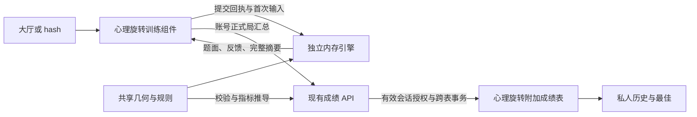

> 由 scope skill 于 2026-11-16 生成
> 状态：已批准 2026-11-16
> 读者：实施 Agent 与审阅者

# 心理旋转

## 目标

在 BrainGym 中增加二维心理旋转训练，让玩家比较图形在旋转及镜像后的关系，以准确率和正确题用时观察本任务中的表现，并查看自己的训练历史与最佳成绩。

## 决策基线

### 需求决策

- **入口与判断**：大厅新增“心理旋转”卡片，进入独立准备页。每题同时呈现参考图和待判断图，玩家选择“仅旋转”或“镜像”；后者表示先镜像再旋转才能得到待判断图。两图保持静态，不提供拖动、转动按钮、叠图提示或作答前的变换演示。两种答案使用固定顺序的原生按钮，支持鼠标、触屏及 Tab、回车／空格，不设置专用快捷键。
- **图形**：使用方块拼接的同色实心轮廓，不显示内部格线。简单图形由 6 格组成，复杂图形由 10 格组成；格子沿边连通、无孔洞。排除非零旋转后与自身重合的图形，以及旋转后能与自身镜像重合的图形，保证旋转角度及答案无歧义。每局随机生成图形，同局不重复轮廓；平移、旋转或镜像后的同一轮廓也算重复。生成有有限尝试上限，耗尽时从已验证的备用图形补齐，不以死循环、重复或有歧义图形凑数。
- **正式局配额**：固定 32 题，将“简单／复杂 × 45°／90°／135°／180° × 仅旋转／镜像”的 16 种组合各出 2 题，再随机排序。不提供难度、题数、速度设置或自动升降级。角度指题目规定的变换角度，镜像题先左右翻转参考图，再按指定角度旋转；不将其解释成玩家实际采用的脑内旋转路径。
- **作答与反馈**：每题不限时，必须作答才推进，不自动超时或跳题。只接受首次有效回答且不可修改；随后显示“正确／错误”和正确答案，保留本题图形供短暂对照。反馈提交显示满 800 ms 后自动继续，反馈期间不接受作答。末题判定时即冻结完整结果及完成时间，展示同样的末题反馈后进入结果页；后续后台事件不撤销完整结果。
- **热身**：提供可跳过的 8 题热身，使用相同的图形类型、角度候选、操作和反馈；分别覆盖两种复杂度、四个角度和两种答案，不要求覆盖全部交叉组合。热身独立生成题目、独立统计、不保存、不更新最佳，结束后显示本地结果，由玩家手动开始正式局或返回准备页。正式局重新生成题目、清零统计并确认身份，不自动继承热身的开局归属。
- **结果展示**：整体、四个角度及简单／复杂两类分别展示正确／错误数、准确率和正确题平均用时。准确率为 `100 × 正确题数 / 本组题数`；正式局整体分母为 32。用时只统计正确题，从题面提交至首次有效回答，不包含准备、反馈、错误题或保存耗时；无正确题时为 `null`，显示“—”。准确率显示一位小数，用时显示整数毫秒，计算及比较不使用展示舍入值。界面采用分别分类，不展开复杂度与角度的交叉表，也不提供逐题回看。
- **最佳与历史**：同一用户、游戏、规则版本保留一项整局最佳，先比较整体准确率，高者优先；相同时比较正确题平均用时，短者优先；仍相同时按首次入库时间、结果 ID 升序稳定选择。完整零正确局仍保存，全部记录零正确时按稳定次序选择最佳，用时仍显示“—”。私人历史每页 20 条，按完成时间、首次入库时间、结果 ID 倒序排列。结果进入记录时选中本模式，记录内的训练入口返回其准备页；普通记录入口仍默认空间 N-back。
- **身份与保存**：账号正式局保存分类汇总，游客正式局和热身只在当前页面展示。账号开局前重新核对有效身份并冻结归属，网络不可用时需明确选择游客；游客可离线练习，登录或恢复联网后不补传。账号保存失败仅在当前结果页保留原请求供手动重试，刷新或离开后不恢复。题面、逐题答案和逐题用时不上传、不持久化，不建立离线队列。
- **中断边界**：主动结束、离开训练页、切换游戏、切后台或锁屏使未完成的正式局或热身作废，不能暂停、续局或保存部分成绩。题间反馈属于未完成局；末题判定后的完整结果按完成边界保留。旧回调、长按、重复输入和跨题迟到事件不能推进新局或造成误保存。
- **兼容与交付**：沿用现有视觉体系及 N-back、Corsi、Stroop 的入口、规则版本、记录和进度语义，兼容 `/`、`/braingym/`、PWA 及离线游客练习。按仓库流程完成演练、Git 交付和正式发布验收后才报告整体完成。本次审阅只产生 spec，批准前不实施或操作正式环境。不增加三维模式、排行榜、综合脑力分、训练收益承诺、新认证方式、遥测或新依赖。

### 技术决策

- 沿用 TypeScript strict、React、Fastify 和 Node SQLite；新增独立的心理旋转引擎、训练／记录／统计组件及共享几何与规则模块。游戏标识为 `mental-rotation`，规则版本为 `1`，hash 入口为 `#mental-rotation`。不将其并入 N-back 的 N 值、维度统计或 Corsi 的长度与进度逻辑。
- 浏览器负责图形生成、SVG 题面、单调计时及判断；共享模块承担配额、轮廓合法性、变换、摘要校验和指标推导。使用整数格坐标定义形状，通过旋转、反射和平移归一进行等价比较；渲染与正确答案来自同一份几何事实，不分别维护图片与答案。SVG 使用合并轮廓，不依赖外部图片、字体、图形库或远程资源。
- 正式局按配额构造题目，热身满足需求基线的分类覆盖。抽取图形、基础朝向及旋转方向后洗牌；非 180° 的顺／逆时针等概率选择，180° 不区分方向。随机性用于组合内变化，不承诺所有可能轮廓等概率。所有生成、拒绝及补齐循环都有上限；备用轮廓通过相同合法性和去重检查，每种复杂度至少提供正式局所需的 16 种互不等价形状。
- 引擎为题面和反馈分别生成交付标识，接收 DOM 提交回执后以 `performance.now()` 开始计时；重复／过期回执不能重置时钟。单题正确耗时先按 `Math.round(回答单调时间－题面提交单调时间)` 转成整数毫秒再累加。不设置作答期限或为了校验而人为截断长时间思考；以安全整数及其汇总的可表示范围限制非法数据。
- 单调时间只用于经过时间；严格 UTC 的客户端完成时间和服务端首次入库时间分别用于记录，沿用现有分离语义。不以墙钟调整影响用时，不声称 DOM 提交回执代表屏幕像素实际呈现时刻或实验设备精度。
- 同一数据库追加独立的 `mental_rotation_results` 及索引，初始化原子、可重复，核心 `PRAGMA user_version` 仍为 `1`。扩展公共游戏／结果分派，保留现有专属类型、规范化字段顺序和旧数据，不重建既有表或放宽其约束。
- 复用 `POST /api/results`、`GET /api/history`、`GET /api/bests`，以 `game=mental-rotation` 分派；省略游戏仍查询空间 N-back。保持有效会话授权、Origin 校验、8192 字节请求体上限、参数绑定、事务、规范化及服务端复算。四张成绩表在同一保存事务中统一检查同用户结果 ID。
- 仅保存固定分类汇总及派生值；前后端复用同一校验和计算函数。服务器不验证真实游玩过程，沿用现有客户端训练信任边界。PWA 只缓存构建资源，身份、私人记录及待保存数据保持不缓存、不持久化。
- 发布指纹覆盖新增附加表的存在性及既有行，并兼容尚无该表的旧库。旧程序可忽略附加表，程序恢复不删除表、不回滚数据库；不改变现有绑定、代理、Cookie、安全头、Hub 定义或托管协议。

## 设计视图

### 功能设计

大厅入口进入准备页，以静态示例说明“只转动能重合”与“需要左右翻转再转动”的区别，标明固定局配置、最佳比较方式及中断规则。准备页提供热身、账号正式开局和显式游客路径；热身及游客标识持续可见，避免误认为可保存的账号正式局。

训练区同时显示参考图、待判断图及当前题号。两图使用相同颜色、同一比例尺及足够留白，以同一形状范围确定尺度，不分别拉伸、自动填满或裁切；旋转和镜像不引入非等比变形。答题前不展示答案、变换提示或旋转角度数值。手机上仍能比较两张完整图形，按钮位置稳定，保持可读尺寸与触控目标，不锁定页面缩放或制造横向页面溢出。

首次回答后保持题面，反馈区用文字明确正误与正确答案，不仅依靠颜色；按既定反馈节奏自动继续。题面和按钮有清楚的可访问名称，名称不能泄露答案；保留可见焦点、原生键盘激活和必要状态通知，不增加装饰性旋转动画。结果、作废及保存失败均有持续可读的文字状态。

结果页以整体准确率与正确题平均用时为重点，其余分类分别呈现，不将各分类分母相加误认为额外题目。热身的分母来自实际题目分布，不套用正式局配额。账号结果展示保存状态与手动重试；游客和热身明确说明不保存。记录页显示本模式整局最佳及分页历史，分类统计从同一局的底层汇总推导；不将不同局的分类最佳拼成虚构整局最佳。

### 技术设计

#### 整体方案

共享模块拥有图形事实和规则，浏览器引擎拥有本局题目、相位、计时及摘要；训练组件负责渲染、回执、输入生命周期及会话确认，不另算一套答案或指标。服务端依有效会话确定成绩归属，校验规范化输入并复算，不信任客户端传来的准确率或平均用时。记录组件只消费当前用户、当前模式的有效响应，账号／模式／分页变化使旧请求失效。

#### 关键结构

| 结构       | 内容与边界                                                                                                                                                                                                                                           |
| ---------- | ---------------------------------------------------------------------------------------------------------------------------------------------------------------------------------------------------------------------------------------------------- |
| 几何题目   | 本地保存格坐标、复杂度、基础朝向、相对角度／方向及正确关系。先得到参考图，镜像题先左右反射，再以图形中心旋转；两图统一居中和等比显示。连通性、孔洞、对称性和去重以几何坐标验证，不依赖像素比较。                                                     |
| 轮廓等价   | 格坐标排序、平移归一；四种直角朝向检查旋转等价，加入反射检查镜像等价。对称排除保证指定非零角度没有更小的等价朝向。去重规范同时覆盖旋转及反射，备用图形同样参与已用集合。                                                                             |
| 分类摘要   | `groups` 为“复杂度 × 角度 × 正确关系”的 16 个唯一分类，每组保存 `correct`、`wrong`、`correctRtTotalMs`；正式局每组正确加错误必须为 2。底层交叉汇总是唯一统计来源，整体及界面分类均由其聚合，不同时接收可相互矛盾的独立总计。                         |
| 数值范围   | 次数与正确总耗时均为非负安全整数，全部正确耗时之和也必须为安全整数；零正确组的总耗时必须为 0。不接受负值、字符串、非有限数、小数、重复／缺失分类、未知复杂度／角度／关系或非正式配额；不将不限时训练误设为固定毫秒上限。                             |
| 结果请求   | 携带 `resultId`、`startedByUserId`、`game`、`version`、`groups`、`completedAt`。ID 与严格 UTC 格式沿用现有成绩入口校验；服务端将分类按复杂度、角度、关系的固定顺序规范化，字段及请求键顺序不影响语义相同的重试。完整规范化请求须小于现有请求体上限。 |
| 指标推导   | 每个展示组聚合正确／错误与正确总耗时，准确率按本组实际总题数计算，平均用时为正确总耗时除以正确数。最佳在固定题量下按正确数降序、正确总耗时升序、首次入库时间升序、结果 ID 升序选择，等价于已确认的准确率／正确平均用时比较。                         |
| 保存与幂等 | 以会话用户限定查询和插入，`startedByUserId` 仅作开局身份前置校验。相同用户及结果 ID 的规范化内容相同则返回首次记录，内容改变或跨游戏复用则 409；不同用户相同 ID 仍独立。保持完成时间与首次入库时间，不在重试时改写。                                 |
| 数据兼容   | 新表保存规范化摘要、派生值及两类时间，初始化失败回滚扩展；重复打开不会重复迁移。发布指纹识别可选新表及其每行，升级、程序恢复和再次升级均保留旧数据及新增成绩。                                                                                       |

#### 实现流程

从入口进入准备页。热身直接创建不保存的本地实例；账号正式局先重新读取当前身份并核对预期用户，失败时停留准备页，网络失败不自动降为游客；显式游客局冻结空归属。启动任务有独立标识，生成和异步身份响应完成后再次核对任务仍有效、页面仍在前台，不能将离开前的旧请求带回新局。

生成器先构造配额，再为每题准备合法、未用轮廓及变换；有界随机尝试不足时用备用轮廓补齐。如校验或内部生成失败，不进入部分对局，不产生结果或保存请求，并允许从准备页重新开始。热身按所需分类覆盖生成，同局同样去重；正式局使用新的题目与统计，不要求与上一局或热身跨局去重。

题目进入待提交状态，不接受提前输入。当前题面回执到达后建立单调起点；引擎接受首次有效回答，写入相应分类的正确／错误，只有正确回答累加耗时，立即关闭本题输入。指针手势及原生键盘激活绑定开始时的题目标识；长按、重复回执、反馈期输入及跨题迟到释放不能作答下一题。由浏览器辅助技术触发的原生按钮激活也须遵守当前相位和首次输入约束。

反馈收到独立提交回执后，满规定时长才推进下一题，调度延迟不跳过尚未展示的题目；未回答时等待，不因迟到 tick 自动结算。末题回答时冻结完整摘要及完成时间，随后展示末题反馈并进入结果；自动保存最多发起一次。未完成时发生中断则取消推进与旧任务、清理运行资源，不输出可保存摘要；末题冻结后中断保留完整结果。

完整账号正式局经共享规则校验后走现有成绩入口；服务端在会话与 Origin 校验后解析摘要、规范化、跨表查重、复算并入库。成功刷新记录，失败保留同一个结果请求供手动重试；401、账号冲突和普通网络失败分别处理，不能换账号转存。游客及热身不调用保存接口，后续身份变化也不补传。个人记录按游戏与规则版本查询，只展示当前用户的当前请求结果。

### 预估改动面

- `src/shared/`：扩展游戏／结果合同，新增图形生成与验证、几何变换、分类摘要、校验及指标；保持现有游戏专属边界。
- `src/client/`：新增心理旋转引擎、SVG 题面、训练、统计和记录组件；接入大厅、hash、页面标题、游戏筛选及结果导航，补充沿用现有体系的响应式样式。
- `src/server/`：增加附加表及结果解析、保存／历史／最佳分派，扩展四表幂等检查；复用既有身份及来源校验。
- `scripts/release/`：扩展可选表的数据保留指纹；原生后台验收按新增游戏实际相位补充入口，不修改正式部署配置或托管协议。
- `tests/`、`tests/e2e/`：几何、配额、有界退化、计时与输入、摘要／存储、升级兼容、指纹、双路径浏览器、离线及身份边界；采用隔离数据库。
- 文档：新建 `docs/wiki/mental-rotation.md`，更新 `docs/wiki/architecture.md` 及 README；实施完成后记录本次验证证据，不将本 spec 或历史验收当作本次通过证据。

## 验收

- 大厅、直接 hash、结果进入记录及记录返回训练 → 均进入心理旋转对应页面，标题与模式筛选一致，普通记录入口仍默认空间 N-back；浏览器测试。
- 正式局及热身 → 正式 32 题、16 种组合各 2 题，热身 8 题且覆盖规定类型，顺序随机且可由受控随机源复现；共享规则测试。
- 图形与答案 → 每种复杂度的格数、沿边连通、无孔洞、无非零旋转对称及镜像歧义，所有角度／方向的 SVG 几何与正确关系一致，同局按平移／旋转／镜像等价均不重复；独立几何断言、变换测试及实际渲染检查。
- 恒定但合法随机源、拒绝样本频繁或随机尝试耗尽 → 在有限步骤内使用合法备用轮廓完成配额且不重复；非法随机值或内部生成错误 → 明确失败且没有部分开局或保存；退化随机源与失败分支测试。
- 首题／后续题未提交、旧／重复回执 → 不提前作答或重置计时；长时间前台思考 → 仍可正常回答，用时不截断、无超时／漏答；引擎和浏览器测试。
- 首次输入、长按、重复点击、反馈期输入与跨题迟到释放 → 每题只结算一次，下一题不受旧事件污染；引擎测试及真实指针、原生键盘交互测试。
- 回答后的文字反馈 → 正误与正确答案明确，保留本题图形，反馈回执后 800 ms 才推进；迟到调度不跳过未展示题；引擎边界和浏览器测试。
- 完成热身或直接正式开局 → 正式局必须手动启动、重建题目与统计并重新确认身份，热身不产生写请求或更新最佳；浏览器测试。
- 整体、角度和复杂度统计 → 正确／错误与分母、加权准确率、正确题平均用时一致，无双重计数；全错、部分分类零正确及展示舍入 → 正确显示“—”，无 NaN 或虚假的 0 ms；规则、服务端和浏览器测试。
- 准确率不同、相同准确率不同用时、完全同分同速及全部零正确 → 最佳符合优先级及稳定顺序，分类数据来自同一真实最佳局，历史分页与排序稳定；服务端测试。
- 缺失／重复分类、未知分类、非法类型、配额、非有限／不安全耗时、零正确非零耗时、版本、ID、UTC 或超大请求 → 返回 4xx 且无部分写入，正常完整摘要仍在请求体上限内；共享校验与 API 测试。
- 匿名、过期／撤销会话、跨账号及跨标签页切换 → 私人读取或保存被拒绝，旧局不能转存其它账号，Token 换发／吊销后旧会话失效；服务端及浏览器测试。
- 相同请求、键／分类顺序变化、同 ID 改内容或换游戏 → 语义相同重试返回首次记录，冲突返回 409，四张成绩表双向交叉冲突不漏检；事务和 API 测试。
- 保存失败或响应丢失后重试 → 当前页面按原请求幂等保存；离开／刷新丢弃未保存结果，游客／热身在联网或登录后不补传；浏览器与 PWA 测试。
- 未完成局主动结束、离开、题间后台或锁屏 → 作废且不保存；末题判定后后台 → 完整结果保留，保存不重复；引擎、浏览器及既有原生 Chromium CDP 验证，明确记录真实硬件锁屏覆盖限制。
- 桌面、窄屏触屏、键盘和缩放 → 图形完整且同尺度，无内部格线、拉伸、裁切或页面横向溢出；两按钮顺序固定、焦点可见且可操作，无专用快捷键，反馈不限于颜色，可访问名称不泄露答案；浏览器与截图检查。
- 旧库升级、重复初始化、初始化失败、旧程序打开及再次升级 → 用户、凭据摘要、有效会话、旧成绩与进度及新增成绩保留；新表或行丢失／改写被指纹拒绝，无新表旧库仍兼容；隔离 SQLite 及发布工具测试。
- 同一构建在 `/`、`/braingym/` 和已缓存离线场景 → 页面、SVG、资源、API 与 Cookie Path 正常，游客及热身可离线，私人数据不缓存；双路径浏览器及 PWA 测试。
- 运行代码交付 → 依次通过 `npm run typecheck`、`npm run build`、`npm test`、`npm run test:e2e`，同一构建设置 `E2E_BASE_PATH=/braingym/` 再跑浏览器测试并清除配置，完成中文 Findings／Verification／Residual Risk 安全审查；按既有流程演练、合入推送 main 后正式发布，核对真实入口与数据保留后才报告整体完成。

现有边界依据：[架构 Wiki](../wiki/architecture.md)、[Stroop 规则](../wiki/stroop.md)、[共享合同](../../src/shared/contracts.ts)、[成绩存储](../../src/server/store.ts)、[发布数据指纹](../../scripts/release/files.ts)、[运维 Wiki](../wiki/operations.md)。
