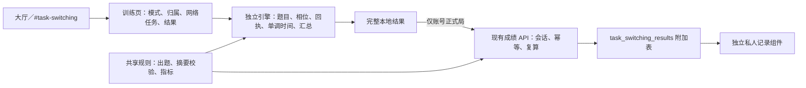

> 由 scope skill 于 2026-11-16 生成
> 状态：已批准 2026-11-16
> 读者：实施 Agent 与审阅者

# 规则切换

## 目标

为 BrainGym 新增数字奇偶／大小规则切换训练，让玩家随每题提示选择当前规则，并通过重复题与切换题的准确率、正确反应时间观察本模式表现。接入既有游客练习、账号私人历史与最佳成绩，保持其他游戏及正式数据语义。

## 决策基线

### 需求决策

- **入口与范围**：大厅新增“规则切换”卡片，进入独立准备页；支持正式训练、可选热身、本局结果和私人记录。首版只有一个固定训练规格，不增加难度档位、自适应、逐题复盘、排行榜或综合脑力分。
- **题面与回答**：每题同时显示当前规则和一个数字，规则提示持续到本题作答结束。数字候选为 `1、2、3、4、6、7、8、9`，不出现 5。两按钮保持相同位置，文字随当前规则更新；鼠标、触屏和 F/J 均可作答，并保留原生按钮键盘操作。

  | 当前规则 | 左按钮／F | 右按钮／J |
  | -------- | --------- | --------- |
  | 判断奇偶 | 奇数      | 偶数      |
  | 比较大小 | 小于 5    | 大于 5    |

- **局规格**：正式局为 1 道起始题＋40 道计分题，计分题中重复、切换各 20 道；热身为 1 道起始题＋8 道练习题，两类各 4 道。起始题正常作答、超时和反馈，但不进入任何成绩统计。其后的分类只比较本题与紧邻上一题所显示的规则，答错或超时不改变后续分类。
- **节奏与输入**：每题作答窗口为 3000 ms，只接受第一次有效回答，不可撤回；到达期限算超时。回答或超时后显示 300 ms 文字反馈，错误或超时同时提示正确答案，之后进入下一题。起始题、热身和正式计分题使用相同节奏；不允许提前输入、反馈期作答、长按连答或跨题迟到事件替下一题回答。
- **热身独立**：可跳过热身；热身不上传、不更新最佳。结束后停留在本地热身结果，由玩家手动开始正式局；正式局重新生成题目、清空统计并重新确认开局身份。
- **指标**：本局结果和私人记录展示整体、重复题、切换题的正确／错误／超时次数、准确率及正确题平均耗时。准确率为正确数除以该组总题数乘 100，错误和超时均降低准确率，整体由两组汇总。耗时只累计正确题；无正确题时均值为 `null`，显示“—”。切换耗时差为切换题正确平均耗时减重复题正确平均耗时，保留负值；任一组没有正确题时显示“—”。准确率显示一位小数，耗时显示整数毫秒。
- **最佳**：同用户、游戏和版本内，先比较未展示舍入的整体准确率，再比较正确题平均耗时，仍相同则优先首次入库较早、再按结果 ID 升序选择。完整但零正确的局仍保存；全部零正确时按稳定次序选择最佳，不将缺失耗时解释为 0。切换耗时差不参与最佳排序。
- **记录与归属**：只保存重复／切换两组汇总，不保存题目、逐题输入或逐题耗时日志。账号正式开局重新校验当前身份，成绩归属由有效服务端会话决定，开局用户 ID 仅作前置校验。游客明确选择后冻结本局空归属，可离线练习，登录或恢复联网不补传。账号保存失败或响应丢失时，仅在当前结果页保留原请求供手动重试，刷新或离开不恢复待保存数据。
- **中断与完成**：主动结束、离开训练页、切换游戏、切后台或锁屏使未完成的正式局及热身作废，不暂停、不续局、不保存部分成绩；起始题和题间反馈同样受此规则约束。末题判定时冻结完整结果及完成时间，随后仍展示末题反馈；此后的后台事件不撤销完整结果，也不再次结算或保存。
- **兼容与交付**：保留 N-back、Corsi、Stroop 的规则、版本、历史、最佳和进度；兼容两种基础路径、PWA 公共缓存及既有离线身份边界。沿用仓库的演练、Git 交付和正式发布验收流程。当前阶段只写待审 spec，批准前不实施或操作正式环境。

### 技术决策

- 沿用 TypeScript strict／ESM、React、Fastify 和 Node SQLite，不新增依赖或认证、遥测服务。新游戏标识为 `task-switching`，规则版本为 `1`，hash 入口为 `#task-switching`；新增独立共享规则、内存引擎、训练／记录组件和成绩存储，不把 Stroop 重构为通用训练框架，也不套用 N-back 或 Corsi 的计分类型。
- 出题先生成符合本局配额的重复／切换标记并洗牌，等概率选择起始规则，再依标记沿用或翻转上一题规则。包括起始题在内，每题数字独立从八个候选中等概率选取；允许规则、数字或题面连续重复，不再固定各规则、各数字、左右正确答案或二者组合的次数。
- 浏览器负责实际出题和单调计时。每个题面与反馈都带独立呈现标识及 DOM 提交回执；题面回执确认规则、数字及按钮文字已共同提交后，才以 `performance.now()` 建立作答窗口，反馈也从其回执开始计时。重复或旧回执不重置时钟，迟到调度只结算实际已交付的当前题，不跳过尚未展示题。DOM 提交不等于屏幕像素实际呈现。
- 正确回答耗时为输入单调时间减题面回执单调时间，逐题 `Math.round` 为整数毫秒后累加。客户端严格 UTC 完成时间仅用于历史排序，与服务端首次入库时间分开保存，不参与反应时间计算；不引入或改变 Corsi 的时间锚点与进度机制。
- 前后端共用摘要校验与指标推导。新增专属结果／历史类型，扩展 `GameId`、`AnyResultInput`、`AnySavedResult`、`AnyHistory` 和公共分派；保持现有游戏专属类型、规范化字段顺序和函数含义。
- 同一数据库追加 `task_switching_results` 及索引，原子、可重复初始化，核心 `PRAGMA user_version` 保持 `1`。复用 `POST /api/results`、`GET /api/history`、`GET /api/bests`，以 `game=task-switching` 分派；保持有效会话、Origin、8192 字节请求体限制、参数绑定、事务、规范化和服务端复算。跨四张成绩表统一检查同用户结果 ID。
- 发布数据指纹在新表存在时保护其存在性与既有行，兼容没有新表的旧库；程序恢复保留附加表，不回滚数据库。不修改正式数据库路径、网络绑定、代理、Cookie、Hub 定义或托管协议；公共 PWA 缓存不纳入身份、私人记录或待保存数据。

## 设计视图

### 功能设计

大厅卡片和直接 hash 均进入同一准备页。页面用具体例子说明“先看规则、再判断数字”，列出左右按钮与快捷键的对应关系，并说明起始题不计分、训练规格及中断规则。热身、账号开始和显式游客练习均有明确入口；等待身份核验时防止重复开局，失败时留在准备页并显示可重试的原因。

训练区突出规则提示与数字，两个原生回答按钮保持并排及左右关系，窄屏也不交换位置；快捷键提示与文字可读，具有可见焦点和足够触控尺寸。用文字区分正式／热身、起始题／后续进度；起始题不混入计分进度。反馈通过文字表达正误，不能只依赖颜色，且不能在反馈阶段回答下一题。F/J 只作用于当前运行的训练，不接管输入框或其他页面的按键。

热身完成只显示本地表现和正式开局操作。正式完成后，结果页先展示整体准确率与正确平均耗时，再展示两类题对比及有方向的切换耗时差。账号结果提供保存中、已保存、失败可重试状态及个人记录入口；游客结果说明不保存、不补传。未完成局中断显示作废原因和重新开始入口，不能包装成低分结果。

结果进入个人记录时选中新模式；记录中的“开始训练”和空记录入口返回它的准备页。最佳和分页历史沿用相同指标语义；切换游戏或账号时重置分页、清理旧数据并使旧请求失效。通过普通导航或直接进入个人记录，仍默认空间 N-back。

### 技术设计

#### 整体方案

训练组件拥有热身／正式选择、开局用户与结果 ID、异步任务世代、展示状态、完整结果和保存请求；引擎拥有本局题目、当前题／相位、呈现标识、单调时间和分类汇总，不处理身份或网络。共享规则是候选、配额、答案判定、摘要校验及指标公式的唯一来源。新一局创建新引擎，取消、卸载或重开使旧任务和旧实例回调失效。

引擎以“等待题面回执→可回答→等待反馈回执／反馈→下一题或完成”推进。索引为零的起始题只建立规则上下文，其回答和耗时完全不累计；后续题从完整题序列中比较相邻规则后分类。输入统一检查实例、呈现标识、单调时间和当前相位，再结算一次；恰为期限时先按超时处理。指针手势、原生键盘激活及 F/J 均绑定当时的题面，同一次操作不能因 pointer／click 双路径重复计数，长按、跨题释放和迟到事件不能污染下一题。

末题判定一次性冻结摘要和完成时间；末题反馈、保存请求及结果展示只消费该冻结结果。页面生命周期在接受输入、推进和处理异步结果时核对前台状态，防止迟到隐藏事件使未完成局继续计分。完整结果与未完成状态区分处理，资源释放不抹除已冻结结果。

服务端先以会话确定用户，再校验开局身份与摘要，生成固定字段顺序的规范化请求。在同一保存事务中查找四张成绩表的同用户结果 ID：内容相同返回首次记录，不同内容返回 409；新记录才生成首次入库时间并保存复算指标。所有历史和最佳查询均限定会话用户、游戏和版本。服务端只验证摘要一致性，沿用浏览器负责游玩事实的现有信任边界。

#### 关键结构

| 结构       | 合同与边界                                                                                                                                                                                                                 |
| ---------- | -------------------------------------------------------------------------------------------------------------------------------------------------------------------------------------------------------------------------- |
| 本地题目   | 当前规则 `parity`／`magnitude` 与候选数字；起始题为第一项，其后分类从相邻规则派生，不从玩家答案派生。正式／热身分别生成独立题序列。                                                                                        |
| 分类摘要   | `repeat`、`switch` 两组，每组含 `correct`、`wrong`、`timeout`、`correctRtTotalMs`；均为非负安全整数，前三项正式局每组合计 20，热身每组合计 4。                                                                             |
| 耗时范围   | 每组正确总耗时不超过 `correct × 3000`，零正确时必须为 0；允许毫秒舍入得到 0 或 3000，不另设最短反应时间或异常值剔除阈值。                                                                                                  |
| 保存请求   | `resultId`、`startedByUserId`、`game`、`version`、`completedAt` 及两组摘要；ID 和严格 UTC 格式沿用既有校验，不使用 N 值、进度世代或客户端分数。服务端只接受正式局配额。                                                    |
| 派生指标   | `score` 为整体准确率，`meanCorrectRtMs` 为整体正确平均耗时，`switchCostMs` 为两组正确均值之差；分类指标从同一共享规则派生。结果响应附规范化摘要及 `receivedAt`。                                                           |
| 存储与幂等 | 新表以 `(user_id,result_id)` 为唯一键，保存游戏／版本、规范化 payload、最佳排序所需复算值和两类时间；与 `results`、`corsi_results`、`stroop_results` 在同一事务中检查 ID 冲突。不同用户可使用相同结果 ID，读写仍各自隔离。 |
| 历史与最佳 | 历史每页 20 条，按完成时间、首次入库时间、结果 ID 倒序稳定排序；最佳按需求基线比较。非法或重复游戏参数返回 400，省略游戏仍选空间模式。                                                                                     |
| 兼容与恢复 | 不重建或放宽既有表，不改写旧 payload、成绩和进度；旧程序可忽略附加表，恢复不删除新表。原库升级、重复初始化、程序恢复及再次升级均保留既有用户、凭据摘要、会话和所有成绩。                                                   |

#### 实现流程

从入口进入准备页，玩家选择热身或正式开局方式。热身直接建立不保存的本地实例；账号正式开局请求当前身份并确认仍与预期相同；游客正式开局冻结空归属。异步开局完成时核对任务仍有效且页面在前台，再生成新题序列，等待起始题的共同题面回执。

当前题回执后开放输入和期限；首次有效回答或到期超时结算本题。起始题不写统计，其后按相邻规则累计对应组，只有正确回答累计耗时。反馈回执后满规定时长才交付下一题，不以调度积压一次结算多道未展示题。未完成时中断则取消推进并作废；末题判定则冻结结果并进入终态后续展示。

完整账号正式结果通过共享校验后提交原请求，成功使用服务端复算结果并刷新记录；失败保留原结果 ID、摘要和完成时间供当前页面手动重试。401、身份冲突和网络失败分别反馈，另一账号不能接收原局。热身和游客永不调用保存接口，之后的登录或网络变化也不改变归属。记录读取按当前用户和所选模式发起，旧任务响应不能覆盖新账号或新模式的数据。

### 预估改动面

- `src/shared/`：扩展公共游戏／结果分派，新增规则切换的生成、判定、摘要校验和指标规则，保持其他游戏的专属合同。
- `src/client/`：新增独立引擎、训练／结果汇总及记录组件，接入大厅、hash、标题、记录筛选和模式跳转，补充符合既有视觉系统的响应式样式与输入生命周期。
- `src/server/`：新增解析和附加成绩表存储，扩展跨四表幂等、历史和最佳分派；沿用会话、Origin 和请求限制。
- `scripts/release/` 及原生后台验证脚本：纳入新表数据保护和新模式后台／完成边界验证，不改变正式配置或托管协议。
- `tests/`、`tests/e2e/`：共享规则／引擎、API／存储、升级与发布指纹、桌面／触屏／快捷键、身份、保存失败及离线场景。
- 文档：新建 `docs/wiki/task-switching.md`，更新 `docs/wiki/architecture.md` 和 README；实施后记录本次验证证据。现役结构参考[架构 Wiki](../wiki/architecture.md)、[Stroop 合同](../wiki/stroop.md)和[运维流程](../wiki/operations.md)。

## 验收

- 大厅、直接 `#task-switching`、结果进入记录、记录返回训练及普通记录导航 → 新模式路径与筛选正确，普通记录仍默认空间 N-back；浏览器测试。
- 正式和热身生成 → 实际题数、两类配额、起始题排除和所有候选合法；起始规则等概率、标记洗牌和数字独立抽取可通过可控随机源验证；规则测试，不固定各数字或答案次数。
- 起始题正确、错误、超时，或后续题错误、超时 → 起始题不进统计，其后始终按相邻显示规则分类，完整正式局仅统计 40 题；规则、引擎及浏览器测试。
- 题面尚未共同提交、重复／旧回执、延迟调度 → 不提前计时、不重置时钟、不跳过未展示题；引擎边界和浏览器验证。
- 输入在期限前、期限上、期限后，或正确耗时存在毫秒舍入 → 仅期限前可接受，后两者超时；统计与共享公式一致；引擎和规则测试。
- 重复回答、反馈期输入、长按 F/J、原生按钮长按、跨题指针／按键释放或迟到事件 → 只结算当题一次，不能替下一题回答；引擎与桌面／触屏交互测试。
- 正常回答和超时 → 文字反馈持续规定时长，错误／超时显示正确答案；下一题规则、数字、按钮文字共同更新，左右映射始终固定；浏览器与渲染检查。
- 跳过或完成热身 → 必须手动开始正式局，正式题目、统计、归属重新建立；热身没有保存请求，也不更新最佳；浏览器测试。
- 部分正确、全错、全超时、单组零正确、负耗时差和展示舍入 → 整体及分类指标正确，无 NaN 或把缺失值显示为 0，比较不使用展示舍入值；规则、存储及浏览器测试。
- 同准确率不同耗时、全部零正确、同分同速和分页 → 最佳遵守稳定比较，历史及游戏／版本筛选准确；服务端测试。
- 匿名、过期／撤销会话、跨账号、跨标签页切换，以及 Token 换发／吊销 → 私人读取或保存被拒绝，成绩不能转存，旧会话失效；服务端与浏览器测试。
- 相同请求重试、键顺序变化、同 ID 改摘要或换游戏 → 相同规范化内容返回首次记录，不改首次入库时间，不同内容返回 409；覆盖新表与其余三张成绩表双向冲突；服务端测试。
- 非法类型、次数／配额、负值／非安全整数、超范围耗时、版本、ID、UTC 时间及超大请求 → 4xx 且无部分写入；服务端测试。
- 保存失败、响应丢失、身份冲突和恢复网络 → 仅原账号可按原请求在当前结果页重试；游客／热身不补传，刷新或离开无持久化待保存数据；浏览器与 PWA 测试。
- 未完成局在起始题、答题或反馈时主动结束、离开、隐藏或锁屏 → 作废且不保存；末题判定后隐藏 → 完整结果保留，最多一次逻辑保存；引擎、浏览器及原生 Chromium CDP 后台验证，单独注明真实硬件锁屏的覆盖状态。
- 桌面、窄屏与触屏 → 按钮左右关系稳定、文字与焦点可读、触控尺寸足够、布局无页面横向溢出；F/J 在训练外及输入框内不拦截，原生按钮键盘操作可用；实际渲染和交互验证。
- 原库升级、重复初始化、初始化失败、旧程序打开及再次升级 → 扩展原子性和数据保留成立；新表指纹能检测空表丢失、行删除或改写，并兼容无该表旧库；隔离 SQLite 与发布工具测试。
- 同一构建在 `/`、`/braingym/` 及已缓存离线游客场景 → 新模式入口、资源、API、Cookie Path 和离线练习可用，私人 API 不缓存，既有游戏规则和记录回归通过；双路径浏览器与 PWA 测试。
- 运行代码交付 → 依次通过 `npm run typecheck`、`npm run build`、`npm test`、`npm run test:e2e`，同一构建再通过设置 `E2E_BASE_PATH=/braingym/` 的浏览器测试并清除该变量；完成中文 Findings／Verification／Residual Risk 审查，不削弱验证门槛。
- 发布交付 → 按既有运维流程完成演练候选、合入并推送 main，从稳定 main 工作区显式发布并核对数据保留、服务健康与真实入口的新模式；正式迁移与验收完成前不报告整体完成，证据记录实际覆盖及限制。
