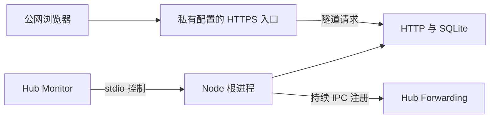

> 摘要：BrainGym 的环境与发布边界、模块、双路径运行、PWA 缓存、WheelMaker 生命周期及会话信任边界。

# 架构与数据边界

BrainGym 使用 React 和 Vite 构建浏览器界面，Fastify 在生产环境同时提供页面和同源 API。SQLite 文件保存用户、凭据摘要、会话和对局汇总，无需独立数据库服务。

| 模块                                             | 职责                                                    |
| ------------------------------------------------ | ------------------------------------------------------- |
| `src/client/App.tsx`                             | 合集入口、训练、结果、登录与个人记录页面                |
| `src/client/game.ts`                             | 按单调时间推进的内存对局，输入去重与作废                |
| `src/shared/rules.ts`                            | 随机出题、汇总校验与平衡准确率                          |
| `src/shared/contracts.ts`                        | 前后端共享的数据类型、游戏标识和规则版本                |
| `src/server/app.ts`                              | Cookie 鉴权、来源校验、API、静态页面                    |
| `src/server/store.ts`                            | SQLite 初始化、事务、凭据与数据访问                     |
| `src/server/cli.ts`                              | 用户创建与 Token 发放、换发和吊销                       |
| `src/server/config.ts`                           | 运行环境校验、路径和托管配置                            |
| `src/server/environment.ts`                      | 开发、正式、测试选择及独立数据库路径校验                |
| `scripts/release/`                               | Git 候选、验收证据、单应用控制、全局 Reload 保护及恢复  |
| `src/server/main.ts`                             | Node 根进程的启动、健康检查和有界关闭                   |
| `src/server/managed.ts`、`json-lines.ts`         | Monitor 控制协议、身份回显、健康事件及有界 UTF-8 帧解析 |
| `src/server/forwarding.ts`                       | 持续 IPC 注册、最新发布状态及断线重连                   |
| `src/server/client-ip.ts`                        | 登录限流所用客户端 IP 的校验和规范化                    |
| `src/shared/paths.ts`、`src/client/base-path.ts` | 服务端基础路径校验和浏览器运行时路径读取                |

## 开发、数据与发布边界

开发入口使用 `BRAINGYM_ENV=development`，API 回环 3002、Vite 5173，账户和成绩留在当前工作区 `.runtime/development/`。两端从同一开发配置读取端口和 Origin。开发库不能越过该目录或通过链接指向正式数据；测试显式指定隔离数据库。既有 Docker 的 production 标记和显式数据库仍兼容。

正式程序的目标目录是仓库外 `D:\Apps\BrainGym`，正式数据库保持现有 Hub 定义所指的绝对位置。发布复制已演练的程序及生产依赖，不复制开发账户、私有环境文件或源码工作区。首次迁移前仍需保护原仓库 dist，实际迁移完成状态以[验收记录](../verification/dev-production-isolation.md)为准。

代码交付阶段先完成隔离验证、提交、合入并推送 main，正式迁移随后从稳定 main 工作区显式执行。Git 合入不触发发布；迁移未通过不能认定整个任务完成。候选与验收证据绑定已提交的运行源码内容、锁文件、Node 环境和文件摘要；main 内容或产物变化时拒绝使用失效证据。

发布工具拥有配置及文件变更，Hub 拥有进程树。Stop、Start 按 BrainGym 应用标识操作，Reload 则作用于整个配置。定义不变不 Reload；定义变化时要确认非目标定义已加载且无待加载变化，并在配置保护下完成原子替换和全局重载。简化 Monitor 快照不包含完整定义，不能代替已加载配置基线。未 Reload 的发布不能把当前磁盘配置标为已加载。

维护期从 Stop 请求开始。发布日志在操作前记录原状态、请求和变更意图；停服后备份失败也必须恢复旧服务。程序部分替换或定义变化后，只恢复本工具修改的程序和定义；数据库继续保留，不自动回滚。恢复失败及意外中断保留私有日志并阻止覆盖。详细命令和失败处理见[运维流程](operations.md#接入-wheelmaker)。

## 运行路径与生命周期

Vite 使用相对资源路径。Fastify 根据 `APP_BASE_PATH` 为 HTML 注入 `<base>` 和运行时路径，浏览器据此拼接 API 路径。同一构建默认运行在 `/`，WheelMaker 定义运行在 `/braingym/`；静态资源、API 和 Cookie Path 都使用该路径。无尾斜杠入口返回 308，前缀之外没有根路径 API 别名，未知 API 返回 JSON 404。

Hub 注入 `WHEELMAKER_APP_MANAGED=1` 时启用托管模式。Hub 直接启动前台 Node 根进程，并通过 stdin/stdout 控制该进程；普通启动不依赖 stdin，EOF 不会停止普通进程。托管 stdout 仅承载协议，业务诊断写入 stderr。

核心就绪取决于 HTTP listener 和 SQLite，Forwarding 的发布结果独立于核心健康。IPC 不可用时根进程保持运行，注册按 1、2、4 秒递增退避，最高 30 秒。建连及首个完整响应各有 5 秒期限；成功注册后没有空闲超时。每次重连重置版本基线，旧版本或重复状态不覆盖新状态。

健康检查通过短时读写事务探测数据库可用性，锁等待上限为 250 ms；托管业务连接的 busy timeout 也为 250 ms。健康状态变化时发送完整快照，恢复后清除旧诊断。shutdown、stdin EOF 和终止信号共用一次关闭流程，撤销注册、排空 HTTP 并关闭 SQLite；10 秒后仍未结束则强制退出，早于 Hub 的 15 秒期限。整个 Hub 重启后由保存的定义启动新实例，instanceId 随实例变化。

## PWA 外壳与离线身份

`scripts/pwa-build.ts` 在 Vite 构建结束时生成 `sw.js`，资源清单只包含产出的 JS/CSS、HTML 和明确列出的图标。发行版本由 HTML、静态资源摘要和 worker 源码计算；HTML 带发行标记。`src/server/pwa.ts` 提供 manifest 数据，`src/server/app.ts` 根据运行时基础路径提供 manifest、worker 和处理过路径的 HTML，因此两个路径共用同一份构建。

`src/pwa/worker.js` 安装时先下载整套资源，校验媒体类型、内容摘要及 HTML 的发行标记与基础路径，全部有效后才写入新版本缓存。HTML 摘要校验前仅将基础路径归一到构建模板的根路径。活动版只为入口/index 导航和清单内的静态资源提供缓存；API、非 GET、查询参数、跨 Origin、未知路径及 Range 请求保持网络语义，不写运行时缓存。

缓存名为 `braingym:pwa:<编码后的基础路径>:<内容版本>`。新版准备完成后遵循浏览器默认等待机制，不调用 `skipWaiting()`、不抢占页面或强制刷新。全部旧页面关闭后才激活新 worker，并只清理同一应用、同一基础路径的旧缓存。缓存名称避免误删其他应用的数据，不隔离同 Origin 应用的访问权限。

`src/client/pwa.ts` 只在生产构建注册 worker；注册失败不阻止在线界面，窗口获得焦点或恢复网络时检查更新。首次缓存或存储失败时不提供离线保证，后续重新打开可再次准备。开发模式不注册新 worker；同 Origin 下已存在的生产 worker 不会被自动注销。

React 将网络故障与 401/身份冲突分开处理。普通开局重新请求当前身份；无法联网时必须主动选择游客，不能把先前保留的用户信息当作已通过校验。游客选择只影响本局 owner，不清会话 Cookie；网络恢复不改变本局归属。API 的 `no-store` 和服务端会话授权保持不变，私人数据及待保存结果不写入 Cache Storage、localStorage 或 IndexedDB。

来源：[PWA spec](../scope/2026-11-12-pwa-support.md)、[构建插件](../../scripts/pwa-build.ts)、[worker](../../src/pwa/worker.js)、[客户端](../../src/client/App.tsx)、[PWA 验收](../verification/pwa-support.md)。

## 身份与代理信任边界

个人 Token 换取固定 7 天的会话。Token 与会话均使用 32 字节安全随机值，数据库只保存 SHA-256 摘要。Cookie 为 HttpOnly、SameSite=Strict，Secure 属性由运行配置控制，托管 HTTPS 定义设置 `COOKIE_SECURE=true` 和 `Path=/braingym/`，退出按相同路径清除。所有写接口要求 Origin 与 `APP_ORIGIN` 一致；托管定义仅接受私有配置的 HTTPS origin，本机 HTTP 用于健康探测。API 响应不缓存，服务日志不记录请求正文、Cookie 或凭据。

登录频率限制为每个 IP 每分钟最多 20 次，失败 Token 也计入额度。普通模式按直连对端限流，不信任客户端转发头。托管模式只信任即时对端为 IPv4 回环 `127.0.0.1`、且原始请求中恰有一个 `X-Forwarded-For` 的单 IP 值；IPv4/IPv6 等价表示归一到同一额度。缺失、重复、多地址、非法或回环客户端地址及不受信任对端均返回 `503/CLIENT_IP_UNAVAILABLE`，不回退到共享额度。来源校验在限流之前独立执行。

该代理契约依赖网关覆盖客户端提供的转发头，并信任本机进程及有权访问 Hub IPC 的用户。本部署依赖同 Origin 应用均可信、发布权限受控的已确认前提。路径前缀、Cookie Path 和 SameSite 不提供同 Origin 应用之间的隔离；引入不可信应用需要重新设计独立 Origin。

## 私人成绩的数据流

已登录用户开局前，客户端取得当前用户标识，上传结果时携带 `startedByUserId`。服务端先与有效会话用户比较，再按会话用户写入；该字段只是前置条件，不能用来授予身份。另一个标签页切换账户后，原结果必须由开局用户重新登录并重试。

成绩保存按 `(user_id, result_id)` 唯一约束，在事务中比较已有内容。相同请求返回原记录，不同内容返回 409；分数由服务端根据四类次数复算。客户端完成时间 `completedAt` 与服务端首次落库时间 `receivedAt` 分开保存，重试不改写。历史按完成时间倒序稳定分页，每页 20 条；最佳按游戏、规则版本、N 值分组并使用未舍入分数。

浏览器负责出题和统计，服务端不验证实际游玩过程。数据库不保存题目序列或逐步操作日志，客户端不建立持久化离线队列。游客结果留在当前页面，不能在登录后补传。

来源：[接入 spec](../scope/2026-11-12-wheelmaker-integration.md)、[API](../../src/server/app.ts)、[运行入口](../../src/server/main.ts)、[托管协议](../../src/server/managed.ts)、[Forwarding](../../src/server/forwarding.ts)、[客户端地址](../../src/server/client-ip.ts)、[存储](../../src/server/store.ts)、[游戏引擎](../../src/client/game.ts)、[规则](n-back.md)、[运维](operations.md)。SQLite 使用 Node 内置模块，其 API 参考为 [Node.js SQLite 文档](https://nodejs.org/api/sqlite.html)。
